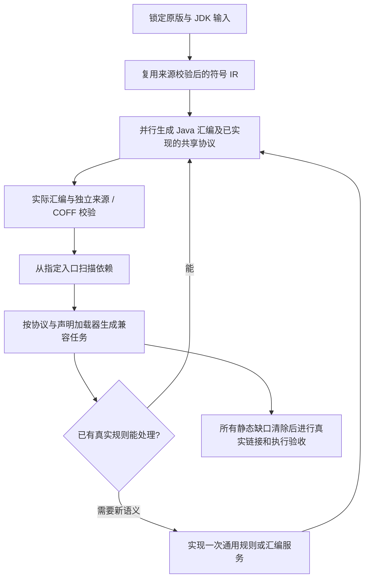

# 自动翻译与兼容收敛程序

v111 已将[正常构造器枚举](NORMAL_CONSTRUCTORS.md)作为第三个增量提供者接入，同一规则生成两侧 67,407／75,305 项构造器元数据，包含原始泛型签名、异常和注解。专项测试已执行原始 getter，并覆盖一个原版类的参数注解元数据；没有执行该原版目标类的构造或初始化代码。两侧实际 System 诊断均自动推进至 `Reflection.getClassAccessFlags`，当前有效待绑定请求为 31,200／37,362。静态任务仍为 405／575 个家族，包含未必执行的路径；Lambda／Record 展开与整版启动仍待完成。

本次设计以已封存的 **v108** 为实现基线，盘点日期为 **2026-11-25**。下文明确区分现有程序、待实现的展开器与最终验收；工作区未完成的新运行时改动不计入基线。

后续 v109 已落实[统一生成方法调用栈与调用者服务](NORMAL_CALLER.md)，两侧全量来源／COFF 校验通过；Lambda／Record 统一展开层仍未实现。v109 待绑定请求为服务器 31,208、客户端 37,370；比下面固定的 v108 盘点各减少一个声明请求，不能解释为整版启动完成度提高一个固定百分比。

v110 已落实[独立汇编运行时提供者包](RUNTIME_PROVIDER_PACKS.md)：复用 v109 的基础 Java ASM／COFF，新增 CDS 五项与 Object／System 身份散列两项 native，独立核对来源、初始化依赖、服务 ABI 与真实对象。启动诊断自动准备包、选择依赖并实际链接；兼容规划器也读取同一份已校验视图。两侧当前剩余请求为 31,201／37,363，仍归组为 405／575 个机制任务，不表示这些任务都在启动必经路径上。真正的 System 路径已越过两组服务，自动选入十项已有 Java 方法后停在反射构造器枚举 `Class.getDeclaredConstructors0`。完整 System 阶段与游戏均未完成。

v108 新增[bootstrap 名字／初始化规则](NORMAL_CLASS_LOOKUP.md)，将普通类、接口与已有数组的名字查找统一批量生成；执行发现尚未选择的初始化器时，来源验证后自动增加类准入。两侧全表查找及原版公开 forName、冷枚举初始化通过。测试中的模块输入明确标注为准备夹具，完整模块引导和游戏继续单独验收。

## 本轮确定的实现方向

采用现有自研后端上的**规则驱动批量翻译程序**。普通方法交给通用后端；相同高层机制由一条共享规则展开；开发者集中实现不能从输入中翻译出来的运行时服务。执行代码仍全部为汇编，启动器最终只保留“启动游戏”。不能承诺剩余工作只是少量兼容补丁。

程序的输入是锁定的原版 1.21.1、JDK、已有库及规则版本，输出是带来源证明的汇编／对象、依赖图和兼容任务。没有 Java Code 的 native 与缺少原始库的请求单列。补齐一条规则后，重新匹配所有受影响现场；不再逐个登记相同调用，也不为未知语义生成默认返回。

| 层 | 自动处理的工作 | 当前状态 |
| --- | --- | --- |
| 普通 Java | 字节码、字段、控制流、原始方法体和符号 IR | 已有批量后端 |
| 共享协议 | 分派、数组 clone、正常字符串拼接、已提供 native 家族 | 已有多项规则；保留各自的执行范围 |
| 协议展开 | Lambda 的捕获类／桥接、Record、MethodHandle／VarHandle 适配 | 有真实输入预检及部分旧后端代码；正常布局的完整展开尚未实现 |
| 构建增量 | 相同 MASM 与汇编器直接复用 COFF | v105 已接入通用汇编入口；细节见[对象缓存](ASSEMBLY_OBJECT_CACHE.md) |
| 兼容调度 | 按加载器、来源类和协议合并缺口；按入口和执行证据排序 | 已有任务规划、实际路径自动选择和两个独立 native 提供者家族；统一协议展开注册表仍待实现 |
| 游戏验收 | 原始 System 阶段、Minecraft 入口、隔离世界创建／保存 | 尚未完成；不能由编译成功代替 |

后续规则实现优先覆盖真实启动阻塞，再处理覆盖面较大的动态协议。v106 实现 [Unsafe 正常字段定位](NORMAL_UNSAFE_FIELDS.md)，v107 进一步将九种类型、四种读写动作及六项原子操作合并为[一组生成规则和一个共享汇编服务](NORMAL_UNSAFE_MEMORY.md)，一次接通 42 项源 native。两侧均已实际运行原版 AtomicInteger 的并发自增；普通 Java 包装方法继续交给批量后端。堆外／静态基址等剩余域、线程、I/O、图形和活动根仍需真实汇编服务。静态清单包含可选实现，不能把所有组数当成启动必经任务数。

自动调度的目标边界是：**已有规则自动穷尽，缺少规则按机制集中报告**。任务键包含输入／变换链、源类／Code、加载器、规则版本、布局、调用假设和 ABI；新增合成类型必须先登记，再冻结布局与分派全集。只有摘要或依赖改变的任务才重建，且一次任务不能因重复生成相同缺口而无限重试。原始 ID、独立来源校验、实际链接和执行验收继续保留。

v105 已落实对象缓存，减少每次增加汇编服务后的重复汇编。它不跳过 Java 代码生成，不缓存最终链接，也不代替尚缺的协议展开器。普通方法级 IR 缓存、反向依赖失效和验证收据缓存仍为后续工作。

v100 新增[按实际启动路径自动选择](DIAGNOSTIC_STARTUP.md)。开发诊断进程记录真正执行到的缺口，自动选入对应类中已有的 Java 汇编再重试；原生／协议／ABI 缺口保持明确停止。它复用当前编译产物，尚未成为完整游戏启动流程，也不提高原生实现计数。

目标是让一个共享规则覆盖所有匹配的原版调用现场，再把无法自动处理的语义集中到兼容任务。不是为每个 Minecraft 方法编写汇编。首个目标仍是 1.21.1，执行端仍全部使用汇编，先完成无需账号的部分。

## 当前盘点：该自动化的究竟是什么

读取 v108 两侧的批次摘要、兼容任务和逐现场预检，得到下表。服务器与客户端有大量共享内容，不能相加作为独立工作量。

| 当前证据 | 服务器 | 客户端 |
| --- | ---: | ---: |
| 含 Java Code 的方法 | 498,906 | 563,770 |
| 已生成并汇编校验的方法体 | 498,179 | 562,769 |
| 方法体生成失败 | 727 | 1,001 |
| 上述失败中报缺少类定义的数量 | 727 | 1,001 |
| 待绑定请求符号 | 31,209 | 37,371 |
| 兼容任务家族 | 405 | 575 |
| 其中汇编运行时家族 | 347 | 504 |
| Lambda 普通结构候选现场 | 25,193 | 28,297 |
| 另列的可序列化 Lambda 现场 | 24 | 24 |
| Record 结构候选现场 | 2,953 | 3,354 |
| 尚无展开规则的 SwitchBootstraps 现场 | 42 | 42 |

这说明普通 Java 方法并没有等待逐个手译。现有失败均先遇到缺少定义；补齐合法输入之后，仍要重新验证，不能推定没有后续问题。缺失内容包括可选库／实现，不能凭名字生成空类，也不能把所有缺失项都认定为启动必经依赖。

Lambda 与 Record 合计有服务器 **28,146**、客户端 **31,651** 个结构候选现场，适合由少数通用规则展开。这里的“候选”只表示已识别结构：适配、访问、初始化、对象身份、异常与下游运行时依赖仍须验证。生成它们也不会同时实现线程、I/O、反射、模块或图形服务。

盘点来源为 `.boom/releases/v108-normal-bootstrap-class-lookup-20261125/status.json` 以及其中指向的两侧批次。对应 `summary.json` SHA-256：服务器 `0f1bf120f8aae9d7e33b45eaa5572b871133b5d5eb355ed76298162e2598ba4d`；客户端 `8f334407a88b2595604a4aa21420a5939db4b9b7505ac8ee5a84e79688ca4a69`。兼容任务和预检属于该批次的分析结果，不作为新的执行证明。

## 程序落地：扩展现有总控，增加真正的展开执行层

保留 `Invoke-AutomaticTranslation.ps1` 作为开发总控，不再另外写一个只产生清单的入口。它目前已经调用编译器和校验器，但 `plan-protocol-expansion.py` 只分析形状；需要增加的是能生成代码的展开层。玩家仍只点击“启动游戏”，最终由启动流程调用这些内部步骤。

```text
锁定原版／JDK 输入
  → 读取原始符号 IR
  → 按共享规则识别、验证和展开所有现场
  → 注册派生类型／方法，冻结本轮类型全集
  → 批量调用现有 Java → MASM 后端
  → 汇编与独立校验
  → 从入口更新依赖、选择提供者、链接
  → 执行启动阶段，收集真实缺口
  → 有新规则／依赖／已生成目标可选入时继续；否则报告待实现语义
```

### 在现有代码中的接入位置

| 文件／拟新增模块 | 职责 | 实现状态 |
| --- | --- | --- |
| `src/compiler/batch_compile.rs` | 保留并行方法生成；在最终 Catalog／Universe／布局冻结前接入展开结果 | 原编译入口已有；前置展开尚未接入 |
| `src/compiler/batch_expansion.rs`（拟新增） | 规则注册、来源检查、派生 IR／类型、依赖及可重复的展开结果 | 待实现 |
| `src/compiler/batch_lambda.rs`、`batch_record.rs`（拟新增） | 正常布局的 Lambda／方法引用与 Record 通用展开 | 待实现；现有结构计划可作输入 |
| `src/compiler/batch_concat.rs` | 继续使用已经提供的正常 String 拼接规则 | 已有，仍保留其支持域限制 |
| `src/compiler/batch_catalog.rs`、`batch_types.rs` | 构造原始类型与派生类型组成的不可变类型全集 | 已有原始目录；合并派生目录待实现 |
| `scripts/Invoke-AutomaticTranslation.ps1` | 组织生成、校验、缓存、闭包与任务更新 | 已有；统一增量任务图待接入 |
| `scripts/Invoke-DiagnosticStartup.ps1` | 根据真实执行自动选入已生成 Java 方法／类，再重试 | 已有；不是缺失运行时的自动实现器 |

现在 `batch_compile.rs` 先建立 Catalog、Universe 和布局，再生成普通方法。Lambda 会引入真实实现接口的类，因此必须先展开，再冻结最终类型全集。只在最后追加 Lambda 工厂汇编会遗漏接口分派、Class 镜像、类型检查和根信息。

原始输入目录保持只读。派生 IR 单独保存原始类／Code 散列、现场常量池索引与 PC、规则语义版本、父变换身份、派生内容散列和来源映射。原始 ID 保留；派生符号用完整稳定身份管理，运行时稠密索引另行映射并检查碰撞。独立校验器先重建变换，再校验生成结果，不能用原始 Code 的旧证明为改写后的代码背书。

### 规则必须能执行，不能只有匹配结果

每条规则实现以下契约；下面是设计接口，不表示当前已有同名模块。

```text
match(original_site)                  → 精确来源和协议匹配
validate(site, source_catalog)        → 已验证形状，或明确不支持原因
expand(validated_site)                → 派生 IR／类型、来源映射、运行时依赖
invalidate(changed_assumptions)       → 受影响的展开与调用契约
verify(original_site, derived_result) → 独立变换校验结果
```

优先让展开结果成为通用后端可处理的普通代码。同一条 Lambda 规则生成捕获字段、工厂、SAM 实现及所需桥接；同一条 Record 规则生成组件访问和三个基本方法。规则按源 bootstrap、描述符、加载器、访问关系及参数形状验证，不按调用者类名逐项特殊处理。可序列化 Lambda、未知参数适配和未覆盖的 bootstrap 保留为独立兼容域。

已知协议仍要保留原始解析时机、并发发布和失败缓存语义。不能因为构建时看到了一个现场，就提前执行原本首次调用时才产生的副作用或异常。新增 helper 也不能引入原程序没有的类初始化边界；caller-sensitive 查询、异常 PC 和栈信息需要来源映射。

native 家族采用“声明表＋已实现汇编服务”的生成方式：表中明确原始声明身份、操作、参数／返回布局、对象与异常前提，生成器自动产生每个入口和绑定。这可以把一族几十个方法集中到一个服务，已有 Unsafe 家族就是这条路线。缺少服务的条目保持未提供，不生成默认返回桩。单凭 Java native 签名不能恢复平台实现。

### 调度和缓存：补一次规则，只重建影响范围

**独立的汇编运行时提供者包已在 v110 实现**，具体契约与测试见[提供者包记录](RUNTIME_PROVIDER_PACKS.md)。Java 方法对尚缺 native 已产生稳定外部符号，因此新增服务时，单独生成、汇编和验证相应入口，复用旧批次中来源不变的 Java ASM／COFF。包绑定基础批次摘要、原始声明／加载器／源类散列、Context／布局 ABI、服务实现与构建工具身份，完整追踪声明类初始化依赖。链接解析器显式合并提供者，拒绝重复定义与过期契约；不修改旧批次的 `native_binding_provided` 字段。开发诊断选择的 Java 子闭包仍会重新汇编，这与重跑基础字节码生成分开记录。

基础 Java 编译器身份和提供者生成工具身份分别记录。新增提供者不要求把旧 Java 产物冒称为新编译器输出；若字段布局、调用约定、解析／分派假设或原始 Code 改变，相关旧对象仍须失效。CDS 和身份散列已完成独立包校验、闭包合并、实际链接及原版方法执行；下一组真实阻塞是反射构造器枚举。`Invoke-DiagnosticStartup.ps1` 已自动准备提供者，`Invoke-AutomaticTranslation.ps1` 的统一增量任务图与最终玩家启动链路仍待接入。

任务图包含输入、展开、类型／布局、方法生成、汇编、校验、链接和启动验收节点；新增依赖按确定顺序登记。不同分片用有界工作者并行，先测峰值内存再提高并发；不为每个方法创建线程。

增量实施分两步：先增加保守分片级生成缓存，再细化到方法和实际读取的契约。缓存键至少包括来源内容、加载器、变换链、规则／后端身份、目标 ABI，以及读取的字段布局、解析目标、接收者集合与模块假设。对尚未追踪的依赖必须保守失效，不能只用 Code 散列命中旧机器码。运行时服务实现变化后，是否重编译 Java 取决于调用假设是否变化；验证和链接结果仍须按依赖失效。

现有 MASM → COFF 缓存继续复用。方法生成、反向依赖图和独立校验收据缓存属于新增工作；复用验证结果时，键必须绑定验证器身份、完整产物与原始依赖散列。旧的 `verified=true` 不能单独作为命中依据。

自动循环只因新增提供者、展开结果、依赖或可验证的目标选择而推进。同一任务键不重复执行；任务结果和依赖均未改变时停止该分支，其他独立分支可以继续。输入变化后按反向依赖失效。链接缺口变少、反复运行同一探针，都不能单独提升完成状态。

### 先交付什么

1. **前置展开基础**：登记派生类型，保留来源与访问证明；现有样例在零规则时输出行为一致。先确保不是仅增加报表。
2. **Lambda／方法引用主规则**：先覆盖经验证的普通形状，再分别补桥接、装箱和序列化。对支持域内的全部真实现场自动生成、汇编和校验；另外选择代表现场执行，执行覆盖单列。
3. **Record 与 Switch 规则**：复用普通后端，扩大一次规则所覆盖的现场；Record 显示名和混淆字段名分开保存，保留浮点和引用语义。
4. **增量生成与语义家族服务**：减少修复一条运行时规则后的重复生成；按实际启动证据优先实现反射／方法句柄、线程、文件和模块等所需的汇编服务。协议展开与运行时依赖显式连接，缺少依赖的分支不能晋级。
5. **完整链接与启动链**：通过原始 System 阶段、Minecraft 入口，再做隔离世界创建、保存、重载。现有诊断中的占位停止只用于开发定位，不进入交付映像。需要登录的客户端验证继续等待用户提供授权会话。

每步都同时保留支持域、生成／汇编／校验数量、实际执行证据和未覆盖行为。首个可启动版本先走正确的通用汇编路径，之后才增加专用快速路径。编译并行不等于游戏多核优化；普通单线程 Java 也不能未经依赖与同步证明就自动改成并行或 GPU 执行。自动内存管理仍需活动根、安全点、引用和对象生命周期，不能从方法翻译成功推导出来。

## 结果与验收状态

总控应分别记录 `recognized → semantic_validated → expanded → assembled → source_verified → linked → executed`。尚缺输入、缺规则、缺运行时服务、ABI 不符、验证失败和实际执行失败分别报告，并附上相同来源身份下的请求差异；不合并成一个“兼容率”。

当前已有的是批量后端、若干共享协议／汇编服务、来源校验、对象缓存、任务规划与实际路径选择。上面的统一展开执行层、派生目录和细粒度增量图属于设计，尚未完成。该方案能够批量消除重复实现工作，但不能承诺“运行一次便补完全部剩余功能”。后续详细契约和已有工具命令如下；历史预检数字保留原批次语境，以本节 v108 盘点为当前基线。

## 现有基础与真正的剩余工作

当前自研批量后端已经为服务器生成 498,179 个、客户端生成 562,769 个 Java 方法的 MASM，并实际汇编和独立校验。含 Code 的方法总数分别是 498,906、563,770。这个比例只衡量方法体生成，不能衡量游戏启动完成度。

剩余工作分为三类：

1. 有字节码、输入完整：由普通后端自动处理；遇到一种新指令或新验证规则，只补后端规则，再应用到全部方法。
2. 有固定协议：Lambda、字符串拼接、record 方法、Class 字面量等，由协议生成器批量降级。生成普通 IR／字节码或汇编元数据，让同一个后端处理所有现场。
3. 没有 Java 方法体或语义依赖平台：native、线程、文件、图形、模块引导、活动根等，需要实际汇编运行时实现。输入中不存在的可选库也不能凭签名恢复。自动程序负责发现、分组、排序和验证，不假造行为。

因此，不能承诺“自动翻译后只剩很少兼容问题”。普通 Java 翻译量已经很高，完整运行时仍是主要工作。一个任务可能涉及多个方法、对象布局和错误行为，任务组数不是补丁数量或进度百分比。

## 程序流程



最后仍须实际执行原始 System 启动、Minecraft 入口和隔离世界／存档验证。静态请求清空也不等于完成。未知动态目标必须保留在范围说明中，不能因为尚未发现就视为不存在。

一轮批量生成已经穷尽当前注册的规则，所以同一输入和工具不变时不能反复全量翻译期待产生新实现。收敛程序应复用结果并输出需要的语义规则；新增规则、输入或 ABI 后再推进下一轮。

## 一个协议规则的接口

每个规则需要提供：

- 匹配条件：精确 bootstrap 所有者、方法描述符、加载器、源类／Code 散列、字节码／常量池形状。名字相同不构成兼容证明。
- 前置条件：正常对象字段布局、类型及模块身份、调用访问权限、所需汇编服务、异常 Context 和初始化要求。
- 降级结果：来源可追踪的 IR／生成类／汇编单元及新增依赖。生成类保留原调用者的来源和私有访问证明，不能冒充原版输入。
- 失败结果：不支持的参数适配、未知 bootstrap、缺少服务或输入，继续进入兼容任务。禁止以返回零、null 或空函数代替。
- 验证：独立重建契约、核对实际 COFF、错误与并发场景；可使用 JVM 作为开发对照，不作为游戏回退。
- 失效边界：所有者、类层次、变换链、字段布局、接收者集合、运行时／编译器和目标 ABI 改变时，哪些契约与链接结果必须重建。

Lambda 优先考虑生成普通捕获类与调用适配方法；字符串拼接将 recipe 与参数转换降到统一字符串服务；record 将组件访问及 equals/hashCode/toString 降到普通代码。已有旧开发后端中的模板可以复用解析与验证逻辑，但旧 opaque String/Class ABI 不能直接接到正常源布局。浮点转换、装箱、异常、身份及初始化语义未覆盖时仍须拒绝该现场。

## 当前实现

入口是 `scripts/Invoke-AutomaticTranslation.ps1`。已有流程负责输入校验、并行翻译、协议生成、汇编、独立校验和缓存。新增 `plan-translation-completion.py` 在其后自动生成完整的 `completion-worklist.json`。

任务规划器同时读取全部协议缺口和分派表中尚未提供的目标，避免只统计直接调用而漏掉虚调用的 native 目标。相同声明只记录一次；native 按“加载器＋来源类”合并，bootstrap 按所有者合并，同时保留精确协议、所有请求符号、影响的方法和原始声明。Java Code 缺失与 native 无 Code 分开。方法生成失败组另列，不把其计数与链接请求直接相加。

提供入口时，调度器自动调用通用闭包扫描，给静态选中的任务提高优先级。全行分派展开会包含启动时未必使用的可选实现，故这里表示静态包含，不声称是实际启动阻塞。`-DirectOnly` 的未展开虚调用若已有生成规则，规划器将其列为自动展开动作，不伪记为需要手写的缺口。

扫描报告绑定本批次 summary 散列、IR 身份、输入指纹和类计划散列。任务规划还校验协议索引及原始方法清单的完整散列，保留源类／Code 身份。它消费既有完整校验报告，不能替代批量独立校验器或最终链接器。

任务清单可通过 `--previous` 比较请求身份，分别列出消除和新增的请求；数量相同不等于没有变化。不同入口、扫描范围或输入的报告拒绝比较。即使已无静态请求，状态仍要求真实执行验收。

开发命令示例：

```powershell
./scripts/Invoke-AutomaticTranslation.ps1 `
  -Pipeline .boom/pending-server-pipeline-v85.json `
  -Lock .boom/locks/server.json -Workers 8 `
  -ClassRoot 'bootstrap:java/lang/System' `
  -Entry 'bootstrap:java/lang/System:initPhase1:()V'
```

`-ResumeBatch <当前编译器生成的 .boom 批次>` 可跳过重复生成，重新独立校验后扫描与规划。`-PreviousWorklist <上一轮任务清单>` 输出请求差异。两个侧面的流水线各有自己的输入锁和任务，不混用服务器／客户端。

调度与任务规划已接通通用生成器。v98 增加首个正常 String 拼接协议展开器；Class 字面量、九个 Class 核心 native、String.intern 和 SystemProps.Raw 也由共享规则提供。Lambda 与其他尚未实现的协议继续进入兼容任务；程序没有自动编写任意缺失运行时的能力。

v96 增加正常 String.intern 规则：原 native、原 Class.getName 和常量／名字共享状态由同一流水线自动选择并验证；动态表、并发与 OOM 恢复均执行汇编。当前强保留策略、弱驻留与引导的剩余范围另见[驻留设计](NORMAL_STRING_INTERN.md)，不因新规则接通而宣称完整运行时已经完成。

v97 增加正常 SystemProps.Raw 家族规则：两项原 native、39 槽 Windows 查询和 13 对 VM 配置由一套规则生成，并通过两侧实际原始构造器／getter、并发、OOM 与源校验。它减少了对应两个原生请求；[完整范围](NORMAL_PROPERTIES.md)仍明确保留 System 引导、完整异常和整版游戏的缺口。

v98 的拼接规则已批量生成服务器 9,991／客户端 10,387 个实际适配器，并接到正常对象汇编内核。每侧 128 个实际源适配器在明确的 bootstrap 准备夹具中完成执行验证；原始 bootstrap 初始化和对象／浮点转换尚未执行。全输入兼容家族降为 407／577，待提供请求为 31,271／37,433；这不是完整启动依赖或简单补丁数量。[拼接范围与验证](NORMAL_STRING_CONCAT.md)保留所有执行边界。其他协议展开和细粒度机器码缓存仍待实现。

## 速度与验收顺序

v99 增加 Class 基础引导共享规则，统一生成注册、基础类型查找和默认断言查询三个入口。两侧原始 Class 初始化器与七个包装类初始化器已实际执行；原生表确认十项已有绑定，其余声明继续未提供。[初始化与验证范围](NORMAL_CLASS_BOOTSTRAP.md)保留完整注册、模块、异常与游戏的剩余工作。

首先复用持久化 IR、批量并行翻译、共享协议表和源码区间索引。按家族修正规则再统一生成，避免逐个现场修改。本轮增加字节一致的 MASM 单元到 COFF 缓存；方法级代码生成复用、依赖驱动的细粒度失效仍属于后续工作。

优先完成启动闭包所需的 System／模块／加载器／文件服务，再扩展常见动态协议。游戏侧的多核、GPU 和内存优化放在可执行语义与验证基础上，执行代码全部汇编；编译工作者并行度不能计入游戏多核优化。自动内存回收仍需活动根、同步点与 Java 引用语义，不能因放弃某种 JVM GC 策略而省略。

玩家启动器继续只有启动游戏入口。上述生成、缓存检查、规则降级及链接最终都由启动流程内部调度，开发命令不进入玩家界面。模组接入时，输入／变换链改变会触发相同的来源检查与失效过程，首版仍只验收完整原版。

## 下一层：先展开机制，再批量编译（2026-11-25）

用户希望把剩余内容尽量自动翻译，集中补兼容问题。对应的程序应在现有批量后端前增加**协议展开层**，而不是为每个缺失符号生成外壳，也不再逐个手写普通 Java 方法。设计工作已经落实为下述接口与真实输入预检；这三个新协议的展开器本身尚未实现。

### 模块与数据流

```text
锁定的原版／JDK 字节码与来源 IR
  → 协议识别：精确 bootstrap、原始常量、调用描述符和来源
  → 规则注册表：匹配、语义校验、依赖和版本
  → 展开：普通 IR／有来源的合成类／明确的汇编服务调用
  → 扩充类型全集，再计算布局、方法选择和分派表
  → 现有自研 Java → MASM 后端
  → 汇编、独立来源／COFF 校验
  → 入口闭包、最终链接、真实执行
  → 把尚缺的规则或服务留在兼容清单
```

展开产生的 IR 与合成类只是编译输入。交付执行端仍为汇编；不在游戏进程中解释 Java 字节码，不启动 JVM，也不使用旧开发宿主的 opaque String／Class 代替正常对象。将一种高层机制展开为普通代码，可以继续复用现有数值、控制流、字段、调用、异常边和汇编生成能力。

合成类型必须在布局及接收者全集冻结**之前**注册。当前 `batch_compile` 在普通方法生成后收集契约，这适合既有表和适配器；Lambda 会新增实现接口的真实类，不能只在最后增加一段工厂函数。否则 `instanceof`、Class 镜像、接口分派和根枚举都会遗漏新类型。实现时需要先增加不可变的“输入类型＋展开类型”目录，再运行后续生成阶段。

来源映射还要覆盖执行语义：内部 helper 不应凭空增加原始程序没有的类初始化边界；Caller-sensitive 查询、异常位置和栈回溯需要保留原宿主与调用点。合成方法的活动根和异常边必须重新计算，不能复制原方法的 PC／栈图当作新代码的证明。

### 每条规则的可执行接口

| 接口 | 必须输出的内容 |
| --- | --- |
| `match(source_site)` | 精确签名及 bootstrap 的解析身份；不以类名相似判定 |
| `validate(site, universe)` | 加载器、访问权、nest、描述符、适配与初始化条件；不支持则返回有原因的缺口 |
| `expand(validated_site)` | 普通 IR、合成类和来源映射；禁止返回默认值桩 |
| `dependencies(result)` | 所需源方法、类型、字段、汇编服务和动态目标 |
| `verify(source, result)` | 独立重建语义契约，再校验汇编及 COFF；执行验证另行记录 |
| `cache_identity(result)` | 输入／规则／布局／ABI 和解析依赖的身份 |

结果状态依次为 `structural_candidate → semantic_validated → expanded → assembled → source_verified → linked → executed`。不能跳级。匹配失败与缺少运行时服务都保留原始来源、精确原因和受影响现场。

静态展开可以提前生成目标，但不能随意提前暴露原本只在调用时出现的 bootstrap 错误。最终调用现场需要明确的未解析／解析中／成功／失败状态、并发发布和错误缓存契约；需要时由汇编实现。运行语义中的异常与开发工具报告“本规则不支持”分开记录，不能用构建成功掩盖运行时链接错误。

已有的 `ClassOrigin.generated` 能记录原始宿主、加载器、散列与现场，但它不能单独表达任意多轮方法变换。新增展开记录应另外保存原始类／Code 散列、常量池位置、规则版本、派生 IR 散列与父变换身份；模组阶段再接入明确的变换顺序。派生代码不能覆盖锁定的原版输入或冒充原始 SHA。

### 三个优先展开器

当前已验证的 v96 批次中，这三种机制的待绑定符号如下。两侧大量重叠，数量不能相加；这些是待展开现场数，不是已完成翻译或启动进度。

| 协议家族 | 服务器 | 客户端 |
| --- | ---: | ---: |
| Lambda／方法引用 | 25,217 | 28,321 |
| 字符串拼接 | 9,991 | 10,387 |
| Record 基本方法 | 2,953 | 3,354 |

已有任务规划还列出服务器 350、客户端 507 个需汇编运行时规则的家族。它们包含可选实现和不同平台的输入，既不是启动必经列表，也不是可以承诺只剩少量工作的补丁计数。

**字符串拼接。** 将 recipe 解析为 UTF-16 常量段和有类型的参数段，展开为正常字符串转换与构造逻辑。对象／数组按字符串转换规则处理；`char[]` 作为 Object 参数不能误用输出字符内容的重载。保留转换顺序、用户 `toString()` 的副作用与异常、null、浮点格式、长度溢出和分配语义。原始 Java 字符串构造实现可以作为依赖重新编译；若使用专用拼接内核，其执行代码必须为汇编。不要直接沿用旧 opaque String 的拼接内核。

[StringConcatFactory 的 Java 21 契约](https://docs.oracle.com/en/java/javase/21/docs/api/java.base/java/lang/invoke/StringConcatFactory.html)给出了参数、recipe、转换及 200 参数槽等要求。普通 Java 调用自身已完成参数表达式求值，展开器仍须保持后续字符串转换的顺序。首批接受静态 String 常量；其他 bootstrap 常量需要准确的链接期转换，不能凭常量种类猜文本。

**Lambda 与方法引用。** 生成真实的正常对象类：捕获字段、构造器、工厂、SAM 实现及所需桥接方法，然后让同一个后端编译。私有实现方法保留宿主访问证明，接口和继承身份进入完整类型表。绑定接收者的 null 检查发生在捕获时，无绑定接收者的检查发生在调用时；参数及返回值还需要转换、装箱、拆箱和异常边。对象可以采用规范允许的无捕获复用策略，但不能因此省略对象类型或同步语义。

[LambdaMetafactory 的 Java 21 契约](https://docs.oracle.com/en/java/javase/21/docs/api/java.base/java/lang/invoke/LambdaMetafactory.html)分别定义链接、捕获与调用，以及桥接、marker 接口和序列化选项。可序列化现场需另行覆盖 `SerializedLambda` 和反序列化契约。`src/compiler/lambdas.rs` 中已有开发后端的类生成与适配逻辑，可复用经过验证的部分；其 16 值等子集限制及旧执行身份不能无条件成为完整批量映像的实现。

**Record 基本方法。** 按 bootstrap 的真实 getter 和字段身份，展开 `equals/hashCode/toString` 的普通 IR。保留精确类型比较、引用行为、NaN 和正负零规则。字段布局名称与显示名称分别保存：Minecraft 混淆后的字段名可能是 `b`，bootstrap 的显示名称仍为 `information`。原始 Record 属性、字段和 getter 用于验证访问身份；输出名称取 bootstrap 常量。

[ObjectMethods 的 Java 21 契约](https://docs.oracle.com/en/java/javase/21/docs/api/java.base/java/lang/runtime/ObjectMethods.html)明确区分名称和 getter，且 `equals/hashCode` 忽略名称参数。预检已针对真实混淆输入修正这条规则，避免把显示名不同误判为不兼容。未知 getter 形式、动态常量入口和其他不支持的形状继续保留缺口。

### 自动推进与停止条件

```text
读取已校验的输入和持久化任务图
重复：
    领取依赖已满足、缓存未命中的规则任务
    用有界工作者并行校验和展开
    登记新 IR、类型与依赖；类型全集变化则重建相关契约
    编译变化的单元，执行独立校验
    更新入口闭包和兼容清单
    若本轮没有新增提供者或依赖变化：停止，输出真实缺口
只有静态闭包通过，才执行最终链接与逐阶段启动验收
```

对同一任务键只处理一次。生成新缺口时允许继续收敛，但不得把“反复重新生成同样的未定义符号”算作进度。已知规则未实现或所需服务不可用时，程序应明确停止这一分支，并保留其他可处理分支。没有设计能仅凭 native 签名自动恢复其 VM、OS、驱动或第三方库语义。

自动 FFI 适配器也需要已核对的契约：目标函数、参数布局、指针寿命、异常、回调和线程规则。可以由一条规则生成很多汇编桥接入口，但 Java 的 native 方法描述符本身不是 Windows API／JNI 实现。模块、类加载、活动根、安全点、线程和图形／音频仍可能是较大的运行时工作。

### 缓存与速度

优化目标是“新增一个规则，只重建其影响范围”，而不是每轮重翻几十万个 Java 方法。需要将缓存分为四层：

1. **来源／符号 IR**：现有持久化 IR 可复用。
2. **展开结果**：键包含源 Code／常量、加载器、规则实现及语义版本、访问与解析身份。
3. **普通方法和汇编单元**：键包含字节码、后端、目标 ABI、实际读取的布局与调用契约。运行时实现变化不应无条件作废无关方法，但 ABI 或调用假设变化必须失效。
4. **契约与链接**：键包含类型全集、接收者集合、模块身份、静态根、运行时和所有输入对象散列。

反向依赖图驱动失效；先用保守的分片缓存保证正确性，再细化到方法。不能只按方法 Code 散列缓存，因为常量池、继承、字段偏移、目标选择和加载器也会改变语义。本轮接入 MASM 单元到 COFF 的字节一致缓存；源码仍重新生成，任何布局或解析变化只要改变输出便会失效。方法级代码生成复用和反向依赖缓存仍未实现。

保留输入计划中原始类／方法的 ID，派生符号使用“宿主身份＋现场＋规则版本”的稳定键；稠密运行时索引由单独映射生成。新增一个 Lambda 类型不应仅因 ID 重新排序，就让所有普通 Java 方法的对象文件失效。具体实现仍需处理符号碰撞与映像身份，不能只截断散列而不检查。

独立校验本身也需要缓存：校验收据必须绑定验证器实现、完整产物散列及其原始依赖。完全相同的证明键可复用已完成的结构校验，再检查产物摘要；新规则、新来源、ABI 或损坏产物要求重验。仅凭一个旧 `verified=true` 字段不构成证明。当前驱动器保守地重跑完整校验，本次集成仍使用这个路径；细粒度证明缓存属于待实现的加速项。

不同规则和源分片可并行，类型全集冻结、全局身份分配及发布必须有确定顺序。默认采用有界工作者和内存预算，不对每个方法创建线程。这里的并行是构建加速，不能计入游戏运行中的多核优化。

### 已落地的设计预检工具

`scripts/plan-protocol-expansion.py` 已实现并接入 `Invoke-AutomaticTranslation.ps1`。自动调度结果 schema 升为 3，增加 `protocol_expansion_plan`；原有兼容清单继续保留。预检工具：

- 读取当前已校验批次中的每一个待实现 invokedynamic 请求，核对真正的 IR 常量、调用指令和 Code 来源。
- 绑定批次、输入、IR、索引和工具散列；校验所读取 ZIP 及类 payload 的完整 SHA，拒绝服务器／客户端混用。
- 按三种展开器生成逐现场结构计划，包括 recipe、捕获类型、方法句柄、桥接／序列化选项、Record 字段及独立显示名。
- 将未知协议、序列化等情况留为兼容任务；每个候选仍保留 `expander_implemented=false` 和 `semantic_compatibility_verified=false`。
- 使用有界进程并行读取分片，输出 `summary.json` 与含每个现场来源的 `sites.jsonl`，只写本项目的新 `.boom` 目录。

这一步验证设计覆盖形状，**不生成游戏汇编、不消除链接缺口，也不执行游戏**。完整 IR 的原始来源校验仍由现有独立流水线负责；该工具在其之后工作，不能替代它。下一项实现任务是上述展开器及前置类型注册，不是把结构候选自动标记为已完成。

独立开发命令：

```powershell
D:/Dev/Python312/python.exe scripts/plan-protocol-expansion.py <已校验批次目录> `
  --ir <对应的持久化 IR 目录> --workers 4 `
  --output .boom/protocol-expansion-plans/<新的运行目录>
```

真实输入预检与验证记录：

| 项目 | 服务器 | 客户端 |
| --- | ---: | ---: |
| 完整盘点的待实现 invokedynamic 现场 | 38,203 | 42,104 |
| 三类规则的结构候选 | 38,137 | 42,038 |
| 需单独覆盖的可序列化 Lambda | 24 | 24 |
| 尚未注册展开规则的 SwitchBootstraps 现场 | 42 | 42 |
| 最终结构预检耗时（4 工作者，本机本轮） | 2.125 秒 | 2.266 秒 |

新规划器 19 项测试通过；包含原有测试的 Python 回归共 88 项通过。服务器／客户端的调度器 schema 3 接入均经过断点续验、完整来源／COFF 校验、兼容任务规划和协议预检；早期预检的单／多工作者输出逐字节一致。随后根据真实输入放宽了不必要的 Record 字段 private 要求，保留对静态字段的拒绝，并在两侧重跑了最终预检和全部 Python 测试。详细报告和各阶段工具散列保存在项目隔离的 `.boom/protocol-expansion-plans`。

本表仅衡量规划与结构覆盖。既有 native、MethodHandle／VarHandle、输入缺失、完整异常、初始化、线程、I/O、内存及图形等工作没有因本表的候选数而消失；预检时间也不是完整翻译、完整验证或游戏启动时间。

玩家界面不增加入口：最终仍由“启动游戏”自动完成准备、展开、编译、缓存和链接。只在真实原始 System 阶段、Minecraft 入口、隔离世界创建／保存通过相应验收后更新可启动状态；此前所有计划和预检报告继续保持 `game_started=false`。
