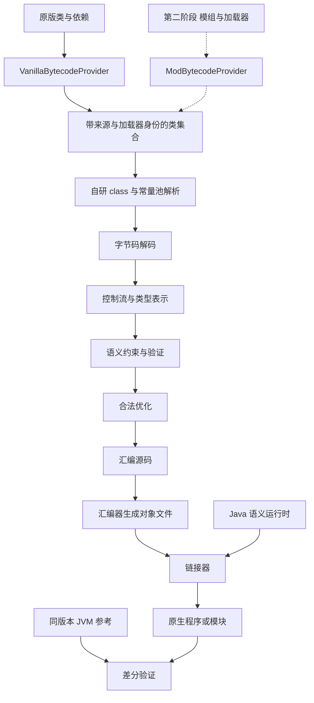
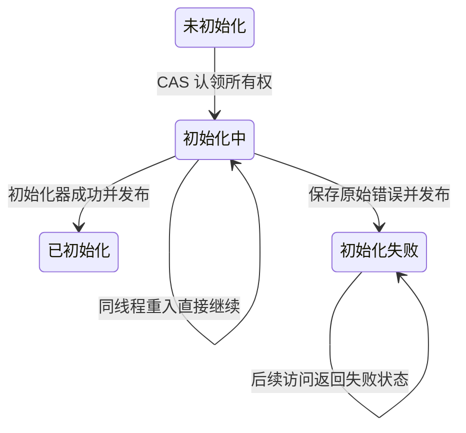

# BoomMinecraft Java 字节码到汇编编译器设计

ClassValue 缓存引用采用 CVAL64/1 按 Class 类型编号保存，直接登记静态根。不可从不透明 Class 镜像推导原始 JDK 字段偏移；读写必须核对原始字段、调用者来源、镜像身份、堆归属和引用值类型。该服务没有替代 Java 初始化锁、storeFence 或弱引用处理，完整缓存生命周期需继续接入。

Shutdown 的 native 绑定只处理退出通知和本进程终止，原始 Java 负责 hook 顺序与 halt 锁。当前 VM 不支持 JFR，通知保留内部原子计数；halt0 使用操作系统终止当前进程并保留全部退出码位。测试必须只终止本项目创建的子进程。不能把 native 退出测试当作完整 Shutdown Java hook 或系统启动完成。

开发验证下一步需要实际原版启动阶段的汇编执行证据，避免仅按保守依赖发现顺序推进。若增加未翻译方法诊断探针，必须在触及缺失实现时明确停止，保留源方法身份，不能返回占位结果或使用 JVM 回退；其运行和编译成功均不能作为原版启动成功。首启判据仍是实际 Minecraft 入口、世界创建和存档验证。

ClassLoader 的私有启动类查找与 Class.forName0 共用冻结目录，但保留不同协议：启动查找只使用 bootstrap 可见性，原始 checkName 包装器处理非法形式，缺失与 null 返回 null，不触发目标初始化。已有但未链接的类型明确拒绝；不能以 null 隐藏缺失的动态类元数据服务。下一步 ClassValue 的每类引用缓存需要独立 VM 字段桥接和根登记，不能把原始 Class 私有偏移施加到镜像对象。

Unsafe 实例字段使用 BOOI cookie，经 FLDS144/5 按真实接收类型解析地址。映射保留定义加载器、声明类与原始字段槽，兼容子类引用前缀引起的位移。内部查找只查本地声明，绕过公开过滤器；缺失字段抛出无消息 InternalError。当前只接通基本类型访问，引用写入、活动根、安全点和屏障仍须独立实现。

String.getChars 在汇编中实现原始范围算法、顺序与消息，不依赖完整 Locale/Formatter 初始化；产物保留 String、辅助方法和 Preconditions 来源及 Code 摘要，不将语义实现记作执行了原始 Java 体。

类名来自 InnerClasses/EnclosingMethod，不能替换所有 `$` 推断嵌套。CLNM64/2 将缓存指针登记为静态根，锁不占引用槽；新名称由汇编分配并在完成后发布，保留独立于驻留模板的身份，不触发目标类初始化。模组变换或动态类型版本必须失效并重建相应来源、名称与缓存。

record 引导的首个路径保持来源边界：只有匹配原始 Record 属性、组件 getter 和固定引导协议的调用点才能生成 `boom-record` 辅助类。每个辅助类带创建者加载器、源散列和调用点身份；普通类不能占用其生成名称替换实现。原始记录访问上下文只在来源匹配时授权生成类读取私有字段，元数据定义本身不授予任意 Java 方法体执行权限。Class.isInstance 复用运行时类型关系，不能以类名相同代替定义加载器身份。

开发线 v73 的反射对象采用 VM 自有、不透明的汇编布局。翻译器校验原始声明和方法 Code 散列，使用冻结类、字段槽位和构造器描述符生成元数据；通用 Object/Member 调用也必须根据实际 VM 类型进入对应服务。元数据导入和 Java 方法体执行分别校验，不能因可读取原始 Class 定义就按 JDK 私有物理布局读写 VM 对象。

字段过滤发布和反射缓存分别管理：注册按类型原子发布，首次字段查询固定该类型的过滤视图。后注册规则不会修改已缓存的结果。完整缓存生命周期将随安全点、活动根和引用处理接入；当前只验证显式缓存驱逐夹具，不能将其记作自动回收完成。不可变成员文本可在离线阶段折叠，运行时仍由汇编分配新的返回 String。

状态：设计草案 0.85
更新日期：2026 年 11 月 24 日

## 目标与阶段顺序

主路线为自研 Java 字节码前端、语义表示与汇编生成后端。输入为原版和未来模组的 `.class` 字节码，输出为可检查、可交给汇编器处理的汇编源码，再通过汇编器与链接器生成机器码。汇编必须是编译链的实际输入，反汇编已有 EXE 不算完成这一目标。

用户已明确选择先验证自研后端的语言子集，再逐步覆盖完整原版。**第一阶段最终目标仍为完整 Minecraft Java 版 1.21.1，第二阶段再实现模组兼容。** 子集验证属于第一阶段内部里程碑；模组相关的类来源、变换链和优化失效机制提前设计。

用户已明确语言边界：**游戏逻辑、游戏运行时以及游戏执行中的优化全部使用汇编。翻译器和启动器可以使用其他语言。** Rust 仅实现编译、输入准备、启动编排和测试工具；C# 仅实现启动器界面。不得引入 Rust/C/C++ 游戏运行时或用 JVM 运行缺失的游戏逻辑。

首个目标平台为 Windows x86-64，汇编语法为 MASM，复用已有 `ml64` 汇编器和 MSVC 链接器。游戏方法由翻译器生成汇编；运行时服务以汇编实现，通过 Windows 系统 API 获取线程和其他平台服务。GraalVM 只保留为独立对照实验，不作为自研后端的代码生成器或缺失功能的隐式兜底。

启动器只面向启动游戏。校验、下载、字节码翻译、编译、链接和缓存更新属于自动启动流程，不提供玩家可见的编译、翻译、开发测试按钮。开发工具保留在命令行和脚本中。当前游戏执行环境不完整时必须清楚报告无法启动，不得把帮助菜单或内核测试显示为游戏启动成功。用户要求后续验证不使用 Computer Use。

## 首版范围

v55 补充安全栈与参数调用约束：保护域绑定针对映像内的加载器/类型身份，应用类默认未绑定，必须由真实类加载流程提供已构造的保护域；引导类域为 null。绑定引用作为根保留，在没有活动 Java 帧时一次发布，后续身份不可替换。未来模组变换产生的新类型版本必须重新建立身份与优化失效边界，不能修改活动映像的域表。

ACCP/1 汇编池保存原始 ACC 字段位置、同映像的线程登记/镜像/类型/影子帧表，以及由原始 Code 推导的局部变量位移。沿实际影子帧读取保护域，在 executePrivileged 读取上下文和调用者 Class；只折叠连续的非空重复域。VM 分配 ACC 并设置其字段，不调用语义不同的公开 Java 构造器。继承上下文直接来自当前 Thread。该边界参考锁定版本的 [OpenJDK JVM 契约](https://github.com/openjdk/jdk21u/blob/jdk-21.0.13%2B3/src/hotspot/share/prims/jvm.cpp) 和 [ACC 创建协议](https://github.com/openjdk/jdk21u/blob/jdk-21.0.13%2B3/src/hotspot/share/classfile/javaClasses.cpp)，实现为本项目自己的汇编。

调用者类查询使用同一影子帧，要求调用的 Java 方法有可信引导来源的 CallerSensitive 注解，并遵循[反射和适配帧过滤规则](https://github.com/openjdk/jdk21u/blob/jdk-21.0.13%2B3/src/hotspot/share/oops/method.cpp)。应用类伪造同名注解不能获得该标记。当前验证中的合成 VM 帧只证明运行时协议；完整 Reflection Java 初始化与调用路径需随 System 和标准库启动补齐。

普通调用按 JVM 的 255 参数槽上限检查接收者及宽值，生成帧的出站参数区至少容纳 max_stack。当前仍拒绝需要栈探测的大于 4 KiB 帧；旧数值批处理 ABI 的每记录 16 个参数限制保持独立。ACC 的临时引用仍只适用于没有自动回收的当前执行模式；自动 GC 前必须接入栈根、安全点和 native 临时根登记。

| 项目 | 目标 |
| --- | --- |
| Minecraft | Java 版 1.21.1 |
| 输入字节码 | 以 Java 21 class 格式为主，支持范围明确声明 |
| 平台 | Windows x86-64；其他平台另做后端 |
| 汇编产物 | 可读 `.asm`，含字节码位置与指令对应注释 |
| 首个可执行形式 | 单方法原生 DLL，由测试宿主调用 |
| 完整原版交付 | 客户端、集成服务器、独立服务器及同版本存档与协议 |
| 模组 | 第二阶段实现，第一阶段预留类加载器身份与变换信息 |
| 工具位置 | 新工具统一存入 `D:\Dev` |

原版 1.21.1 元数据要求 Java 21。输入准备继续校验官方版本元数据、游戏 JAR、依赖、资源与平台库，锁定文件记录内容哈希和 classpath 顺序。[官方版本元数据](https://piston-meta.mojang.com/v1/packages/9aa86ea608c3ec777dcdc09e6c5a06c85b53599e/1.21.1.json)

完整原版并不等于将所有方法指令换成另一套指令。对象、类初始化、标准库、异常、垃圾回收、线程、反射和原生库都必须有执行环境；这些运行时能力也属于后续实现范围。

## 架构

当前 `i32-v2` 使用带类型限制的指令表示与控制流帧，还未建立完整 SSA 优化层。先保留可追踪的直接翻译结果，之后再增加值分析、公共子表达式、寄存器分配和循环优化。

### 模块职责

| 模块 | 职责 | 当前状态 |
| --- | --- | --- |
| 输入准备与锁定 | 校验官方输入、依赖与来源 | 已有基础实现 |
| 类集合提供器 | classpath 优先级、多版本 JAR、类来源 | 已有原版实现 |
| `compiler/classfile` | class 结构、常量池和方法 Code 解析 | 已实现子集所需部分 |
| `compiler/i32` | 指令解码、控制流检查、MASM 生成 | 已实现 `i32-v2`，含同类静态调用与 switch |
| `compiler/numeric` | I/J/F/D 类型验证与汇编 | 已实现受限数值方法、转换和整数除零传播 |
| `compiler/managed` | 数值方法构建与诊断宿主 | 已实现统一上下文/参数向量 ABI |
| `compiler` 构建与执行 | 真实汇编、链接、产物身份和测试 ABI | 已实现单方法 DLL |
| 完整类型与优化 IR | 多类型数据流、调用和优化 | 待实现 |
| Java 汇编运行时 | 对象、GC、异常、类、线程和标准库支持 | 已有持久工作池与显式堆/标记清扫基础；已接入同类对象、字段、基本数组及同类引用数组；仍缺跨类对象、安全点和栈映射 |
| 图形与平台集成 | JNI、LWJGL、输入、音频和窗口 | 待实现 |
| 模组适配器 | 捕获加载器变换、兼容性与失效记录 | 第二阶段实现 |

## 当前整数子集

### 输入约束

`i32-v2` 接收普通 `Object` 子类中零到四个 `int` 参数、返回 `int` 的静态方法。类不能包含字段、接口或 `<clinit>`；方法不能为同步、原生或抽象方法，也不能有异常处理器。当前限制最多 256 个局部变量槽和 256 个操作数栈槽。

编译范围是一个选定方法，类中其他未选方法可以存在未支持的指令，但不能引入上述类初始化或状态约束。重载需要明确方法描述符。

不满足约束时直接拒绝，不输出部分可执行结果，不调用 GraalVM 或其他后端代为执行。

### 指令与检查

支持整数常量、`iload`、`istore`、`pop`、`dup`、`swap`、加减乘、取负、位运算、三种移位、`iinc`、整数条件跳转、`goto`、`tableswitch`、`lookupswitch`、`ireturn` 和相应宽形式。`ldc` 仅接收整数常量。

`invokestatic` 仅支持同一类中的整数静态方法。编译器解析 Methodref 与 NameAndType，遍历调用图，将所需方法一起生成汇编。调用图最多 128 个方法，拒绝递归、跨类调用和任何不满足子集约束的被调用方法。

控制流检查覆盖指令边界、栈上溢与下溢、合流栈高度、局部变量范围和所有来路上的确定初始化。循环通过工作队列传播帧状态并收敛。这是本子集的验证器，尚不是完整的 JVM class 验证器。

指令行为以 [JVMS 指令集](https://docs.oracle.com/javase/specs/jvms/se21/html/jvms-6.html)为依据。32 位整数溢出保留回绕，右移区分算术与逻辑，移位计数使用低五位，比较保留有符号规则。

### 汇编与调用约定

每次选定的入口输出一个 `boom_entry` 函数，所需同类被调用函数使用内部唯一符号。前四个参数使用 Windows x64 ABI 的 `ecx`、`edx`、`r8d`、`r9d`，返回值使用 `eax`。局部变量与操作数栈放在固定栈帧中，生成对齐、序言、尾声和展开信息；调用者预留 32 字节 shadow space。

汇编经过 `ml64` 生成 COFF 对象，再由链接器生成无入口、无 CRT 依赖的原生 DLL。测试宿主通过已知整数 ABI 调用，不解释字节码，也不启动 JVM。

保留的 `i32-v2` 没有异常 ABI，继续拒绝除法与取余。新增 `numeric-v1` 已建立受限整数异常上下文，但还不是完整 Throwable 对象与异常处理系统。

原生测试在独立进程中运行并设置超时。哈希检查用于发现产物变化，不构成恶意程序沙箱，也不能证明任意生成代码都正确。

## 新增数值后端与统一调用 ABI

`numeric-v1` 支持 `int`、`long`、`float`、`double`、窄整数描述符、同类对象及一维基本/同类引用数组，最多 16 个混合逻辑参数（实例方法含接收者），一个数值/引用返回值或 void。验证器记录局部变量类型与宽值的第二个 JVM 槽，按 JVM 槽数检查 `max_stack`，处理所有来路上的类型合流。引用保留 64 位地址，在 JVM 中只占一个槽；null 与相同引用类型允许合流。当前最多 64 个 JVM 局部槽、64 个栈槽，允许普通 Object 子类的非静态字段和有界同类递归，仍不支持接口、单类模式的类初始化及跨类调用。

在已有控制流基础上，支持数值常量池、宽值加载/存储、栈复制插入、长整数算术与移位、整数除法/取余、浮点加减乘除、比较、全部 I/J/F/D 转换和三种整数窄化。数组支持 `newarray/anewarray`、引用局部变量、八种基本元素及同类引用元素的加载/存储、`arraylength`、引用/空值比较和 `areturn`。同类对象支持创建、字段、构造函数和实例调用，具体范围见对象布局章节。浮点取余、跨类调用、继承/接口、静态/volatile 字段、数组协变/多维数组、异常处理器和同步仍明确拒绝。

包含数组操作的模块额外生成汇编堆绑定入口，并把堆与数组汇编源一起汇编链接。堆创建后、工作者运行前绑定，所有回调结束后才能销毁。堆 ABI 版本为 1，绑定与内存服务均拒绝不兼容版本。诊断用 `execute-managed` 不允许直接传入伪造引用或调用需要堆的模块；测试与独立汇编入口负责有效堆及引用生命周期。

根入口使用 Windows x64 的 `rcx=Context16*`、`rdx=uint64 argv[]`，以 `rax` 返回原始位。参数按逻辑值占 8 字节，JVM 局部槽仍按原始 1/2 槽宽度映射。Context16 为四个 DWORD：异常种类、原始字节码位置、方法索引、瞬时活动帧深度；公开根入口将深度清零，方法体进入/退出时维护，返回后为零。程序模式的方法索引是程序内统一编号。整数除零设置种类 1，调用链立即传播；最小整数除以 -1 和取余按 Java 边界规则执行，不触发硬件除法故障。

浮点入口保存并设置 MXCSR 为最近偶数舍入、渐进下溢，返回前恢复调用方状态；包括除零导致的上下文返回。浮点转整数分别处理 NaN、上下界和向零截断。NaN 负载不属于位相等承诺，对照使用 Java 的规范化 NaN 位表示。依据 [Java 21 浮点语义](https://docs.oracle.com/javase/specs/jvms/se21/html/jvms-2.html#jvms-2.8)和 [JVMS 转换/算术规则](https://docs.oracle.com/javase/specs/jvms/se21/html/jvms-6.html)。

## 跨类静态链接与基本类状态

`compiler/program.rs` 的 `program-v3` 模式复用数值验证和 MASM 生成，把同一输入集合中各直接 Object 子类的精确身份贯穿对象签名、静态/实例字段、构造及实例调用。支持基本数值、具名对象和一维基本/具名引用数组，返回还可为 void。启用 bootstrap 字符串时使用 `program-v4`。普通类须无接口且直接继承 Object；继承/接口分派、完整异常、同步、volatile 和类常量仍拒绝。

类按内部名排序，方法按 class 声明顺序分配程序内编号。Methodref 的类、方法名、描述符必须精确解析，不能用同名方法替换重载。编译前检查类与方法的 public、private、同包访问；v26 在验证元数据配置中增加双向授权的 nest 私有访问，跨包 protected 继承仍明确拒绝。当前显式集合表示单个应用定义加载器及非命名模块范围，不支持动态加载。

可达调用图有 1024 个方法、128 层遍历深度上限，输入最多 1024 个类、256 MiB class 字节。允许调用图中的回边，执行时统一维护 128 帧活动深度预算。统一 Context16 中的方法编号对应 `program.json` 的符号表，异常穿过不同类仍保留原始方法及字节码位置。基本数组直接按同一汇编堆中的地址传递，不复制成另一套宿主数组。

`program.json` 保存各源 class 的精确字节摘要、符号和调用边，输入指纹排除绝对路径与命令行输入顺序。它是输入身份，完整构建缓存还需结合编译器版本、目标平台、运行时源及工具链。构建失败时调用者必须处理失败，不得使用旧目录产物冒充新构建。

`compile-locked-program` 通过原版类提供器自动发现所选静态入口的类与方法闭包，只提取需要的 class。提取前校验整个输入锁及类来源哈希，提取后再核对编译摘要；保留 JAR、条目和定义加载器范围。多定义加载器当前拒绝，未来模组提供器必须在字节码变换完成后提供有明确身份的类。新增 java.base 提供器和加载器类型元数据目前独立于本程序后端，缺失类不会交给 JVM 兜底。

方法包装入口、`new` 及外部静态字段访问确保所属类初始化，不能跳过“看似纯函数”所属类的初始化。同类静态字段访问由入口/初始化器保证。实例接收者先检查空值和精确布局；当前对象均经过正常 new 初始化，不支持 Unsafe/JNI 创建未初始化实例。`anewarray` 仅分配数组，不初始化元素类。父类/默认接口初始化仍缺失。设计依据 [JVMS 21 链接与初始化](https://docs.oracle.com/javase/specs/jvms/se21/html/jvms-5.html)。

### 精确对象身份、布局及构造

`numeric::LinkedObject(class_id)` 与 `LinkedObjectArray(class_id)` 保留程序内具体类编号；旧单类 Object 类型不会代替这些身份。新对象的未初始化类型同时记录分配位置与类编号，构造调用必须与之匹配，完成后替换所有同源栈/局部别名。不同类的参数、字段、返回和引用数组元素不能合并；当前也不把这些类型自动提升为 Object 或接口。

程序编号属于本次输入集合/模块范围，`program.json` schema 3 保存逐类实例布局与静态状态。锁定输入的定义加载器身份继续留在 origins，多加载器执行仍拒绝；不能把另一个模块中相同数字编号的类型或对象直接混用。完整层次类型表与本精确类型空间暂未统一。

每类有独立的对象布局和引用数组布局，地址即运行时身份。实例字段排除 static 字段，引用前缀后放标量，每槽八字节，字段偏移保存在 `object_layouts`；静态引用槽单独成为根。`objects.asm` 在字段和实例调用前检查对象头与预期布局；`references.asm` 写入时检查元素布局。final 实例字段仅允许定义类构造函数写入，final 静态字段仅允许定义类初始化器写入。

虚调用当前直接链接到符号方法：被接受的可执行类全部是 Object 直接子类，且接收者必须匹配精确具体类，因此没有可分派的子类覆盖。继承字段解析、接口/覆盖分派、数组协变与多维分配尚未开放。构造前使用/逃逸和错误构造所有者均被验证器拒绝；正常 Object 基础构造为空操作。规则参考 [JVMS 初始化对象验证](https://docs.oracle.com/javase/specs/jvms/se21/html/jvms-4.html#jvms-4.10.1.9)。

### 初始化状态与静态数据

类描述符大小 64 字节，ABI 1：magic/版本位于 0/4，状态/所有者线程 ID 位于 8/12，初始化器地址位于 16，类编号位于 24，原始失败 Context16 位于 32，活动等待者数量位于 48。状态由 CAS 认领，拥有线程执行初始化器，其他线程通过 [WaitOnAddress](https://learn.microsoft.com/en-us/windows/win32/api/synchapi/nf-synchapi-waitonaddress) 等待；发布成功或失败后唤醒所有等待者。

静态槽各占八字节，先准备默认值及类型匹配的数值 ConstantValue；引用槽支持具名对象和一维基本/具名引用数组，集中成为 GC 根区。`getstatic/putstatic` 保持窄整数和 64 位指针语义，final 只允许定义类的 `<clinit>` 写入。类初始化依赖与普通方法调用边分开遍历，允许合法的同线程循环初始化和有界普通方法递归。

Context 类别 8/9 分别表示 ExceptionInInitializerError 和 NoClassDefFoundError，类别 10 表示有界方法栈溢出。已知 Error 类别不被重新包装，原始异常种类、位置和方法保存在描述符中。该实现仍是错误状态协议，没有 Throwable 对象、异常捕获、完整原因链或 Java 栈展开。

初始化器自身设置 Java 的最近偶数舍入/渐进下溢环境并恢复调用方 MXCSR，不能继承任意本机调用者的舍入模式。每个 Java 方法体维护活动深度，当前上限 128；深初始化链触发 StackOverflowError 状态后逐帧恢复深度，失败类保持失败状态。这个受限预算不是完整线程栈实现，不与 JVM 的 -Xss 阈值作相等承诺。

`boom_get_static_roots` 返回静态根区及数量。修改者静止后，GC 调用者须把它与调用者自己的根集合一起提供；失败类的已赋值静态引用也必须保留。程序模块只绑定一个堆生命周期，相同地址的有效绑定可重复确认，另一个堆返回拒绝且不改变绑定；堆销毁后不得继续调用或重新使用模块。调试用描述符和字段地址查询不会执行 Java 反射语义。

当前普通程序类仅支持 Object 直接子类，Object 的空基础初始化由运行时建模。执行期的父类链、默认接口初始化、volatile、监视器、完整 String 转换、完整反射、通用标准库方法执行和完整异常仍未实现。

## Bootstrap 字符串字面量与内建方法

`ClassFile::string_literal` 按 [JVMS modified UTF-8](https://docs.oracle.com/javase/specs/jvms/se21/html/jvms-4.html#jvms-4.4.7) 解码为 UTF-16 单元，保留 NUL 和未配对代理字符，拒绝截断、过长编码、裸 NUL 和四字节 UTF-8。编译期按完整 UTF-16 内容建立字面量编号，不按哈希合并；不同类常量池的同内容字面量映射到同一槽。

`numeric::BootstrapString/BootstrapStringArray` 独立于擦除 Object 和普通精确类编号。显式输入不能定义 java.* 类。当前 bootstrap String 由自研汇编运行时实现受限的 Java SE 21 合约；没有声称已翻译 OpenJDK String 的全部字节码。`new String`、拼接、字符集转换、大小写转换、反射与接口分派仍明确拒绝。

池 ABI 2 大小 56 字节：magic/ABI 在 0/4、锁在 8、字面量数在 16、根槽指针在 24、条目表在 32、字符串布局在 40、绑定堆在 48。条目各 16 字节，保存只读 UTF-16 地址和单元数。池只绑定一个堆生命周期；首次解析在锁内分配、复制并发布，失败释放锁且不发布部分对象，另一个堆会被拒绝。

字符串对象载荷 16 字节：char[] 引用位于 0，hash/已计算标志位于 8/12。引用前缀为 1，字符数组按普通 char[] 的类型标签 261 分配。字符串与其字符数组均由汇编堆分配，所有字面量槽加入静态根区；编译器限制静态和字面量根合计最多 65536。该布局是内部运行时表示，不能直接交给依赖 OpenJDK 私有字段布局的字节码或 JNI；更广的 bootstrap 执行和反射必须先统一对象表示。

汇编内建方法按精确名称和描述符开放 length、isEmpty、charAt、hashCode、equals、compareTo、toString 及 intern，语义依据 [Java SE 21 String API](https://docs.oracle.com/en/java/javase/21/docs/api/java.base/java/lang/String.html)。索引与比较按 UTF-16 单元进行，hash 使用 32 位回绕及安全的可重复缓存；charAt 错误为 Context 类别 11（StringIndexOutOfBoundsException）。equals 的 Object 参数接受已验证引用，非 String 返回 false。

ABI2 字面量模式中可构造的 String 实例全部来自驻留字面量池，intern 因而返回接收者；**开放动态 String 构造或其他字符串来源前，必须实现一般内容驻留，不能沿用这一受限实现**。toString 返回自身。静态 String ConstantValue 在所属类的 Java 初始化器体之前解析并赋值；这不代表所有 JVM 链接/准备阶段和失败时序已完整覆盖。初始化器中的字符串异常保留原始 Context，失败后的已准备字符串继续作为根。

在 x86-64 上，已完整初始化的对齐 QWORD 根一经发布就保持不变。生成的 ldc 先直接读取本模块字面量槽，命中后省去池锁；冷路径调用 strings.asm。运行时直接调用也有相同的只读快路径。它依赖单次堆绑定、模块生命周期和静止 GC，不能在 Java 执行期间清空字面量槽或卸载模块。跨独立模块的字符串域尚未统一。

未来 bootstrap 变换若改变 String 定义或相关合约，必须使这些内建假设失效；不得继续按原版 bootstrap 身份替换变换后的实现。当前没有开放这种变换或多定义加载器执行。

## JDK 来源及加载器类型身份

`jdk.rs` 使用锁定的 `lib/modules` 准备 java.base class 输入，记录镜像、提取工具和逐类身份。调用已有 `jimage` 仅是离线准备，不属于运行时服务；凭据绑定原输入锁，读取时校验来源和 class 摘要，拒绝缓存路径链接。不能把所有 JDK 模块的类都归入 bootstrap；当前其他模块明确缺失。输入格式依据 [JDK jimage 工具源码](https://github.com/openjdk/jdk/blob/jdk-21-ga/src/jdk.jlink/share/classes/jdk/tools/jimage/JImageTask.java)。

`compiler/types.rs` 独立于旧单类对象类型，定义类身份为“定义加载器 + 内部名”，描述符解析结果保留具体类型编号和每一层数组组件。元数据加载沿父类/接口递归，检查字节摘要、实际类名、版本、循环和 final/接口边界；方法描述符保留基本类型并检查 255 参数槽预算，数组维度上限 255。当前解析真实应用输入时使用 java.base 父优先解析与单个 vanilla-application 范围，尚未实现动态模组加载器或模块访问检查。

只读类型描述符 ABI 1 大小 40 字节：magic/ABI 位于 0/4，种类/标志位于 8/12，父类或数组组件地址位于 16，祖先表地址位于 24，祖先数位于 32。类/接口的祖先闭包由编译阶段生成；`types.asm` 使用描述符身份、祖先表及数组组件循环进行汇编赋值检查。数组可赋给 bootstrap Object、Cloneable、Serializable；基本数组保持不变，引用数组按组件协变。同名而定义加载器不同的类型不会合并。规则依据 [JVMS 类型身份与数组创建](https://docs.oracle.com/javase/specs/jvms/se21/html/jvms-5.html#jvms-5.3)。

类型描述符必须由有效模块持有，直到所有对象和工作者不再引用为止。运行时接口接受已验证模块中的有效指针；magic/ABI 检查不等于能安全读取任意原始地址。本层次元数据中没有实例字段布局、虚表或初始化状态；program-v3 先使用独立的精确布局执行受限对象集合。后续必须统一两套身份、加入父类字段布局及覆盖/接口分派，不能直接取消精确布局检查。多维数组分配仍未开放。

## 扩展到完整 Java 的语义要求

| 能力 | 实现要求 |
| --- | --- |
| 数值 | `long`、浮点、转换、边界规则与正确的异常 |
| 调用 | 静态、虚、接口、特殊与动态调用，参数和返回 ABI |
| 类初始化 | 初始化触发、顺序、失败状态及并发可见性 |
| 对象 | 布局、类型、身份、字段、继承和数组 |
| 异常 | 抛出、捕获、栈展开、隐式异常与清理 |
| GC | 分配、根集合、栈映射、写屏障与安全点 |
| 同步 | 监视器、原子访问、`volatile` 和线程可见性 |
| 动态行为 | 反射、方法句柄、动态生成类与本机模块加载 |
| 标准库与平台 | 所需 JDK 类库、JNI、文件、网络、图形、输入与声音 |

类生命周期与并发分别依据 [JVMS 加载链接初始化](https://docs.oracle.com/javase/specs/jvms/se21/html/jvms-5.html)和 [Java 内存模型](https://docs.oracle.com/javase/specs/jls/se21/html/jls-17.html)。复用现有本机库时仍需明确引用生命周期和线程边界。[JNI 规范](https://docs.oracle.com/en/java/javase/21/docs/specs/jni/design.html)

运行时必须使用汇编实现。对象共享、反射、身份、GC 根和栈展开等语义需要显式 ABI 和数据布局，不能由 Rust 或其他语言的执行运行时隐式承担。

## 多核优化

先建立与 JVM 等价的执行结果，再优化游戏工作。编译器使用多个线程和游戏能够多核运行是两件事，分别测量。

已实现的 `native/runtime/parallel.asm` 提供受限纯内核的多核 map：1 到 64 个工作者，调用线程参与，每次原子领取 64 条独立记录，按原始索引写入结果，返回前等待全部线程。检查数量、空指针、地址溢出和输入输出重叠；创建线程失败时由已有工作者完成剩余任务。该 ABI 尚不支持共享可变 Java 对象，也未接入 Minecraft tick、区块或渲染调度。

离线编译采用独立的 Rust 受限线程池，每个任务复用 JAR 索引处理最多 256 个类，保持 classpath 来源及结果顺序。客户端资源准备也采用有上限的并发下载与校验。这些离线并发不计为游戏运行时优化。

`parallel.asm` 同时支持统一数值 ABI：输入记录 128 字节（16 个参数位），输出记录 32 字节（值、独立 Context16 和保留位）。每条输入的异常状态单独清零和保存，其他任务继续执行。

`native/runtime/pool.asm` 提供持久工作者。创建时分配有上限的线程与私有事件；重复运行只发布任务并唤醒，不反复创建线程；调用者参与计算，返回前等待本批工作者全部完成。不超过一个 64 条输入块时只由调用者执行。重复派发和销毁用忙碌状态保护，运行中返回 ERROR_BUSY；销毁必须由持有生命周期的所有者发起，不能与新的外部调用竞争。它不是完整 Java Thread/monitor/volatile 实现。

世界权威写入保留所有者线程。候选工作通过不可变输入、任务依赖、区块版本和提交顺序组织；若原版任务必须观察同一 tick 的前序更新，就保持依赖屏障。随机数消费顺序也必须保留。

| 候选工作 | 必须检查的约束 |
| --- | --- |
| 网格生成 | 邻区块数据、资源版本与 GPU 上传顺序 |
| 地形生成 | 生成阶段、跨区块结构与随机序列 |
| 光照 | 边界依赖、传播收敛与提交顺序 |
| 存档压缩 | 一致快照、文件提交和失败恢复 |
| 寻路 | 输入快照与路径应用时的有效性 |
| 红石和方块实体 | 更新顺序与共享写入，初期保持同步 |

线程池和在途任务必须有预算。评价主线程时间、排队、同步和总耗时，不能仅凭 CPU 利用率更高判断优化成功。

## GPU 优化

CPU 汇编不能直接作为 GPU 着色器执行。未来从受限计算 IR 中抽取数据并行内核，为其分别生成 CPU 与 GPU 实现；普通对象图、异常和复杂回调先保留在 CPU。

先测量渲染提交、网格上传、剔除和显存使用，再评估计算迁移。GPU 收益必须包含数据整理、传输、同步、读回和提交；小任务使用 CPU。世界生成等影响存档的计算保留精确性要求，不以近似结果替代原版规则。

每个 GPU 加速路径保留原生 CPU 实现，回退发生在副作用提交前。图形 API 之间的资源共享另行验证，不能假定已有 OpenGL 资源能直接交给其他计算后端。

### 当前汇编线程数量调节

`boom_pool_run_budget` 在同一个持久池中按批次选择实际唤醒的工作者，调用者也计入数量。`scheduler.asm` 已对重复的独立同类任务批次使用 QPC 计时，尝试 1、2、4 等数量直至创建上限，每个数量记录两个真实批次，按每条记录的时间归一化。每条任务只执行一次，不为测试性能重跑副作用。

选取测量最小值后，优先使用时间位于其 110% 内的最少工作者。少于 1024 条记录的批次使用调用者，不参与训练；更换内核会清空历史，工作量分布改变需要调用者显式重置。忙碌时拒绝重置、运行和销毁。训练不包含外部批次 GC，线程池与调度器元数据也尚未纳入启动器内存总账。

该策略已避免样例中的盲目增加线程。它要求调用者证明任务独立，不能将任意 Java 方法自动并行；还未接入实际游戏任务图，也没有游戏帧率证据。

## 内存优化

`native/runtime/heap.asm` 已实现预算内的非移动堆基础：32 字节块头、16 字节对齐、受锁保护的分配、零初始化、显式标记清扫、循环图追踪、空闲块合并及复用。GC 工作栈包含在传入的总预算内；对象布局暂要求引用槽位于负载前部，原生块不包含引用时声明零个引用槽。

当前收集器仅能在所有修改者静止时由调用者显式运行，根数组由调用者完整提供。基本数组、精确具名对象和一维引用数组已接入，可在入口返回或整个并行批次结束后回收临时图。**继承、通用数组语义、栈映射、安全点、线程挂起和 Java 执行中的自动 OOM 重试尚未接入**。它是运行时基础，不是完成的 Java GC，也不能直接用来运行完整原版。原生 ABI 接受受信任的类型化指针，不提供任意指针攻击的安全边界。

分配器保留空闲游标，使正常连续分配不再每次从堆首扫描；空间不足时回绕搜索前面的空闲块。GC 合并后重建游标，保留预算与对象地址语义。该路径也已在并行数组分配、显式回收和复用测试中验证。

分配锁只保护块保留、头信息、游标和预算记账。保留成功后先释放锁，再在当前分配者独占的载荷中清零，最后返回对象；对象不能在分配返回前发布。不同对象的清零可以并行，GC 仍必须等待所有分配/修改者结束。它没有消除全局分配锁，未实现 TLAB；对象密集任务可能在更少工作者下更快，自适应调度须根据真实批次选择预算，不能承诺线程数越多性能越好。

完整运行时阶段分别记录托管对象、原生缓冲、线程栈、代码、元数据、文件映射和显存。将数据从 Java 对象复制到原生缓存不能直接算作内存减少。

优先减少重复数据和短命分配、改善局部性、限制快照与缓存，再调整 GC。对象布局变化必须保留身份、别名和反射语义。共享原生数据需要明确所有者与有效期，不能长期持有可移动对象的裸地址。

### 单类后端的对象布局

数值后端目前允许一个普通 Object 子类的非静态字段和方法，支持 `new/getfield/putfield/invokespecial/invokevirtual/return/areturn` 所需子集。普通实例调用直接链接同类目标，并检查对象的模块本地类型标签；它不是跨类虚方法分派。构造函数按分配字节码位置保留未初始化类型，完成 `<init>` 后统一更新局部变量和操作数栈中的别名；禁止未初始化对象被普通方法、字段读取或返回使用。

布局描述符包含魔数、ABI 版本、负载大小、引用前缀数量和字段数量。引用字段排在前面，其他字段按 class 声明顺序排列，各占八字节，块头仍为 32 字节。类型标签使用描述符的地址，所有相关对象释放前必须保持模块加载，不能用当前标签直接替代将来的类加载器身份。构建清单另保存字段名、描述符及偏移供链接/验证使用。

`objects.asm` 的分配和类型检查均为汇编。单类后端仍拒绝静态字段与类初始化；program-v3 使用独立的具名验证路径增加这些能力。父类字段、接口、数组协变/多维数组和完整异常仍未开放；安全点和执行中的自动 GC 尚未接入。根对象图与循环中的基本数组字段已验证可保留及回收。构造函数检查参考 [JVMS 21 类型验证规则](https://docs.oracle.com/javase/specs/jvms/se21/html/jvms-4.html#jvms-4.10.1.9)，当前验证器仅覆盖本子集。

### 当前同类引用数组

`references.asm` 已实现具体同类元素的一维引用数组，使用独立描述符（魔数、ABI 1、元素类布局地址）作为块头类型标签。引用元素占八字节，全部计入 GC 引用前缀。编译器支持 `anewarray/aaload/aastore`、长度、引用数组参数、返回及字段；不把引用数组类型与对象或基本数组混合。

写入先检查 null、边界，再验证非 null 元素的具体类型；失败不修改目标槽。显式 GC 已验证数组到对象、对象回指数组的循环图和解除元素引用后的回收。当前只有一个具体类的元素，不支持协变、继承元素、跨类数组、多维数组或引用数组复制。其描述符地址也受模块加载生命周期约束，未来必须由统一类链接器赋予类型身份。

## 模组兼容预留

### 类集合与加载器身份

编译器输入应包含类名、定义加载器身份、来源 JAR、嵌套 JAR、原始及变换后哈希、映射空间和变换次序。同名类不能仅按名称合并。

第一阶段由原版提供器给出类集合。第二阶段适配真实加载器，在必要的 Mixin 与其他字节码变换完成后编译。Fabric 的类变换和嵌套 JAR 行为可参考其[文档](https://docs.fabricmc.net/develop/loader/)与 [Knot 源码](https://github.com/FabricMC/fabric-loader/blob/master/src/main/java/net/fabricmc/loader/impl/launch/knot/KnotClassDelegate.java)。

采集 Agent 不保证看到最终变换结果；多个变换器与类重定义必须遵循明确的链路。[ClassFileTransformer 规范](https://docs.oracle.com/en/java/javase/21/docs/api/java.instrument/java/lang/instrument/ClassFileTransformer.html)

### 模块生成与失效

固定模组集合可整体预编译。动态类加载则需要自己的类加载、验证、编译和模块链接协议，不能沿用当前单方法 DLL 直接声称支持。JNI、反射和渲染替换模组分别验证。

每项优化记录依赖的方法哈希、读写范围、线程所有权、回调与输出精度。模组改变这些条件时重新分析；无法证明时退回等价的普通原生实现，不能跳过模组逻辑。

模组兼容需区分能加载、功能通过和优化覆盖。Fabric、NeoForge、Forge 分别适配。当前没有实现模组加载或运行。

## 验证与完成标准

### 编译器验证

差分使用真实 javac 输出、JVM 参考结果和经过汇编器实际生成的代码。覆盖边界值、溢出、分支、循环、局部变量合流与 ABI；明确检查未支持功能被拒绝。随着新类型和运行时能力开放，增加相应语义样本。

当前整数子集已对 16 个方法、1057 组输入验证一致；汇编调度器对 65,539 条输入在 1、2、4、8 工作者下逐项一致。已全量扫描服务器输入 27,956 个类，在 438 个候选整数静态方法中生成并链接 23 个。这些结果不能推导整个 JVM 或 Minecraft 已兼容。

### 完整原版验收

第一阶段最终需要覆盖客户端、集成与独立服务器；生存、创造、极限、旁观；三维度与世界生成；红石、流体、实体、村民、战斗和容器；资源包、数据包、语言与命令；图形、输入与音频；认证、联网、LAN；双向存档和耐久运行。

必要功能尚未验证或有已知行为缺失时，不能关闭第一阶段。小型方法、帮助菜单、服务器进入世界均为中间步骤。

### 性能验收

在功能通过后，对齐机器、运行时约束、世界、输入、画质、视距和内存预算。区分冷启动与 JVM 稳态，比较帧时间分位数、MSPT、吞吐、内存与峰值。逐项开启优化并保留原始样本，多次运行评估波动。

当前不宣称自研汇编比 JVM、Rust 或其他语言更快。直接生成汇编本身不是性能证据。

## 里程碑

| 顺序 | 第一阶段内部交付 | 完成条件 |
| --- | --- | --- |
| C0 | 原版输入、锁定与 JVM 参考 | 单版本可复现，来源和依赖明确 |
| C1 | 整数静态叶子方法到汇编 | 真实汇编链接、ABI 与差分通过，未支持功能拒绝 |
| C2 | 扩大类型和控制流 | `long`、浮点、转换、除法和异常约定逐项通过 |
| C3 | Java 运行时与调用 | 对象、类、GC、调用、异常、线程和所需标准库逐步覆盖 |
| C4 | 完整原版客户端与服务器 | 功能、存档、协议、平台与耐久矩阵通过 |
| C5 | 专门优化与原版交付 | 多核、GPU、内存优化各自有正确性和收益证据 |

第二阶段在完整原版交付后实现模组兼容。其输入契约提前进入设计，但不挤占当前编译器与运行时的实现。

## 对照实验与既有调研

Horizon 的路线是游戏重实现，其 Java Bridge 使用 JVM 和状态镜像运行模组；可借鉴模块隔离与验证方法，不能视为通用 Java 到汇编已经解决。[Horizon](https://github.com/horizon-rust/horizon)、[桥接架构](https://github.com/iaxivers/horizon-java-bridge/blob/java-bridge/docs/java-bridge.md)

先前 GraalVM 实验已帮助定位动态服务发现、资源、协议和 JFR 等运行时需求，相关代码单独保留。它们提供参考与问题样本，不计为自研后端实现，也不替代上述 C1 到 C4 的验收。

## Class 镜像与执行类型的边界

program-v5 接入 source-verified Registry：普通可执行对象仍受 program-v3 的直接 Object 子类限制，类常量所需元数据单独加载父类与接口，不触发目标类初始化，也不自动编译其方法。锁定应用使用 vanilla-application，显式测试输入使用 explicit-application；bootstrap 查询不能退到应用类。JDK 缓存须匹配输入锁，类来源与内容摘要进入程序身份。

镜像池 ABI 1 大小 64 字节：magic/ABI 位于 0/4，冷创建锁 8，类型数 12，强根表 16，元数据行表 24，自有镜像布局 32，字符串池 40，绑定堆 48，保留位 56。类型行 24 字节：类型描述符指针 0，名称字面量号 8，父类镜像号 12，组件号 16，保留位 20；无关系使用 FFFFFFFF。镜像对象负载 8 字节，保存类型号，无堆引用前缀。池和镜像不能跨堆复用，模块必须存活到堆销毁。

getName、isArray、isPrimitive、isInterface、getSuperclass、getComponentType、isAssignableFrom 是当前明确开放的汇编内建方法。getSuperclass 对接口/基本类型返回 null，对数组返回 bootstrap Object；组件查询可取得基本类型镜像。普通 int.class 的 Integer.TYPE 字段读取仍需合法包装类初始化，当前不将其折叠成绕过初始化的常量。Class 实例的布局自有，不能直接执行 OpenJDK Class 私有字段字节码或 JNI 反射。

模组接入后，镜像身份须由全运行时的定义加载器与类型身份统一管理，不能仅按同名类或模块局部类型号合并。当前静态程序强根没有卸载语义；未来类卸载需要弱驻留表、安全点及缓存失效。对象布局到 TypeDesc 的映射和 getClass/checkcast/instanceof 已在 program-v7 接入；这些类型检查不代表通用对象执行已支持继承。

## 动态字符串接入前提

StringConcatFactory 的 makeConcat 与 makeConcatWithConstants 需要校验真实 BootstrapMethods/MethodHandle 身份、引导签名、调用签名、参数数与配方中的动态/静态标记数。配方按 UTF-16 单元处理，静态 String 内容作为原文插入。当前前端只规划整数、long、boolean、char、String；浮点格式、任意 Object.toString、其他 bootstrap 常量及动态引导方法需要另行实现，不能套用整数拼接结果。

动态字符串分配开启前，必须把仅字面量的 intern 改为完整内容驻留：既要合并动态值，也要匹配尚未加载的字面量，否则“先 intern 动态值、后 ldc 同内容字面量”会破坏身份。驻留表须纳入 GC 根和堆/模块生命周期；拼接结果应先完整构造再发布。这一前提现已在 program-v6 中实现，见下方 ABI3 与动态驻留约束。

参考：[StringConcatFactory Java 21 API](https://docs.oracle.com/en/java/javase/21/docs/api/java.base/java/lang/invoke/StringConcatFactory.html)、[JVMS BootstrapMethods](https://docs.oracle.com/javase/specs/jvms/se21/html/jvms-4.html#jvms-4.7.23)。

## program-v6 的动态字符串执行约束

Concat 配方 ABI1 为 32 字节：magic/ABI 位于 0/4，片段数 8，参数数 12，片段表指针 16，字符串池指针 24。片段行 24 字节，kind/参数号位于 0/4，字面量 UTF-16 地址 8、单元数 16。整数、long、boolean、char、String 使用不同 kind，不能按统一机器宽度丢失转换语义。静态常量展开总量和片段长度受限，运行时先计算总长度，再分配并填充私有 char[]，最后返回独立 String。

动态驻留池 ABI3 为 80 字节，56 之后增加锁、项数、根槽地址和容量。当前表使用 Java hash 与开放寻址；扩容必须重排，hash 相同仍比较长度及 UTF-16 内容。hash 缓存写入顺序和对齐指针发布按当前 x86-64 目标处理。强表根包含动态字符串；未加载字面量可直接采用同内容的动态对象，使后来 ldc 解析相同身份。ABI2 继续限制为仅字面量程序，不能向其中引入动态对象后仍使用返回自身的 intern。

显式 GC 只在批次静止后运行，当前源字符串和中间拼接值依赖这一边界；接入自动 GC 前必须为这些活动引用提供安全点和栈映射。池绑定单一堆、模块存活到堆销毁。模组变换或 bootstrap 实现变化需要使调用点配方、表示、来源摘要及运行时缓存同时失效，不能把同名动态引导方法都当作 StringConcatFactory 内建操作。

## program-v7 类型映射与验证

运行时类型映射 ABI1 为 32 字节：magic/ABI 位于 0/4，映射数 8，类型数 12，行表指针 16，镜像池指针 24。行大小 40：堆标签 0，TypeDesc 指针 8，类型号 16，kind 20，固定负载大小 24，固定引用槽数 32，基本数组元素移位 36。kind 0 为普通对象，1 为基本数组，2 为引用数组。这里只注册编译器已生成布局的对象类型，JDK 元数据存在不代表已提供该类的可执行对象或 native 方法。

checkcast/instanceof 使用实际堆标签和祖先/接口/数组元数据，getClass 通过实际类型号查询同一镜像池。目标类型解析只加载元数据，不请求初始化。新引用类型携带元数据号；合流记录可选类型集合，以“每个候选均可赋值”验证调用、返回和字段存储。整数与未初始化令牌不得进入这些集合。所有可达方法在布局冻结前预验证，之后不得产生新合流或改变字面量/调用点布局。

接口引用的 Object.getClass 依据实际接口身份和 final Object 方法处理，不把所有 invokeinterface 当成 Object 调用。一般接口/父类分派仍需方法解析、方法选择、默认方法冲突及访问规则。当前字段按完整对象的引用前缀排列，子类新增引用会改变标量位置；不能简单开放继承验证门槛后继续按父类固定布局偏移访问。后续需要为真实动态类型生成字段身份到偏移的映射与方法表，或改用支持精确引用图的布局，并把构造、初始化、GC 与模组变换失效边界一并接通。

## program-v8 阶段：接口执行与继承边界

编译器的 `hierarchy.rs` 按定义加载器身份解析方法和字段，选择接收者的类方法或最具体默认方法。更具体接口的抽象重声明会遮蔽父接口默认方法；多个无关具体默认方法产生冲突。私有已解析方法直接选择，并先执行调用者访问检查；v26 增加来源校验的 nest 访问证明。[JVMS 方法选择](https://docs.oracle.com/javase/specs/jvms/se21/html/jvms-5.html#jvms-5.4.6)、[invokeinterface](https://docs.oracle.com/javase/specs/jvms/se21/html/jvms-6.html#jvms-6.5.invokeinterface)

`program-v8` 首先在直接 Object 子类与接口组成的封闭输入中执行这些规则。每个调用点生成不可变接收者类型表及 MASM 分派函数，先由汇编运行时校验对象标签、载荷大小和引用前缀，再按定义类型身份调用选中的汇编方法体。支持类方法覆盖默认方法、子接口默认方法、抽象重声明后的具体实现、接口私有方法调用，以及类 Methodref 继承接口默认方法。参数槽数包含接收者，long/double 各占两槽；传递值仍采用 argv64。分派表无可写热路径或共享缓存发布，工作线程可并行读取。

实例方法调用不触发其声明接口初始化。new、静态调用及静态字段访问保留各自触发点。类描述符的初始化回调先准备常量字符串，再按接口继承顺序确保声明默认方法的接口，最后运行本类 clinit；接口自身初始化不递归初始化父接口。已有汇编初始化状态机处理首次执行、同线程重入、其他线程等待和失败持久化。[JVMS 初始化顺序](https://docs.oracle.com/javase/specs/jvms/se21/html/jvms-5.html#jvms-5.5)

Context16 新增状态 13 IncompatibleClassChangeError、14 AbstractMethodError、15 IllegalAccessError；这些属于初始化失败时应直接传播的 Error。尚未实现完整 Throwable 对象和 catch。

v8 阶段的父类执行保留硬边界，以下布局限制随后由 v9 的封闭应用类执行扩展。离线布局规划记录字段的声明类和字段序号，区分隐藏字段，并在整个实际对象范围内排列引用前缀。子类新增引用可能移动父类标量字段；该阶段的固定偏移访问尚未改为按实际对象映射，故不能开放非 Object 父类执行。构造器的直接父类初始化、super 调用、完整访问/加载约束和可扩展类加载仍待接通。`plan-hierarchy` 仅输出来源校验的检查报告，不是可执行游戏镜像。

未来模组加入或变换类时，接收者集合、选中方法、初始化依赖及字段映射都必须使相关编译缓存失效；当前封闭表不假定对未来加载器永久有效。

## program-v9：应用类继承执行

封闭应用类继承已接入实际对象布局、构造器和访问。实际对象使用完整继承链的引用前缀；字段身份为声明类与字段序号，生成的 MASM 字段地址函数按实际运行时类型选择偏移。父类私有字段和子类同名字段分别保留。继承的静态字段/方法解析到声明类，初始化触发也落在该声明类；实例构造和初始化依赖包括父类，再处理应初始化的默认接口。

构造验证区分 new 产生的未初始化对象和当前构造器的未初始化 this：前者只允许自己的构造器，后者允许本类委托或直接父类构造，拒绝跳过直接父类。允许初始化前向本类声明的字段写入，不能由此把 this 提前当作已初始化引用使用。构造期间的虚调用按实际子类选择目标。

普通虚调用按实际类选择覆盖方法；invokespecial 另按当前类、直接父类和直接父接口规则固定选定目标，再验证接收者属于当前调用类的层次。调用点缓存身份包含调用指令种类，避免同一常量池符号的虚调用和特殊调用共用错误选择。方法执行仍全部由生成汇编完成。

`covariant_arrays.asm` 增加一维引用数组的动态长度、读取和写入。运行时校验数组标签和实际组件类型，先判空和边界，再检查元素可赋值性；失败时保留原槽。验证器不再把静态推断出的具体数组组件当作写入类型的硬限制，元素兼容性由实际数组决定。[JVMS aastore 验证规则](https://docs.oracle.com/javase/specs/jvms/se21/html/jvms-4.html#jvms-4.10.1.9)

本阶段不等于完整 Java 继承：bootstrap/JDK 类的 Java 方法执行、跨包 protected 访问、nestmate、动态类加载及完整类验证仍有边界；Object/多维/一般元数据数组的执行还需扩展。现有 Context16 仍只有异常状态，Throwable 对象与处理器尚待接入。

## 内存优化原则（用户补充）

不照搬 HotSpot 的 GC 算法。保留原版及未来模组可观察的对象生命周期语义，分配器、回收器及其多核调度自行用汇编实现。Java 字节码没有主动释放普通对象的接口，JVM 规范也不限定某一种回收算法。[JVMS 堆内存语义](https://docs.oracle.com/javase/specs/jvms/se21/html/jvms-2.html#jvms-2.5.3)

GC 是自动回收的一类机制，不预设它必然比手动管理低效。优化目标是减少分配、共享争用、扫描工作与停顿，以及控制峰值内存；不以“完全没有 GC”作为验收条件。翻译成汇编不会自动获得任意 Java 对象的最后使用位置。无法证明生命周期时必须保持正确的存活追踪，不能在任务结束、区块卸载或一帧结束时释放仍被其他对象引用的数据。

当前全局分配锁和批次静止标记清扫仅作为正确性基线。实测短小含分配负载在更高线程数下未普遍加速，源码中的全局分配锁是优先测量和改进的共享路径；不能把通过多核结果检查当作已完成内存性能优化。下一步优先减少分配热路径的共享状态：工作线程取得较大的独占块后从本地推进游标，公共堆只在补充块等边界协调；需要保留跨线程引用、循环图和内存预算的正确性。

对象头当前仍为 32 字节。v9 的 8 字节字段槽属于正确性基线；v10 已在封闭应用类层次中加入紧凑标量布局，引用前缀仍用于精确追踪。线程本地分配、对象头压缩、区域分配和自动回收调度仍未完成。

经逃逸与可观察行为分析证明安全的临时对象，可采用栈上或任务区域分配、批量回收；对帧、区块或任务边界的内存重用也必须证明外部没有存活引用。长期共享对象采用精确可达性追踪，弱引用等可见行为单独保留。引用计数会引入计数更新和循环处理成本，不预设为全局替代方案。尚未接入的安全点、栈映射和写入跟踪，是自动及并发回收的前置工作。

后续实现按以下顺序约束，不将规划记为已有能力：

1. 先完成活动线程、生成帧、运行时临时引用、静态状态及待处理异常的精确根登记；建立分配慢路径和安全点握手，再接入自动回收。
2. 增加汇编线程本地分配块；预留块及未使用尾部计入总预算，补充、线程退出与回收边界负责统一记账。回收器须能识别块内对象和未使用空间，不能直接复用当前堆扫描器而遗漏对象。
3. 在可证明的闭包中减少分配或使用任务区域。消除对象不能破坏身份比较、同步、弱引用和构造副作用；无法证明的调用与跨线程发布保留普通共享堆分配。
4. 对共享长寿命对象测量精确回收的并行或增量方案。并发扫描必须配套写屏障、根快照和跨线程发布协议，不预先承诺零停顿。原生及 GPU 资源另行登记所有权、释放时机和内存预算。

弱/软/虚引用、引用队列及 Cleaner 是 Java 可观察行为的一部分，不能把 referent 当成普通强字段无限保留，或仅清空指针就宣称兼容。相关服务当前未实现，需要与引用处理阶段、通知及原生资源清理共同验证。[Java 引用对象语义](https://docs.oracle.com/en/java/javase/21/docs/api/java.base/java/lang/ref/package-summary.html) 未来模组变换、动态类加载或未知 native 调用可能改变逃逸结论，必须使相关生命周期优化失效并重新编译。

优化以实测为准：分别记录分配吞吐、共享锁竞争、回收耗时与停顿分布、峰值提交/保留内存、批次后存活图和重用情况；进入完整游戏后增加帧时间分位数和长期世界运行。只改变算法和布局，不通过泄漏、遗漏根或丢失对象来换取更短测试耗时。

## program-v10：对象布局 ABI2

ABI1 保留每字段 8 字节的开发配置。ABI2 的引用字段仍为 8 字节且位于前缀；标量按宽度递减稳定分组，long/double 为 8 字节、int/float 为 4 字节、short/char 为 2 字节、byte/boolean 为 1 字节，并按宽度自然对齐。最终有效载荷不额外补到 8 字节；堆分配器另按 16 字节分配边界预留对象块。继承字段的声明身份、实际对象字段映射和访问控制保持独立于布局。

生成的 MASM 对 byte/short 做有符号读取，对 boolean/char 做无符号读取，写入使用精确的 BYTE/WORD/DWORD/QWORD 指令。boolean 字段使用独立字节，避免让独立字段共享位更新。单独字段的并发修改不能覆盖邻接字段。[JLS 17.6](https://docs.oracle.com/javase/specs/jls/se21/html/jls-17.html#jls-17.6)

`objects.asm` 校验 ABI1/ABI2、引用前缀和字段数量/载荷边界；未知版本及不匹配布局拒绝。引用数组描述符继续使用 ABI1，但组件可为对象布局 ABI2；运行时类型映射使用实际载荷大小，GC 继续只追踪引用前缀。String/Class 的专门运行时布局保持其既有 ABI，bootstrap 类执行仍有独立边界。

程序身份现在包含实际对象布局、字段映射和调用分派表，布局或解析结果变化会使缓存身份变化。版本从 program-v9 升至 program-v10。`plan-hierarchy` 的离线检查仍显示经典槽布局；实际生成布局以 program.json 中每类的 `layout.abi`、偏移和 `storage_bytes` 为准。

优化验收同时检查数值语义、跨继承私有/隐藏字段、相邻字段写入、GC 存活图、回收复用、OOM 后恢复及实际分配块占用。相同字节码由保留的旧编译器和当前编译器分别生成原生程序，核对所有输入 class 哈希后进行对象图比较；比较基线是本项目旧布局，不是 HotSpot 内存基准。完整游戏内存、停顿和帧率待实际启动后验证。

## 异常表、活动异常与内存根

class 解析器保留 Code 中每一条异常记录的原始顺序、半开保护区间、处理器位置和 catch 类型；catch_type=0 保留为 catch-all。结构检查拒绝空/越界区间、越界处理器及错误常量池类型。独立 `plan-exceptions` 对所有普通 Java 21 指令进行长度解码，检查记录是否落在指令边界，并用来源校验的类型图确认每个 catch 类型属于 bootstrap Throwable 层次；该命令只输出规划和只读表，不生成 Java 方法的可执行代码。

数值验证器已识别 athrow：顶部必须是已初始化的 Throwable 引用或 null；抛出是终结控制流。受保护指令向处理器传入指令执行前的局部变量和仅含 catch 引用的栈。构造调用失败后，其未初始化接收者的局部别名不可再次使用；构造器的 this 未初始化标志继续保留。相关规则依据 [JVMS 4.10.1.9](https://docs.oracle.com/javase/specs/jvms/se21/html/jvms-4.html#jvms-4.10.1.9)。这仍是受限验证器，尚未覆盖完整 StackMapTable 及所有 Java 指令。

`native/runtime/exceptions.asm` 新增明确命名的 Context32 接口：set32 保存已经构造的 Throwable 引用，match32 按表顺序检查当前调用点的保护区间和类型关系，take32 在进入处理器时取回同一引用并清除异常状态。其头部 16 字节沿用 kind/原始 PC/方法/深度，偏移 16 为待处理对象指针，偏移 24 保留。kind=16 表示已有真实对象的待处理异常；原来的整数异常编号仍属于 Context16 路线，不冒充对象。

处理器表 ABI1 为 40 字节：magic/ABI/count/reserved/行指针/运行时类型映射/Throwable 类型；行是 start/end/handler/reserved/catch 类型，共 24 字节。匹配输入是本层方法的调用点 PC，不能直接拿最初抛出方法的 PC 匹配调用者的表。未匹配时保留对象和来源，处理器入口才消费引用。当前接口要求可信且存活的模块元数据和有效堆指针，不是任意地址验证器。

Context32 服务目前独立验证，现有程序生成器、持久任务池和类初始化描述符仍使用 Context16。编译器继续明确拒绝生成异常处理器/athrow 的可执行代码，禁止仅放宽门槛便越界写旧上下文。下一阶段需接通实际 Throwable 构造、隐式异常对象、athrow-null 的 NPE、OOM 时的紧急异常、类初始化失败原因和整条 Context32 调用链。类失败记录中的异常引用必须长期计入静态根；不能只缓存整数状态而丢掉原始 cause。

待处理异常也是存活根。当前测试将 Context32.pending 槽显式交给静止收集器，验证异常及其引用图存活，并在处理后可回收；这不代表线程已自动登记、安全点或栈扫描已完成。未来自动回收时，分配慢路径、生成帧、运行时内部临时对象和异常传播过程都必须提供准确的活动引用。重抛必须保留对象身份；不允许把引用换成错误码后重新猜测异常。抛出及 handler 栈行为依据 [JVMS athrow](https://docs.oracle.com/javase/specs/jvms/se21/html/jvms-6.html#jvms-6.5.athrow)。

## program-v11：可执行 java.base 提供器

java.base 从纯类型元数据扩展到可执行 Java 字节码来源。锁定程序发现阶段通过同一个来源校验提供器读取应用与 JDK class；显式开发程序可以自动加入所需的父加载器 JDK 类。新增来源必须是经过锁定 JDK image/提取缓存校验的 `jdk:java.base` 字节码；不能根据 java.* 名称信任本地输入。每个新增 Source 保存 ClassOrigin，提取字节与原始 SHA-256 一致；混合程序缓存身份包含来源、定义加载器和完整字段/分派布局。

当前支持一个应用定义域与 bootstrap 的组合，同名多应用加载器/动态加载仍未开放。符号请求使用调用方的定义加载器，描述符用声明方加载器解析；bootstrap 不能向应用子加载器寻找类。包级访问同时检查包名和定义加载器，不能因为路径包名相同就放行跨加载器的非 public 成员。[JVMS 5.3 运行时包身份](https://docs.oracle.com/javase/specs/jvms/se21/html/jvms-5.html#jvms-5.3)

具名对象、字段、构造器、继承、初始化依赖、虚分派和静态根沿用自研汇编生成，JDK Java 方法没有改写成 Rust/C# 函数或转回 JVM。混合程序启用对象布局 ABI2；类型到布局映射也使用每个类的实际定义加载器。String/Class 继续使用既有专用运行时布局，不能同时把它们的私有 JDK Java 表示当成已兼容对象；请求不受支持的 Java 方法体会明确失败。

显式提供的未活动定义可参与闭包中的方法选择，但不会仅因出现于输入列表就分析或执行其父类初始化器。收集到的 JDK 源先保留在构建内存中，在生成验证通过后才发布到忽略的构建目录。一个编译阶段复用已经校验的提供器快照，逐个 class 仍检查来源和字节哈希。

此阶段验证了 java.util.Objects 的空值查询，以及 OptionalInt/Long/Double 的构造、私有标量字段、空单例和所选实例方法。不是完整 java.base 兼容声明。模块 exports/readability、完整 protected/nestmate、volatile/synchronized、Throwable、反射、MethodHandle/lambda、其他 JDK 模块和所有 native 服务仍有缺失；无法生成的路径继续拒绝。现有 Context16 程序 ABI 保持不变，独立 Context32 异常服务尚未接入完整调用链。

## program-v12：volatile 字段的 x86-64 排序

程序后端已实现静态及实例 volatile 字段访问，覆盖 1/2/4/8 字节紧凑字段、旧 8 字节字段槽、引用、数组引用和 String。volatile 与 final 同时出现仍拒绝。源成员的 ACC_VOLATILE 标记保留在类型指令中；可达方法中实际使用 volatile 时，程序清单和缓存身份选择 schema12/boom-volatile-program-v12，而不因输入中存在未使用的 volatile 定义就改变所有程序的执行契约。

目标限定为 Windows x86-64 的普通可缓存堆/模块内存。自然对齐的普通 MOV 读取承担 acquire；存储使用目标物理宽度的内存 XCHG，提供原子更新和 StoreLoad 所需排序。静态存储槽固定为对齐 QWORD；紧凑实例使用 BYTE/WORD/DWORD/QWORD，不把窄字段扩展写入相邻字段。旧 8 字节对象槽继续遵守旧表示。继承字段的所有实际接收者偏移均检查自然对齐，返回值仍做既有窄化/位表示处理。

当前直接生成器不提升、合并或缓存 volatile 读取，不移动 volatile 操作两侧的普通访问。未来 SSA、寄存器分配或 GPU/任务重排必须把这些指令视为带顺序约束的内存效果，不能根据结果未使用就删除同步效果。依据 [JLS 17.4](https://docs.oracle.com/javase/specs/jls/se21/html/jls-17.html#jls-17.4) 的同步次序和 happens-before，以及 [Intel 指令手册 XCHG](https://cdrdv2-public.intel.com/929356/334569-093-sdm-vol-2d.pdf) 的内存操作锁定规则。此映射不承诺可直接用于 MMIO、非临时存储、其他 CPU 后端或尚未支持的 Unsafe/JNI 内存操作。

开发验证使用独立 native/probe/volatile.asm：两个持久 Windows 原生线程在每轮执行生成的方法，控制器只在完整 actor 调用前后同步。actor 中的 volatile 写入与随后读取之间没有 CLR/JVM 切换或测试宿主栅栏。结果包括静态/实例 store-buffering、普通数据经 volatile 标志发布、对象经 volatile 引用发布、long 撕裂及相邻窄字段。另生成明确标记为错误的测试副本，把本项目生成的 XCHG 改成普通 MOV，检查测试确实能观察缺失排序后的禁止结果。错误副本没有生产编译清单，仅保留于忽略的隔离测试目录。

volatile 引用仍属于精确引用前缀或静态根，发布后的对象图在所有 actor 完成后可正确追踪、回收和继续使用。尚未接通自动/并发回收；未来新增写屏障时必须同时覆盖 volatile 写入，保留其排序约束。此阶段是多核正确性的前置能力，不是完整 Java 线程/监视器、完整 JMM、游戏多核加速或整游戏内存优化的验收。

## program-v13：冻结启动断言策略

Class.desiredAssertionStatus()Z 接入来源校验的类型元数据与汇编镜像服务。应用类和 bootstrap 类各有一个启动开关，默认均关闭；开发 CLI 提供 --enable-assertions 与 --enable-system-assertions，均要求已核验的 java.base。类及接口按定义加载器取对应值，数组和基本类型返回 false。查询实际 Class 镜像，不初始化所查询的目标类，null 接收者沿用 Context16 的空指针状态。这里仅覆盖冻结启动配置；逐类/逐包覆盖和 ClassLoader 动态断言设置仍拒绝，不能据此声称完整断言管理兼容。

镜像池 ABI2 保持原有 64 字节大小和 24 字节行，偏移 56 指向不可变 32 字节策略描述符：magic/ABI/flags/typeCount/statusTable/reserved。flags 的低两位分别表示应用和系统默认状态，每个类型的状态为 DWORD 0/1。汇编运行时校验头、数量及具体状态，已有镜像的缓存命中也不能跳过策略结构校验。旧 ABI1 的尾部仍必须为零，无断言查询的旧程序继续使用 ABI1；查询操作 7 只接受 ABI2。

可达查询使程序采用 schema13/boom-assertions-program-v13；实际策略加入缓存身份，不能把开关不同的构建混用。对照覆盖四种应用/系统开关组合、类/接口/数组/基本类型、实际对象 getClass、初始化中缓存查询及不触发目标初始化。Java 断言本身的 AssertionError 构造与抛出仍依赖尚未完成的异常执行链。[Class API](https://docs.oracle.com/en/java/javase/21/docs/api/java.base/java/lang/Class.html#desiredAssertionStatus())、[java 启动断言选项](https://docs.oracle.com/en/java/javase/21/docs/specs/man/java.html)

## program-v14：来源校验的 VM 时钟绑定

新增明确的 VM native 绑定清单。当前只绑定 bootstrap java.base 中实际的 public static native System.currentTimeMillis()J 和 System.nanoTime()J，校验所属类来源、定义加载器、描述符、native/static/public 标记及不存在 Java Code；同名应用类、其他描述符或 Java 方法体不能冒充 VM 服务。其他尚无汇编实现的 native 方法继续带完整成员名报错，不经 JVM 回退。

调用由自研后端生成，运行时实现为 native/runtime/vm_clock.asm。毫秒时间从 Windows 精确 FILETIME 取得，先按无符号除法取毫秒，再扣除 Unix 纪元差，保留 1970 年前的向下取整。nanoTime 使用 QPC/QPF，以商与余数拆分计算纳秒，避免直接 64 位乘法溢出；结果按 Java long 位模式回绕。纳秒计时无 UTC 纪元关系，不应与毫秒时间直接相减。[Windows 精确 UTC API](https://learn.microsoft.com/en-us/windows/win32/api/sysinfoapi/nf-sysinfoapi-getsystemtimepreciseasfiletime)、[QPC 计时说明](https://learn.microsoft.com/en-us/windows/win32/sysinfo/acquiring-high-resolution-time-stamps)

此服务不分配 guest 对象，不使用 Rust/C# 时间计算作为游戏实现。绑定加入程序清单、来源摘要及缓存身份，采用 schema14/boom-vm-program-v14，并可与断言策略、volatile 共存。它只提供两个已验证的 VM 时钟；没有执行完整 System Java 启动、属性和标准流初始化。完整游戏启动前仍需独立接通这些启动义务，不能把时钟原生调用通过当成 System 或整个 JDK 已完整兼容。

## program-v15：模块身份与加载器边界

新增 Class.getModule、Module.getName 和 Module.isNamed 的来源校验内建服务，实际查询和身份对象创建全部在 modules.asm 中执行。绑定只接受锁定 bootstrap java.base 中对应的 public 实例 Java 方法，所属 Class/Module 必须为 final 的真实 JDK 类。编译器不能把应用同名方法、错误描述符或替换后的 native/static/synchronized 方法当成这些服务。Class、String、Module 各使用运行时管理的专用表示，继续拒绝将 JDK 私有表示的 Java 方法体直接用于这些对象。

当前输入配置为 classpath，已支持的命名模块来源仅 java.base。类与接口按定义加载器和已校验来源确定模块；每个应用定义加载器拥有独立未命名模块，类来自不同 JAR 不改变同一加载器的未命名模块身份。基本类型属于 java.base，任意维数组递归沿用最终组件类型的模块，查询不初始化所查询的类。其他 JDK 命名模块来源、应用 module-path、动态加载和模块重新定义尚未接通，不能将它们默认为 java.base 或未命名模块。[Class.getModule](https://docs.oracle.com/en/java/javase/21/docs/api/java.base/java/lang/Class.html#getModule())、[Module API](https://docs.oracle.com/en/java/javase/21/docs/api/java.base/java/lang/Module.html)

模块池 ABI1 为 80 字节：magic/ABI/lock/count/roots/rows/layout/strings/boundHeap/mirrors/typeCount/reserved/membership。成员表按类型 ID 存放 DWORD 模块 ID；每个 8 字节模块行保存名称字面量 ID 和 named 标志。未命名行名称为 FFFFFFFF，getName 返回 null。模块对象载荷仅有一个 8 字节模块 ID，不伪装为 Class 对象；动态类型映射为它注册真正的 bootstrap java.lang.Module 类型。池内锁保护第一次创建和发布，后续读取不可变身份；模块池与镜像池绑定同一堆生命周期。

所有已创建模块对象都计入程序静态根区，模块名由现有字面量根管理；回收仍只在修改者静止后发生。并发测试应包含直接查询，不能仅依赖一个共享 Java 类初始化器里的查询，因为类初始化锁会串行化首次模块创建。源方法绑定、模块身份、类型成员关系及布局均纳入 schema15 的缓存身份，断言镜像 ABI1/ABI2 与 VM 时钟可共存。

模块池当前属于一个封闭链接程序，跨独立编译模块的全局身份统一仍需游戏级注册服务。ABI1 不提供模块层或可变访问边；需要层查询时使用后文 program-v16 扩展。原版 bnl.<clinit> 通过 Runtime.class.getModule().getLayer().findModule("jdk.jfr") 选择分析器，必须按真实模块解析图实现，不能硬编码“JFR 不存在”来跳过分支。

## 启动模块解析图：编译期输入准备

新增 prepare-jdk-modules 和 plan-boot-modules 开发命令，从输入锁指定的同一 lib/modules 镜像提取各模块的 module-info.class 及定义加载器常量表。游戏执行时不运行此 Rust 代码，也不由 JVM 计算查询结果；program-v16 的汇编模块层读取编译后固定表。

class 前端保留 CONSTANT_Module/Package 及 Module 属性的 requires、exports、opens、uses、provides，另保留 ModulePackages、ModuleResolution、ModuleTarget 和 ModuleMainClass。解析校验模块 class 结构、常量种类、标志、属性边界、重复指令以及 java.base 依赖约束；这不代表完整 Java class 验证器或整个 JPMS 已实现。定义加载器映射离线识别锁定 ModuleLoaderMap$Modules 的不可变数组构造形状，拒绝意外字节码，不调用其初始化器。

当前解析配置限定为 JDK21 系统模块、classpath 应用、默认根集合。默认根按非 DO_NOT_RESOLVE_BY_DEFAULT 且存在非限定导出选择，并保留 java.base；解析普通 requires 和递归服务提供者依赖。requires static 自身不引入模块，目标因其他原因已解析时才计入读取关系；requires transitive 扩展读取闭包。解析图保存自身读取关系、bootstrap/platform/application 加载器种类与服务绑定记录。其他模块路径、升级路径、补丁、命令行附加模块及动态解析需要新的显式配置和缓存身份，不能默默套用本配置。[OpenJDK 默认根规则](https://raw.githubusercontent.com/openjdk/jdk21u/master/src/java.base/share/classes/jdk/internal/module/DefaultRoots.java)、[启动解析阶段](https://raw.githubusercontent.com/openjdk/jdk21u/master/src/java.base/share/classes/jdk/internal/module/ModuleBootstrap.java)

快照保存锁身份、镜像/提取工具摘要、每个描述符字节摘要、加载器表及解析图。读取时重新解析源字节、核对模型并重新计算图；修改模型或解析图后只重算快照摘要不足以通过验证。缓存拒绝路径逃逸、链接/重解析点和超限输入，可以迁移到普通新目录。静态图包含哪些模块，与是否已实现这些模块的 class 提供器和运行时服务分别记录。

锁定 JDK 的开发对照由 JVM 只读取模块元数据和当前 boot layer，核对所有系统描述符、默认根、实际模块集合、加载器种类及成对 canRead 结果。该参考进程不执行 Minecraft，输出不作为解析器的输入。模块存在于镜像中不保证出现在默认启动层，例如当前镜像的 java.se 已安装但未进入默认层；findModule 使用实际解析结果。[ModuleLayer API](https://docs.oracle.com/en/java/javase/21/docs/api/java.base/java/lang/ModuleLayer.html)

## program-v16：冻结启动层的汇编查询

编译参数 --jdk-modules 指向与当前输入锁匹配、已经重新核验的启动模块快照。可达代码使用 Module.getLayer、ModuleLayer.boot/empty/findModule 时，程序采用 schema16；图的摘要、完整解析图、模块身份和名称字面量均参与缓存身份。没有层查询的旧程序继续使用模块池 ABI1，无需提供该快照。此阶段面向 boot layer 已建立后的应用入口，不包含完整 System 启动，也不开放 module-path、附加根或动态层配置。

模块池 ABI2 从 80 字节扩展为 96 字节，尾部指向层池和已绑定堆指针槽；旧行与成员映射不变。解析图的每个命名模块登记独立身份，加载器种类映射为当前 bootstrap、platform 或应用定义域。未命名模块仍按定义加载器区分。层池 ABI1 为 64 字节，包含 magic/ABI/lock/count/roots/layout/modulePool/heapPointerCell/boundHeap/reserved；两个 8 字节载荷对象分别代表 empty(0) 和 boot(1)。它们的动态类型为实际 bootstrap java.lang.ModuleLayer，不使用 JDK 私有字段表示。

layers.asm 实现层的首次创建、原子发布、查询与身份检查。boot 和 empty 身份稳定，未命名模块 getLayer 返回 null；命名模块来自冻结 boot 图。findModule 校验实际层对象和名称 String，按 UTF-16 内容匹配已解析模块名，再取得模块池中的同一对象。已安装但未解析的模块返回空结果；empty 层查询无结果但仍检查 null 名称。boot 的父层为 empty，因此当前封闭图不需要搜索其他父层；一般父层搜索和动态 defineModules 仍需后续实现。[Module.getLayer](https://docs.oracle.com/en/java/javase/21/docs/api/java.base/java/lang/Module.html#getLayer())、[ModuleLayer.findModule](https://docs.oracle.com/en/java/javase/21/docs/api/java.base/java/lang/ModuleLayer.html#findModule(java.lang.String))

运行时查找先返回 Module 或 null，自研生成器再调用已翻译的原始 java.util.Optional.ofNullable。Optional 的构造器、EMPTY 初始化、isPresent 和 orElse 等所需 Java 方法均来自锁定 java.base，经普通调用/初始化链执行；不以 Rust/C# 包装对象代替原始 JDK 方法。原生查找失败时保留 Context16 错误状态，不执行包装工厂。尚未支持 Optional.get 中的完整异常分支，Context32/Throwable 集成仍独立推进。

模块、层及名称均纳入现有静态/字面量根区。身份对象可按首次查询物化，池与堆同生命周期；跨独立编译模块的身份统一仍未实现。临时 Optional 只由返回引用和 Java 活动帧决定存活，在当前修改者静止边界回收。自动回收、安全点、栈映射与并发回收尚未接通。运行时可以在尚未创建 Class 镜像时完成模块查找，堆绑定来自编译程序的堆指针槽，不依赖某个偶然发生的 Class 查询。

验证覆盖所有系统模块名、实际解析集合、动态字符串、NUL/未配对代理项、null、empty 层、身份和实际 getClass、查询不触发目标类初始化，以及与断言镜像 ABI2/VM 时钟共存。多核直接查询必须绕开共享 Java 初始化锁，验证只创建一个 boot、一个 empty 及各模块唯一对象；静止回收检查名称和身份根保留、临时 Optional 回收及继续运行。可读性/导出检查、模块描述符对象、类提供器和动态模块仍不能据此宣称完整兼容。

## program-v17：lambda 捕获与方法引用

对精确的 `LambdaMetafactory.metafactory` 协议做离线链接：解析原始 invokedynamic 的捕获签名、SAM 签名、实例化签名和直接方法句柄，检查参数数量、引用关系及允许的基本类型扩大转换，再生成编译器内部类模板。捕获字段、构造器、捕获工厂和 SAM 适配方法继续通过本项目的字节码验证与 MASM 后端生成代码；游戏执行时不调用 JVM、JDK metafactory、Rust 适配函数或通用解释器。原始输入 class 字节保持不变，调用点在内部指令表示中改为生成工厂的调用。

模板记录原始创建类的定义加载器、来源、SHA256、常量池调用点以及生成器 ABI。原始输入类清单优先于生成名字；用户定义同名前缀不能取得编译器权限。仅经过来源核对的模板可按原始创建类权限访问其私有成员；special 调用使用创建类的查找上下文。模板是带内部来源信息的编译输入，不宣称是可直接交给 JVM 加载的普通 class，也不表示一般 nestmate 或 MethodHandles.Lookup 已实现。

静态、绑定/未绑定实例、接口、默认方法和构造器引用复用已有的具名对象、紧凑字段、类型映射和方法选择。接口静态引用保留 InterfaceMethodref 身份，Java 8 以下的相关常量用法拒绝；类引用与接口引用不能混用。泛型限制由生成的 checkcast 执行；按协议生成基本类型扩大、装箱/拆箱及返回值丢弃适配，但实际执行仍受对应包装类 Java 启动与 native 服务的实现范围限制。

无捕获调用点由模板的静态初始化器创建一个闭包，保存为 final 静态根；之后工厂只读取该根。发布与首次访问同步、对象创建和读取均走现有汇编类初始化与堆服务。对象身份的复用符合 metafactory 对捕获对象身份的约定，不以和某个 JVM 实现的 lambda 引用相等或生成类名相同作为差分断言。[LambdaMetafactory 协议](https://docs.oracle.com/en/java/javase/21/docs/api/java.base/java/lang/invoke/LambdaMetafactory.html) 有捕获调用点保存当次参数，引用字段纳入普通精确追踪；未证明安全时不复用这些对象。静态根当前绑定整个编译镜像/堆生命周期，动态卸载尚未实现。

绑定实例引用在捕获时检查首个接收者非空。对锁定 java.base 的单参数 Objects.requireNonNull 做来源校验后生成内联汇编检查，保留输入引用类型及当前 Context16 的异常来源；这不等于已完成 Throwable 实体化与 Java catch 执行。null 捕获值若不是绑定接收者，不应被错误拒绝。

schema17 身份包含调用点计划、生成 class 字节摘要、创建类来源以及空值检查绑定。未来模组变换改变创建类、目标方法、接口层次、类加载器或调用点常量池时，相应模板、访问结论、布局、分派和生命周期优化均须失效。当前仅支持标准 metafactory；altMetafactory 的桥接、标记接口和序列化、通用 MethodHandle/VarHandle、隐藏类反射及动态类定义仍待实现。验证覆盖范围与首个真实原版启动分别记录。

## program-v18：同步方法与堆内对象监视器

同步方法通过 `ACC_SYNCHRONIZED` 生成汇编调用封装。实例方法锁定实际 this；静态方法先完成所属类初始化，再获取与该类字面量相同的 Class 镜像作为锁。封装在正常返回和当前 Context16 异常返回时都释放监视器，保留方法结果及已有异常来源；锁获取失败时不执行方法体。构造器、类初始化器上的异常同步标志，以及没有来源核验元数据的同步执行保持拒绝。接口、虚方法和 special 分派必须调用选定方法的实例封装，避免绕过同步；实例封装不会额外初始化声明接口。

监视器由 `native/runtime/monitors.asm` 实现，按同一堆内的对象身份匹配，记录 Windows 执行线程的持有者、重入深度和等待者。竞争者通过 WaitOnAddress 等待并在唤醒后重查状态；不同对象不共享同一语义锁。内部登记表有独立短锁，分配与回收的加锁顺序统一为登记表后分配器。该基线尚不是线程本地快速锁或已完成的游戏多核性能优化。

堆 ABI1 的保留头字段新增监视器能力版本：96 为活动链，104 为登记表锁，108 为监视器 ABI1，112 为未结束的持锁/等待计数，120 为可复用记录链。旧堆缺少能力标志时不能用于新监视器。记录是计入堆预算的普通 32 字节载荷对象，加上现有 32 字节块头；引用前缀保存被锁对象和下一记录。退出最后一层且无等待者后清除对象引用并复用记录，避免每次加锁都分配新节点。

现有回收仍只允许所有 Java 修改者静止后显式执行。回收在相同登记表锁下检查活动计数并丢弃空闲记录链，使节点可被普通精确追踪回收；有持锁者或等待者时返回失败，堆销毁也拒绝未结束的监视器。这个检查不能代替线程安全点或栈根，不能据此在仍执行其他 Java 指令的线程旁并发回收。未来自动或移动回收必须登记活动监视器根、更新身份指针，并维护等待及生命周期协议。

当前覆盖同步 Java 方法的进入和退出、重入、异常释放、静态 Class 镜像身份和共享状态互斥。Object.wait/notify/notifyAll、Java Thread 中断、完整 monitorenter/monitorexit 代码生成、catch/finally 的 Context32 执行与完整 Java 内存模型仍待实现。直接运行时非法退出使用 Context16 状态 17 表示 IllegalMonitorStateException；这不表示已生成实际 Throwable 对象。

依赖发现和动态分派不把 abstract 类作为实际对象类型枚举。抽象类声明的方法仍可由具体子类选中和执行；通过具体接收者进行的方法选择保持原有访问和默认方法规则。这样不会因抽象父类自身不可能存在的实例，引入已被所有实际接收者覆盖的方法体及其无关依赖。来源证明、同步绑定及 Class 镜像身份纳入 schema18 缓存身份；模组改变方法标志、加载器或类层次时必须失效重编译。[JVMS 同步语义](https://docs.oracle.com/javase/specs/jvms/se21/html/jvms-2.html#jvms-2.11.10)

## program-v19：冻结资源目录与流

精确绑定锁定 java.base 的 `Class.getResourceAsStream(String)`。编译器核对 final Class 身份和成员契约，记录调用类及定义域；只有已核验的启动模块快照和有序资源 JAR 才能构建资源镜像。JDK 镜像、提取工具、锁、模块图、JAR 摘要和优先级决定缓存身份。各 `.class` 资源须与当前未变换执行输入一致，不能用其他 JAR 的同名 class 代替。

编译阶段提取已解析启动模块的资源，再按 classpath 顺序加入 JAR；Multi-Release 清单启用时，逻辑条目选择不高于 21 的最高版本，保留物理版本路径。条目按无符号 UTF16 排序，明确处理目录、空数据、重复及超限输入。冻结包头保存 ABI、总大小和源身份，汇编常量表保存各条目的偏移、长度和 SHA256。发布前验证缓存数据和目录，不以“重算整个缓存摘要”替代源绑定。

`resources.asm` 按 Class 镜像确定模块及相对包名前缀，数组沿组件类型解析，基本类型使用 java.lang。命名模块访问限制按描述符包和开放规则执行；class 资源与模块外资源另按 JDK 规则处理。应用查询先读取允许公开的父模块资源，再按 JAR 顺序查询。当前只有 bootstrap java.base 和一个应用定义域可成为 Class 锚点；其他模块可提供资源，不代表其 class 执行提供器已经实现。

查到条目后，相对执行模块自身的位置打开 `resources.pack`，检查大小、头部、源身份和实际数据摘要，再生成受堆预算限制的新 byte[]。每次查询独立句柄和流，不共享游标；相对查询的临时名称也纳入堆预算，绝对名称复用现有不可变字符视图。构造及后续读操作执行原始 JDK ByteArrayInputStream 的 MASM 代码。缺失目录项返回 null；已声明资源的数据包缺失或被修改使用当前 Context16 完整性错误，不伪装成资源不存在。完整 IOException/Throwable 仍待接通。

运行时系统接口限于 Windows 文件 API 和 CNG SHA256，平台封装及所有游戏侧资源逻辑均为汇编。锁定 JDK 的 JAR URL 解码器对补充字符名可能抛 IllegalArgumentException；该行为由源摘要约束，并通过 JVM 对照验证，不能未经重新审查就套用于另一版本 JDK。

数据包只读，首次路径发布有同步，资源与流的临时对象由既有堆管理。显式回收仍要求所有修改者静止；读取并发正确不等于实现了并发 GC。后续精确根、安全点、线程本地分配及生命周期优化必须保持引用、弱引用与终结相关语义，无需复制 HotSpot 收集器的内部策略。

未来模组变换需分别维护原始资源视图与执行 class 视图；当前原始字节一致性检查只适用于未变换原版配置。加载器、变换链、模块图、资源顺序或源内容变化时，目录、调用绑定和相关优化全部失效。动态添加资源、目录 classpath、一般 URL/文件系统、动态模块和完整 IO 不在此冻结配置的已验证范围内。

## program-v20：基本类型 Class 身份

`Class.getPrimitiveClass(String)` 是 JDK 包装类初始化使用的包内 static native 服务。绑定时核验锁定 bootstrap java.base 的 final Class、精确成员契约、原始调用类来源及 java.lang 同一运行时包权限。同名应用类、不同加载器、改动过的调用来源或错误 native/static/访问标志均拒绝。发现阶段只记录服务需求，不把 Class 的 opaque Java 私有表示当作普通对象执行。

`mirrors.asm` 按完整 UTF16 长度与内容匹配八种基本类型及 void 的名称，读取同一镜像池中的固定类型 ID，复用既有镜像根及首次发布锁。查询不执行包装类初始化；包装类的 TYPE 初始化器由普通自研汇编编译链执行原始 Java 字节码。数组组件查询、TYPE、名称、模块归属、getClass 及 assignability 因而使用同一身份，不能另造一套 native Class 对象。查找本身没有临时名称分配。

void 仅作为非引用的 Class 元数据类型存在，字段值、形参和数组组件仍拒绝 V；方法描述符的返回 void 仍沿用“无返回值”。旧基本类型枚举及描述符身份不变，新增 void 位于末尾。未知名称使用 Context16 的 ClassNotFoundException 类别，null 保留 NullPointerException；完整 Throwable 对象、消息和 catch 尚未接通。[OpenJDK 原生查询语义](https://raw.githubusercontent.com/openjdk/jdk21u/master/src/hotspot/share/prims/jvm.cpp)

schema20 缓存身份保存 native 成员和调用来源以及九个类型映射。没有该服务的旧程序保留既有身份序列化格式；运行时源摘要仍独立参与构建产物校验。未来模组改变加载器、原始定义或访问上下文时必须重新核验。当前只接通这项 VM 服务，不把它扩展为通用反射、动态类加载或完整 System/包装类所有方法兼容。

## program-v21：System native 服务与启动边界

`system.asm` 实现 `System.arraycopy` 及冻结 native 注册表，成员绑定来自已校验 bootstrap java.base。public static native 服务与 private static native registerNatives 使用不同的精确访问契约；后者还核验调用者就是同源 System，不因缓存中已有绑定而放过其他调用者。原始 `<clinit>` 继续执行自己的字节码，调用真实汇编注册函数，未替换为空方法。

当前 JDK 的 registerNatives 注册 currentTimeMillis、nanoTime 和 arraycopy 三个性能相关方法；其他 System native 不由此表注册，尚未实现的方法继续拒绝。编译器逐一核验三个成员，产生不可变三项函数表和独立发布状态。运行时先验证完整表，再以一次 CAS 发布；重复相同注册可成功，缺项、错误版本或已发布状态冲突均拒绝。在含该初始化器的程序中，调用经已发布表分派；未注册调用保留 UnsatisfiedLinkError 类别，不改为直接调用或 JVM 回退。[OpenJDK 注册入口](https://raw.githubusercontent.com/openjdk/jdk21u/master/src/java.base/share/native/libjava/System.c)

数组复制使用实际堆头与类型映射，先完成 null、数组种类和范围检查，再写入目标。八种基本数组要求完全相同的组件类型，保留所有载荷位；同一数组的重叠按正确方向处理。引用数组组件整体可赋值时直接复制，否则逐元素检查实际类型，在失败位置保留已经复制的前缀和尚未改写的其余元素。零长度仍检查 null、基本类型不匹配和范围。复制以元素宽度读写，引用使用对齐 QWORD；不分配临时 guest 数组。当前回收要求修改者静止，后续并发/移动收集接入时必须补充相应屏障，不能复用无屏障假设。

修正 Object 构造验证：普通方法可初始化真正的 new Object()，子类构造仍只允许直接父类的 this 调用。优化为空操作必须证明目标是原始 bootstrap Object 且 public 空构造器的 Code 仅为 return；其他新对象不能借此跳过自己的构造器，间接子类也不能越级调用 Object 构造器。已有元数据源摘要参与此结论的缓存身份。

System `<clinit>` 完成与 VM 应用启动阶段完成分别记录。当前只能执行该类初始化器及零配置安全管理器查询的相关原始方法；属性、标准流和其他依赖 initPhase1/2/3 的方法与外部字段访问明确拒绝，不能向应用返回尚未初始化的 null 作为正常配置。后续要接通 SharedSecrets、平台和 VM 属性、编码、标准描述符和流，以及系统类加载器等启动义务。旧独立时钟/数组服务仍属于限定的 native 对照配置；这些组件验证不等于完整 System 或完整原版启动。

schema21 身份包含 native 来源、具体服务签名、原始执行类与映射；运行时源码独立校验。未来变换链、加载器、native 替换或 GC 策略改变时，注册表、类初始化结论与批量复制路径均需失效重编译。动态 JNI 注册、取消注册、全部 System native、完整异常实体化和启动阶段尚未完成。

## program-v22：String.join 与字符串接口分派

对精确的 String.join(CharSequence, CharSequence[]) 与 String.join(CharSequence, Iterable) 建立来源校验的运行时绑定。绑定核验 final bootstrap String、原始 public static Java 成员和 bootstrap CharSequence 接口，记录定义来源、调用者、常量池位置及回调计划。原版 class 字节不变；连接算法由本项目的汇编运行时实现，不宣称直接执行 String 私有 byte[]/coder 表示的 Java 方法体。

`string_join.asm` 使用 Context16/参数数组 ABI，计划 ABI1 为 88 字节，保存字符串池、实际类型映射、CharSequence 描述符、四个生成分派入口、String[] 标签及 null 字面量。数组重载使用 toString 回调；Iterable 重载另绑定 iterator、hasNext、next。回调执行源输入经自研后端编译的方法，保留真实方法选择、同步封装及上下文错误；Rust 和 C# 不执行这些游戏侧回调。

保持两个重载的求值顺序：Iterable 先检查两个参数，再转换分隔符；数组重载先转换分隔符，再检查数组。null 元素转换为 null 文本，toString 返回 null 则在迭代结束后的长度计算阶段报错，后续回调不会被提前省略。迭代元素先检查 CharSequence 类型，再扩容和转换；不合类型保留 ClassCastException 类别。分隔符转换结果只在元素多于一个时参与长度和复制，测试应覆盖其返回 null 的情形。

数组配置预分配相同长度的临时 String[]；Iterable 从 8 项开始按需扩容，所有引用向量计入堆预算。一次收集完成后，先按 UTF16 计算总长度，再分配结果字符数组与 String 并填充。保留 NUL、代理项及新结果身份，不无条件复用单个输入或驻留结果。临时向量和回调局部引用当前仅在修改者静止后回收；自动回收必须先补齐原生帧根描述和安全点，不能在回调仍执行时直接收集。

接口/虚方法表可记录运行时拥有的 String 接收者，使用实际 bootstrap String 类型身份及已有汇编 String 服务，不伪造 Java 执行类 ID 或方法 ID。普通接收者仍指向来源校验的已编译方法。该桥接支持既有 StringIntrinsic 覆盖的精确成员；一般 CharSequence、JDK 集合、Object.toString 和其余 String API 的实现范围继续分别记录。

分派 ABI2 通过 EDX 区分被调用方法已有的错误来源和分派自身的错误。普通虚方法、接口、special 分派与连接回调都保留内层 Java 方法和字节码位置；自身的 null/类型错误由调用点标记。ABI2 加入缓存身份，旧分派产物必须重建。此改动不等于 Context32、真实 Throwable、catch/finally 或 Java 栈追踪已经完成。

模组改变类加载器、接口层次、方法成员、调用者或源字节时，连接计划、回调闭包、运行时桥接和相关优化须失效。当前是单个封闭编译镜像，不支持动态加入实现类或跨独立模块统一身份；完整原版启动仍需独立验证。

## program-v23：基本类型到 String 的转换

精确绑定锁定 java.base 的 String.valueOf(char/int/long/boolean)，记录原始 final bootstrap String、成员契约、调用来源和常量池位置。字符和有符号整数复用汇编拼接计划，分别按低 16 位 UTF16 代码单元和十进制生成新结果；保留 NUL、未配对代理项、负数和最小整数的语义。每次字符或数值转换生成受堆预算限制的字符数组和 String，不擅自驻留或复用结果。

布尔转换另行证明原始 Java 方法确实只选择 true/false 两个常量池字符串，再从当前字面量池取得对应对象，保留与 ldc 及 intern 的身份。成员字节码形状或字符串内容改变时拒绝该绑定，不能把任意同名方法折叠成内建服务。

schema23 的缓存身份包括具体转换绑定和已有连接计划；无此服务的程序保留既有身份格式。自动回收之前仍须补齐生成帧和原生服务的活动根。此阶段不包含浮点格式化、Object.toString、char[] 构造或全部 String API，也不表示完整原版已经启动。

## program-v24：无 CDS 共享归档的执行配置

当前运行时没有映射、生成 HotSpot CDS 归档，也没有记录归档类列表。将这个实际配置冻结为 ABI1，并纳入 schema24 的缓存身份：共享、归档转储和类列表转储均为 false。`cds.asm` 实现三个原始私有状态查询、initializeFromArchive(Class) 及非转储状态下的 getRandomSeedForDumping；档案加载、模块恢复和转储命令继续明确拒绝。不能把更改标志但没有实现的模式视为成功。

这项绑定保留没有归档时的执行语义。OpenJDK 在没有使用归档堆时不恢复字段，非转储状态下的归档种子为零；正常 Java 路径仍负责初始化对象和静态状态。[归档堆初始化](https://github.com/openjdk/jdk21u/blob/master/src/hotspot/share/cds/heapShared.cpp)、[VM 查询和归档种子](https://github.com/openjdk/jdk21u/blob/master/src/hotspot/share/prims/jvm.cpp)。本项目不是跳过 JDK 初始化器，也不把 HotSpot 存档对象或其布局交给自有堆。

编译器记录每个调用点的原始 CDS 定义、调用者、成员和执行类编号。私有查询只允许同源 bootstrap CDS 调用。每次静态 native 调用先确保原始 CDS 类初始化；其中的查询递归遵守已有同线程初始化状态机。原始 Java 初始化器创建自己的排除标志数组，测试检查六个真实字符串及其静态根。initializeFromArchive 只验证自有 Class 镜像并保持目标类原有状态，不触发该目标类的普通初始化或覆盖其字段。

运行时计划为只读 32 字节：magic、ABI、零标志、保留字段和实际镜像池指针。未知操作、非零配置、错误版本及非法 Class 参数拒绝；已有 Context16 错误保留。状态和归档查询在预热后不新增 guest 对象。显式回收依然要求修改者静止；初始化常量、排除数组和 Class 镜像作为现有精确静态根保留。原生帧安全点、完整异常对象、动态归档和自动回收尚未完成。

未来变换链改变 CDS 定义、原始 Java 初始化器、成员或调用来源时，此计划及依赖的初始化结论必须失效。引入不同归档配置时需同时改变语义实现、计划 ABI 和缓存身份。无 CDS 归档配置不等于完整 VM 启动或完整原版启动。

## program-v25：十进制 API 与包装类初始化

为原始 final bootstrap Integer.toString(int) 和 Long.toString(long) 绑定已有汇编十进制计划。结果使用本项目 UTF16 字符串布局，不执行依赖 String.COMPACT_STRINGS、byte[]/coder 或私有 String 构造器的 JDK 方法体。只接收精确 public static Java 成员及其 java.base 来源，进制重载和浮点转换仍需另行实现。

直接静态调用先执行对应 Integer/Long 的原始类初始化器。对 String.valueOf(int/long)，进一步证明原始方法是一个参数装载、精确 invokestatic 十进制委托及 areturn，保留该委托引入的包装类初始化义务。调用者、API 定义、初始化类定义及执行编号共同加入转换绑定与 schema25 身份。方法体、调用目标或定义加载器变化时重新核验；不能按方法名消除任意 Java 委托。

生成的汇编在格式化之前调用现有类初始化状态机。正常路径保留原始 TYPE 和查表数组的建立、并发首次进入的单次发布；初始化失败保留来源及错误状态，回收腾出空间后也不能重新尝试失败的初始化器。当前验证的是 Context16 错误类别、首次 OOM 的原始方法位置及持续失败状态，完整 Throwable/catch/堆栈追踪仍不由此宣称完成。

每次转换仍创建新的字符数组和 String；不根据值相同复用对象。冷状态八线程测试分别覆盖 String.valueOf 及直接 toString 的 int/long 路径，检查 TYPE 初值、完成状态、结果、临时对象数量和显式回收后的静态图。当前 Integer 和 Long 配置分别保留 6 和 3 个 guest 对象；这是本项目子集的分配计数，不是整个 JVM 或游戏的内存对比。自动收集、线程本地分配及完整 System 标准流启动继续独立推进。

### 下一处启动义务：System 应用启动阶段

当前主入口依赖发现已越过十进制转换，进入 System.setErr。该方法会检查权限并调用设置标准流的 native 服务；仅执行 System 类初始化器仍没有建立标准流和属性。继续保留现有启动阶段保护，不能把空流字段或空 native 返回值交给原版作为成功结果。

按锁定 JDK 的实际字节码，后续启动计划须在应用 main 之前完成属性输入及 VM 保存、Properties/编码和实际标准流、冻结模块层身份及可读性、系统类加载器和最后的 VM 初始化级别。每项服务都要有汇编实现及初始化状态发布，不得把冻结模块元数据的存在直接当作整个阶段完成。阶段失败必须停止进入应用入口，并保留错误与已经建立的根；未来自动收集还需纳入启动中的活动对象和原生帧。

标准流验证须覆盖真实字节写入与读取、重定向后的对象身份及回调、编码、关闭/刷新和错误行为；原版依赖未全部实现时保持拒绝。世界测试仍只使用项目隔离目录，客户端登录测试继续延期。完整启动验收仍要求实际原版运行及世界验证，不能用一个 setter 或帮助输出代替。

## program-v26：FileDescriptor、字节 IO 和 nest 访问

精确绑定原始 final bootstrap FileDescriptor 的三个 private static native：initIDs、getHandle(int) 和 getAppend(int)。调用者必须是同源原始 FileDescriptor。源成员和 fd/handle/append 私有字段的声明均重新校验；原始类初始化器、三个私有整数构造器调用、匿名 JavaIOFileDescriptorAccess 实例及 SharedSecrets 登记由自研后端执行。Windows 标准索引只映射 0/1/2，其他索引返回 -1；Windows append 默认值为 false。[OpenJDK Windows 描述符服务](https://github.com/openjdk/jdk21u/blob/master/src/java.base/windows/native/libjava/FileDescriptor_md.c)、[标准句柄映射](https://github.com/openjdk/jdk21u/blob/master/src/java.base/windows/native/libjava/io_util_md.h)。

initIDs 校验并原子发布实际物理字段表，后续 IO 真正读取该表。池 ABI1 为 32 字节，保存 magic/ABI、只读表、已发布表及保留字段；表为 48 字节，保存实际对象布局以及三个字段的偏移和宽度。支持既有槽布局及紧凑布局，检查引用前缀、对齐、范围和字段不重叠。未登记、错误版本、损坏布局或冲突发布拒绝，保留已有 Context 错误。

`file_descriptors.asm` 提供非拥有句柄的字节写入、读取和刷新服务，直接调用 Windows API。写入处理短写并在各轮重新读取当前句柄；追加按 Windows 的 EOF 偏移语义执行，读取区分文件和断开管道的 EOF。数组类型、null、范围及零长度先于有效 IO 检查；失败保留 IOException/SyncFailedException 状态。此层没有临时 guest 分配，但仍要求调用期间对象和数组保持存活，显式回收只允许所有调用者静止。移动或自动收集前须增加 IO 活动根/固定协议。[OpenJDK Windows IO 行为](https://github.com/openjdk/jdk21u/blob/master/src/java.base/windows/native/libjava/io_util_md.c)。

字节服务当前是供后续文件流绑定使用的运行时 ABI。真实读写通过原始初始化器创建的描述符及独立开发驱动验证；并未将整个 FileInputStream/FileOutputStream Java 包装、Blocker、finally、关闭和 Cleaner 宣称为已完成。原始 System 启动阶段保护继续生效。

class 解析新增 NestHost/NestMembers，检查版本、结构及互斥。私有成员访问按实际定义加载器和运行时包核对，再检查双方的 nest host 及宿主的成员授权；无法建立关系时不授予私有访问。宿主解析不触发类初始化，名字含 `$` 或同一包均不构成授权。记录调用者、声明类和宿主来源，作为 schema26 身份的一部分；生成 lambda 仍先核验既有 lookup host 来源。[JVMS nest 访问](https://docs.oracle.com/javase/specs/jvms/se21/html/jvms-5.html#jvms-5.4.4)。

只有使用这些新能力的程序采用 schema26；旧程序保留既有身份序列化。模组或动态加载改变宿主、成员表、加载器、字段布局或 native 定义时，相关私有访问和 native 字段表必须失效。完整动态 nest 反射、跨包 protected 访问、完整异常实体及 System 应用启动继续独立实现。

## program-v27：来源证明的常量类初始化请求

原始 SharedSecrets 的延迟 getter 在登记字段为空时通过私有 ensureClassInitialized(Class) 请求初始化。编译器核验锁定 java.base 的原始调用者、私有 static helper 的完整字节码、精确 lookup/ensureInitialized 成员和仅捕获 IllegalAccessException 的异常表。当前只接入同属 java.base 且 public 的普通 Class 常量，满足该 lookup 的类访问条件；其他目标或动态 Class 参数继续拒绝，不能把访问异常当作成功初始化。

对每个调用点核验紧邻的 ldc/ldc_w Class 指令，并检查全部普通分支、switch、goto_w 和异常入口，禁止跳过该常量直接进入调用。类型验证要求消费 bootstrap Class；冻结元数据还要证明镜像类型与实际执行类、定义加载器及源摘要一致。绑定键包含调用方法名、描述符和字节码位置，避免 SharedSecrets 多个 getter 共用同一 Methodref 和相同局部字节码位置时碰撞。

生成汇编直接调用已有 boom_class_ensure 状态机，保留目标的原始初始化器、依赖顺序、并发等待、初始化器错误来源和持久错误状态。原始 Class 常量的镜像创建和原始 getter 的字段复读仍执行，不把空字段替换成伪造登记对象。这里提供的是这一已证明 helper 的专用运行时实现；一般 MethodHandles.Lookup、Java catch/finally、真实 Throwable 与栈追踪仍未完成。

仅使用该能力的程序采用 schema27，缓存身份纳入调用者、完整调用点、目标来源、镜像 ID 和执行类 ID，并携带此前的资源/值转换/CDS/nest/描述符配置。旧程序保留原有身份与汇编。未来模组变换 helper、getter、目标初始化器、访问属性、模块或加载器时须使相关证明和调用点优化失效，重新发现实际依赖，不能沿用冻结绑定。

## program-v28：流的 native 字段登记

FileInputStream/FileOutputStream.initIDs 的原始职责是取得各自声明的 fd 引用字段。新绑定核验原始 public bootstrap java.base 类、private static native ()V 成员以及 private final FileDescriptor 字段，记录两种类的来源；从翻译后完整物理布局选择同一声明类的实际引用槽，不按字段名字猜测继承偏移。[OpenJDK 输入流字段登记](https://raw.githubusercontent.com/openjdk/jdk21u/master/src/java.base/share/native/libjava/FileInputStream.c)、[输出流字段登记](https://raw.githubusercontent.com/openjdk/jdk21u/master/src/java.base/share/native/libjava/FileOutputStream.c)。

file_streams.asm 校验并原子发布该字段表。池 ABI1 为 32 字节，含 magic/ABI、表地址、已发布地址和保留字段；表 ABI1 为 32 字节，含实际对象布局、fd 偏移、8 字节宽度和保留字段。校验槽布局及紧凑布局的边界、引用前缀和对齐，同表重复登记成功，冲突、损坏和未登记状态明确拒绝。

汇编 descriptor 服务实际消费已发布表，检查精确对象布局后读取该引用；null 字段仍返回 null，不擅自创建描述符。当前这个运行时 ABI 只覆盖精确布局的原生对象，不是完整 JNI，也未将流的 Java 构造器、read/write 包装、继承接收者字段适配、打开/关闭/Cleaner 宣称为可用。后续 native IO 要接入继承字段映射、异常、活动根和阻塞协议后再验证完整调用链。

原始流的 Java 类初始化器仍由后端翻译执行：Input 的 initIDs 不激活字段类型 FileDescriptor 的初始化；Output 的原始初始化器调用延迟 getter，取得实际登记对象写入 FD_ACCESS，再登记自己的字段。测试通过静态子类入口触发真实父类初始化而不执行构造器，二者的验证范围分别记录。schema28 身份包含流计划、字段声明来源和物理布局，以及 v27 初始化证明和已有运行时配置；无流绑定的程序保留先前身份和汇编。动态变换或模组改变任一来源、字段、继承、加载器或模块访问条件时，相关表和已生成调用点须重新构建。

新的流执行配置同时启用普通静态入口的初始化错误来源 ABI2，并显式纳入缓存身份。父类初始化失败时，入口直接传播已有 Context，不把错误方法/PC 改写成调用入口；原始初始化器自身和各级依赖仍保存错误状态。测试分别注入输入流字段发布冲突及输出流依赖的 FileDescriptor 初始化 OOM，并检查错误来源、未完成的后续登记和再次调用的持久失败。早期配置保留原有 ABI1 汇编，完整异常对象、同步入口的来源契约统一和 Java 栈追踪仍需后续实现。

## program-v29：原始 Throwable 构造与生成帧链

接入原始 private native Throwable.fillInStackTrace(int)，核验 java.base 定义加载器、来源、精确成员和 backtrace/depth/stackTrace 字段。Java 构造器、public synchronized 包装、cause 赋值、Throwable/Collections 静态初始化及空数组/空列表哨兵仍执行原始方法。native 按实际接收者的完整布局访问由 Throwable 声明的字段，不把子类遮蔽的同名字段当成 VM 字段。

frames.asm 实现线程独立的生成帧链。池 ABI2 为 48 字节，包含版本、TLS 初始化状态/索引、方法表、活动上下文租约和关闭标记；每个 48 字节节点位于实际生成方法的本机栈帧，记录前驱、原始方法元数据、当前字节码位置、租约标记、Context 和所属池。生成器在进入/返回和错误退出时登记/退出节点，保留返回值与已有错误来源，不为每个帧节点分配 guest 对象。

全局原子计数只用于上下文的入口租约。相同上下文的嵌套方法复用已有租约，避免所有工作线程在每次方法调用时争用同一缓存行；新的嵌套入口上下文持有独立租约。TLS 索引只在首次进入时发布，活动入口阻止释放。关闭要求调用者静止、工作者退出，释放幂等，关闭后拒绝重新进入；模块元数据必须至少存活到其堆对象全部销毁。

throwables.asm 捕获实际活动帧，将原始方法 ID 与字节码位置复制到私有 long[]，连同所属元数据池身份存入真实 Throwable.backtrace；depth 来自实际快照。按实际异常类型过滤前缀中的 fillInStackTrace 和构造器，过滤已证明生成的 lambda 隐藏桥接帧，保留用户方法与其他构造器。旧轨迹在分配前清除；轨迹分配 OOM 不替换正在构造的异常，原始 Java 包装继续设置自己的哨兵，回收腾出空间后可以再次捕获。[OpenJDK 堆栈捕获及 OOM 行为](https://raw.githubusercontent.com/openjdk/jdk21u/master/src/hotspot/share/classfile/javaClasses.cpp)。

ClassFile 解析保存 SourceFile 及 Code 内的全部 LineNumberTable 行，验证索引范围及属性结构，允许多个行号表并保留其顺序。原始方法来源、类型身份、代码长度、文件、行号和帧标记均进入 schema29 的缓存身份；普通静态入口采用初始化错误来源 ABI2。无此服务的配置继续使用既有身份与汇编。

当前仍使用 Context16 调用头，TLS 帧链不越界写入 Context32.pending。捕获数组属于 VM 私有轨迹，Java StackTraceElement 数组的实体化、隐式异常工厂、athrow/catch/finally、初始化失败 cause 根和完整 Context32 调用链分别接入。节点暂未携带全部活动局部引用/运行时临时根，不能据此开启自动 GC；显式回收仍要求所有修改者静止。

模组变换或优化改变方法、加载器、继承、字段声明、隐藏桥接标记或调试映射时，须使这些 native/帧证明与相关代码缓存失效。已有 Throwable 可能持有旧轨迹，不能原地替换其方法表或卸载所属模块；后续动态系统须提供版本化元数据的存活协议。本阶段不代表完整原版启动或所有异常语义已完成。

## program-v30：Context32 与可执行异常链

具有异常处理器、athrow 或显式监视器指令的可达闭包启用 schema30。闭包内所有生成方法、同步封装、初始化器和 native 回调共享 Context32；其前 16 字节仍为 kind、原始 PC、方法和深度，16 为 pending Throwable，24 为所属异常 VM 计划。kind16 表示已实体化的对象。普通旧配置保持既有身份与汇编，不将 Context32 的尾部写入旧调用者。

公开 boom_entry32 使用完整上下文；boom_entry 为旧 Context16 调用者创建内部 Context32，复制返回的前缀，未捕获异常的实际引用放入 RAX。外部持有 pending 或返回的异常引用时，必须在静止回收前显式提供根。桥接保持调用方 MXCSR，测试在 Context16 后放置哨兵以检测越界。内部循环和方法递归始终使用同一个完整上下文。

athrow 检查实际 Throwable 类型并保留对象身份；throw null 经 VM 工厂形成 NullPointerException。处理器按原表顺序，以当前方法保存的局部调用点 PC 检查半开保护区间，避免把内层原始抛出位置误作外层调用点。进入处理器时清空原操作数栈，只放入同一个 Throwable 并清除 pending；重抛、catch-all 与 javac 生成的 finally 路径继续执行生成汇编。[JVMS 异常处理语义](https://docs.oracle.com/javase/specs/jvms/se21/html/jvms-2.html#jvms-2.10)

VM 工厂只为已验证的 21 种原始 bootstrap 异常布局服务，类型、声明字段、引用前缀、标量宽度和原始来源进入计划身份。VM 自己产生的异常由汇编分配并初始化 Throwable 状态，使用原始 Java 初始化器创建的 SUPPRESSED_SENTINEL 和 UNASSIGNED_STACK；Java new 产生的异常继续执行原始 Java 构造链。捕获真实源方法与 BCI，NPE 私有 native 可从该轨迹查找当前支持的操作诊断。原始 Java getMessage 和同步代码继续执行；诊断文本尚不保证与 HotSpot 的局部变量数据流分析及措辞相同。

新增类描述符 ABI2：保留 64 字节格式，在偏移 56 保存独立失败根槽的地址。所有失败根槽和两个应急异常根槽位于静态根数组中，数组内容为对象引用值。初始化失败时，Error 直接传播，其他 Throwable 包装为 ExceptionInInitializerError；第一次实际失败对象进入根槽，后续访问产生持有该 cause 的 NoClassDefFoundError，失败状态不会因回收重试。等待者在成功和失败发布后均被唤醒。[JLS 类初始化失败规则](https://docs.oracle.com/javase/specs/jls/se21/html/jls-12.html#jls-12.4.2)

VM 准备阶段先执行原始 Throwable/Collections 哨兵初始化，再在受预算约束的堆内预留 OOM 与栈溢出异常。准备完成后的 OOM 路径直接发布应急对象，不依赖再次分配或轨迹捕获；完全耗尽堆的测试仍能执行 catch。准备本身失败属于启动故障，不能将其当成已经具备完整 guest 异常环境。

monitorenter/monitorexit 使用现有汇编可重入监视器；异常对象穿过同步封装、finally 和处理器时，锁与帧必须正常退出。八线程验证包含普通异常竞争及同一个失败初始化器的竞争：第一次失败仅有一个拥有者，其余记录收到后续失败。此处验证正确性和根存活，不宣称游戏帧率或多核吞吐改善。

活动局部引用、native 临时对象和全部线程仍缺精确安全点根协议；本阶段保持显式静止回收。新增 pending 与类失败根是后续协议的一部分，不能据此开启自动 GC。弱引用、Object.wait/notify、完整 Java 线程、StackTraceElement 实体化和 System 应用启动仍需继续实现。模组改写方法、处理器、继承或字段布局时，相关工厂、处理器、帧表及代码缓存一并失效。

## program-v31：Unicode 比较与 UTF-16 字符串原语

String.equalsIgnoreCase 使用 Unicode 15.0 的单码点上/下映射，原始 UTF-16 载荷由汇编读取，成对代理项合并为码点，孤立代理项保留。ASCII 映射直接计算，其余映射二分查找只读表；不分配临时字符串或更新共享计数。比较先检查单位长度，按原始值、上映射、上映射后的下映射判等；不使用当前系统区域设置。[Java 21 String 比较约定](https://docs.oracle.com/en/java/javase/21/docs/api/java.base/java/lang/String.html#equalsIgnoreCase(java.lang.String))

表由官方 UnicodeData.txt 的简单映射生成，生成器先与锁定 JDK Character 整数 API 对全部 1114112 个码点作独立比较，仅在完全一致时写入 2879 行 MASM 常量。元数据记录 Unicode 源摘要、二进制行摘要、10 个原始 Character/CharacterData 定义的摘要及原始 String 成员合同；更换定义须重新验证。JVM 仅用于开发数据和结果对照，运行时只读取编译进模块的汇编常量。分发包含 Unicode 数据许可通知。

同一来源校验配置提供 String.indexOf(int)、indexOf(int,int)、substring(int) 和 substring(int,int)。搜索返回 UTF-16 单位索引：负起点归零，非法码点返回 -1，补充码点按代理项对搜索，BMP 范围内的代理值可按单个单位匹配。substring 校验半开区间，完整范围返回原接收者，空范围返回该池的规范空字面量，其余区间复制到受预算约束的新 String/char[]，允许在代理项中间截断。分配与回收语义沿用当前显式静止堆。

只有使用新成员的闭包加入 schema31 来源计划及数据身份。包含 substring 的闭包启用动态字符串池；包含异常处理器的闭包同时保留 Context32。其他配置继续保留原输入身份和生成汇编。内部 String 仍为运行时不透明表示，不能把这些 API 当成开放 JDK String 私有字段反射。

简单映射不等于 String.toLowerCase(Locale) 的完整算法；后者还需要多码点扩展、上下文规则及真实 Locale/System 初始化。当前原始 Locale 初始化的发现已越过 equalsIgnoreCase、indexOf 和 substring，停在 System.getProperties。不得用默认空属性或跳过原始初始化来宣称原版启动完成。

## program-v32：VM 构造器入口

VM 需要创建部分 bootstrap 对象，并执行其原始私有构造器。新增可信 VM 根入口：先按普通状态机初始化目标类和依赖，再按实际布局分配对象，将接收者放入内部参数向量首槽，随后执行原始 Java `<init>` 的生成汇编。外部签名只包含 Java 构造参数，以实际对象引用返回；公开开发入口允许选择 `<init>`，不允许直接重复执行 `<clinit>` 或实例化抽象类/接口。

I/J/F/D 参数继续按每个逻辑值 64 位传递，宽局部槽由方法体原验证器映射。VM 入口本身不伪造 Java 帧；真正执行的构造器仍携带原始方法、BCI 和调试映射。构造失败时保留真实待处理异常；已通过静态字段逃逸的部分对象不能被入口擅自释放。未逃逸的暂态对象交给现有显式回收。类初始化、父类构造、this 链、异常与引用身份均需独立 JVM 对照。

构造入口的源定义、方法、实际布局类、内部辅助符号及外部签名进入 schema32 身份。普通静态入口保留原缓存身份及汇编；可信 VM 根访问权限不扩展为普通 Java 调用者可访问私有成员。

## program-v33：SystemProps.Raw 的 Windows 平台属性

编译器核对原始 bootstrap Raw 私有 static native、39 个带 ConstantValue 的索引及 FIXED_LENGTH；只有其原始声明类能绑定调用。使用实际 String[] 标签及 Raw.platformProps 引用字段，原始私有 Raw 构造器继续执行生成汇编。此处实现 platformProperties，vmProperties 的启动参数/VM 属性接口单独接通，不把它替换为空配置。

平台服务全部为 MASM，直接调用 Windows API 取得工作目录、临时目录、用户名称和目录、显示/格式区域、代码页、标准句柄编码、系统版本与 ISA。固定的 x86-64 架构、分隔符和字节序属于声明平台合同；Windows 不设置的代理和 ABI 项保留 null。值按原始索引填入真实 String[]，UTF-16 路径保留完整字符。Windows 编码别名和 locale 特例依据原始平台实现并与锁定 JDK 对照。[OpenJDK 平台属性桥接](https://raw.githubusercontent.com/openjdk/jdk21u/master/src/java.base/share/native/libjava/System.c)、[Windows 平台来源](https://raw.githubusercontent.com/openjdk/jdk21u/master/src/java.base/windows/native/libjava/java_props_md.c)

属性池 ABI1 为 80 字节：magic/ABI 0/4，状态/拥有线程 8/12，堆单元/String 池/数组布局 16/24/32，静态缓存根单元 40，行表/数量/保留位 48/56/60，回退字面量表 64，绑定堆 72。首次拥有者构建快照，等待者使用 WaitOnAddress；成功发布只读值快照，每次调用另建独立可变数组。预热路径直接检查堆身份，不执行全局绑定 CAS 或重复 OS 查询。缓存及值图位于普通受预算约束的堆，静态根保留它们。

构建 OOM 时清除未完成根、拥有者与状态并唤醒等待者，回收后可以重试。快照完成后的数组分配 OOM 不破坏缓存。OS API 返回的临时 Shell 路径始终释放；原生局部缓冲区不跨方法发布。可变长 Windows 输出先在私有 char[] 容量内构造，再发布实际逻辑 UTF-16 长度，保留物理块的预算记账。自动 GC 仍未启用。

这项能力不等于 System.initPhase1/2/3 已完成。原始 SystemProps.initProperties 还需要 String.concat、VM 属性及实际集合/标准库依赖；StaticProperty 仍要求真正的 System 属性表。完整原版启动的门槛保持不变。

## program-v34：String.concat 的来源和分配合同

`String.concat(String)` 与 invokedynamic 的 StringConcatFactory 配方是两条不同入口。前者绑定原始 java.base String 与 StringConcatHelper 的类摘要，检查原始 concat 方法的 isEmpty 分支及 simpleConcat 委托；不把 helper 的其他方法或未知 String 重载当作已支持。绑定与新汇编模块摘要构成条件性的 v34 身份层，旧程序的缓存与生成汇编保持原样。

接收者和参数先按本模块 String 布局及绑定堆检查。空后缀返回接收者，原堆已满时仍无需分配；空接收者与非空后缀产生新 String 对象，共享后缀的不可变 char[] 与哈希缓存；两个非空值产生独立 String 和 char[]，检查长度加法后复制 UTF-16 单元，不改写输入。共享字符数组通过正常对象引用前缀被静止 GC 跟踪。空参数产生 NPE，OOM 进入现有 Context32 物化/捕获路径；第二次分配失败留下的临时字符数组在下次静止回收时释放。

并发执行沿用汇编工作池、带锁堆分配和不可变输入。当前不在持有原生临时引用时触发自动 GC；后续安全点和精确根必须覆盖复制及分配过程，不能仅依据 Java 局部变量存活性提前回收输入。模组变换 String/helper 或改写调用点时，必须失效此来源证明和缓存，不可沿用原版专用优化。

12 个入口、2233 组 JVM 对照、4466 次原生对照与 6147 条八线程记录仅证明此组件；满堆身份、精确的零/一/二对象分配路径、共享存储存活和中途 OOM 已分别检查。完整 System 初始化、游戏启动与整游戏多核收益尚未完成。
## program-v35：VM 身份哈希与原生虚调用提供者

`System.identityHashCode(Object)` 是独立的 VM 原生绑定：null 返回零，非空引用使用当前非移动 Heap1 中的稳定地址生成 31 位哈希，不读写对象字段、不分配对象，也不调用 Java 的 hashCode 覆写。Object.hashCode 的默认实现采用同一汇编服务；普通 invokevirtual、invokeinterface 和 invokespecial 仍按真实 Java 选择规则执行子类覆写、父类方法和同步方法。String.hashCode 继续计算内容哈希。

绑定校验原始 java.base Object/System 的 native、访问标志及描述符，记录调用点来源、原生类摘要、汇编服务摘要和 heap.asm 摘要。此算法依赖非移动堆，后续移动回收必须保存独立的稳定身份，更新堆 ABI 和缓存身份；不能直接把新地址当作旧对象的新身份。哈希允许碰撞，不跨 JVM 比较具体数字。

有原生哈希提供者的调用表使用 ABI3；旧表继续 ABI2。运行时先取得实际类型，再选择普通 Java 方法、String 内容哈希或 VM 身份哈希。数组使用类型描述符的 array 种类与 assignable 检查，避免只枚举调用表生成前已登记的数组；直接以数组为符号所有者的调用保留 null 接收者的 NPE。Class、Module 和 ModuleLayer 通过原始方法选择校验后使用默认身份哈希。类加载器及变换链改变提供者或覆写集合时必须失效来源证明和调用表。

组件验证覆盖 17 个入口、3712 组 JVM 语义关系对照、7424 次原生对照及 6147 条八线程记录；同步覆写计数保持 6147，身份查询没有调用覆写。另检查静止 GC 前后的稳定性、1024 个对齐分配对象的哈希分布、8193 次原生服务零分配和 8193 次满堆源程序调用零分配。此结果不代表完整对象字符串转换、System 启动或游戏启动完成。

## program-v36：来源校验的十六进制格式化

Integer.toHexString(int) 与 Long.toHexString(long) 的绑定必须校验实际原版方法：加载参数、iconst_4、invokestatic 同类 toUnsignedString0、areturn，且没有异常表；helper 的描述符、访问级别与 Java Code 必须匹配。保留原始数值类初始化，绑定记录类来源、调用点和独立 hex_strings.asm 摘要。没有此绑定的程序沿用原身份层及汇编。

汇编只读取对应位宽的补码位模式，计算最高有效半字节位置，零取一位，输出小写 0–9/a–f。每次结果使用新的 String 和 char[]，不修改参数、字面量或先前结果；字符串池沿用 ABI3。失败写入原上下文并交给既有 Context32 物化/捕获；分配字符数组成功而 String 失败时，不在原生临时引用活跃期间自动回收，后续静止 GC 释放该临时数组。该约束和来源摘要同样适用于未来模组失效处理。

组件验证包含 8580 组完整 UTF16 输出、848 组 JVM 关系对照、1696 次原生关系调用、6147 条八线程记录，及精确分配预算和 OOM 恢复。它是 Object.toString 默认表示路径的一个依赖；不代表 StringBuilder、String.valueOf(Object)、System 或完整游戏已经完成。

## program-v37：VM 存储配置与原始 Java 方法桥

String 的实际运行时存储继续使用 ABI3 的 UTF-16 char[]。COMPACT_STRINGS=false 和 StringUTF16.isBigEndian=false 只能绑定到来源验证的原始 java.lang 字段/私有 native，记录目标字节序、字段访问规则及字符串汇编源摘要。原始 StringUTF16 类初始化与 length 方法继续翻译执行；配置绑定不表示整个 String Java 初始化已完成。

StringBuilder.toString 的原始 new String(this) 形式经来源及字节码验证后，使用 builder_snapshot.asm 跨越 VM 所有的 String 存储边界。输入布局来自实际 AbstractStringBuilder 继承字段映射，当前 payload 为 14 字节；复制读取 value/count/coder，结果始终为新的 String 和独立 char[]，包括空结果。部分分配失败不发布结果，静止收集可回收临时数组。池绑定堆、布局及 ABI；尚未具备安全点与原生临时根，禁止在此复制过程中自动回收。测试所用 builder 由验证宿主准备，不作为原始构造/append 完成证据。

四种 Float/Double 原始位转换保留原类初始化，生成 MOV 位复制；Java 规范化包装方法仍执行原始 Code。对不访问 VM 私有布局的特定 String/Class Java 方法，编译器生成受限静态 holder，逐字节保留原 Code、常量池、异常表与调试信息，记录原始宿主来源和生成 ABI，随后走普通字节码到汇编路径。此机制没有 Java 解释器，也不开放通用私有字段访问。当前原始 Class.toString 已验证，String.valueOf(Object) 的完整依赖仍未完成。

新能力组成 schema37 身份；未使用这些能力的旧程序保留原身份与汇编。类加载、变换或原始字节改变时，必须重新验证布局、原生绑定及 holder 来源，并使旧缓存失效。组件报告覆盖 10 个入口、2144 组 JVM 对照、4288 次原生对照、129 个原始 UTF16.length 数组长度及 6147 条八线程记录；完整 System、StringBuilder 构造/追加和 Minecraft 尚未完成。

## program-v38：冻结原生 VM 属性

Raw.vmProperties 的接口遵循锁定 JDK 的交替键值数组协议，保留终止 null 键。原始私有 static native、描述符和 bootstrap 来源必须验证；普通 Java 调用只允许原始声明类的实际私有调用点。开发 VM 可直接调用此 native 入口，入口本身没有 Java Code，不能将它记作原始 Java 属性初始化完成。协议参考 [OpenJDK 21 System.c](https://github.com/openjdk/jdk21u/blob/jdk-21.0.13%2B6/src/java.base/share/native/libjava/System.c) 与 [JVM_GetProperties](https://github.com/openjdk/jdk21u/blob/jdk-21.0.13%2B6/src/hotspot/share/prims/jvm.cpp)，实现不使用其 C/C++ 运行时代码。

原生映像目录、类路径、库路径和自定义属性在启动编译流程内冻结，配置完整参与 schema38 缓存身份；不得从翻译器的 JDK 路径推断交付 java.home。VM 身份属性来自本项目，拒绝尚未实现的专用 VM 选项。属性值以 UTF16 字面量进入汇编；重复定义最后值生效，空定义转为空串。类加载、变换、路径或启动属性变化均重新验证来源并使对应程序缓存失效。

属性池 ABI1 为 64 字节，绑定 Heap1、StringPool3、String[] 布局及有界 literal ID 表。汇编先验证元数据与堆归属，再分配结果数组及加载根化字符串；热调用只有一个数组分配，无须另建缓存数组。共享不可变字符串，保持每次可变数组独立。活动原生临时数组尚无精确根，继续只在修改者静止后收集；部分失败数组由后续静止收集回收，已经发布的字面量根保留。并行一致性、分配预算和 OOM 恢复均需分别验收，不据此宣称完整 System、多核游戏加速或自动 GC 已完成。

## program-v39：Class 组件字段与类型定义策略

Class 的 VM 私有 componentType 字段由镜像元数据实现。只有原始 Class.componentType / descriptorString 方法桥、原始宿主 Class 摘要、精确字段描述符及 private final 标志同时通过验证，getfield 才可映射到既有组件镜像查询；原始 Code 逐字节保留。此边界不开放任意 Class 私有字段，也不生成虚假的 Class 物理字段布局。当前 componentType 原始 Java 方法已执行验证，完整 descriptorString 继续沿原始 Java 依赖实现。

Class 查询池 ABI1 为 32 字节：magic、ABI、类型数量、具名定义策略、镜像池指针和保留位。isHidden 先验证池，再通过既有镜像服务确认唯一镜像身份及实际类型号，随后核验镜像位于绑定 Heap1 范围；不分配或触发目标类初始化。已有异常上下文原样保留，null 为 NPE，坏元数据及伪造/跨堆接收者拒绝。池、Class 来源、镜像汇编、堆 ABI 和堆汇编均加入 schema39 身份；旧程序没有这些绑定时保留原身份及汇编。

本 VM 当前的 lambda 持有类采用普通具名定义，类型查询如实反映该策略；JVM 的 lambda 隐藏标志不作为两种实现间的固定预期值。[JLS 15.27.4](https://docs.oracle.com/javase/specs/jls/se21/html/jls-15.html#jls-15.27.4) 描述了 lambda 运行时类和对象身份的实现选择空间。当前具名类型集合只接受已知生成器 ABI1，未来加入隐藏类、动态定义或卸载时，须扩展定义种类、查询策略及缓存身份，不能让新类型沿用全部具名的旧配置。

## program-v40：字符替换与运行时修复的缓存身份

String.replace(char,char) 绑定须核对原始公开 Java 方法的精确分支及恒等返回、两种存储 helper 的来源和签名。VM 只在 StringPool3 UTF-16 配置下执行新汇编服务，来源与相关汇编摘要组成 schema40 身份。null 检查在恒等优化之前；未匹配或字符相同没有 guest 分配，发生替换时返回独立 String/char[]，不得别名可变临时缓冲或复制过时的哈希缓存。分配中途失败继续遵守显式静止回收协议。

对象载荷地址可以等于堆区域结束位置，条件是载荷长度为零、其实际块头和类型有效；非空载荷必须整体落在堆内。此约束同时用于 replace 和 concat 的字符数组所有权检查。已复现的 concat 旧检查错误通过原生源码修复；缓存来源摘要必须改变，不能为了让旧指纹测试通过而保留有缺陷的旧代码。

此类运行时修复的回归需区分主汇编和原生依赖：受影响程序的生成汇编保持逐字节一致，输入身份按原生摘要失效，除原生摘要及产物路径以外的清单内容逐项比较；不涉及该依赖的程序仍要求原身份与汇编都不变。模组变换和未来内存布局/分配器变更沿用此失效边界。

## program-v41：数组方法所有者与浅拷贝边界

数组 Methodref 的所有者是数组描述符，不是普通内部类名。仅当 invokevirtual 指向数组所有者的 `clone:()Ljava/lang/Object;` 时，链接器走专门规则：解析带定义加载器身份的数组组件、检查可访问性、核验原始 Object 的 native 声明，并保留调用后 checkcast 的普通类型检查。普通对象的 clone 和不符合声明的 native 方法继续拒绝。数组克隆的语言语义依据 [JLS 10.7](https://docs.oracle.com/javase/specs/jls/se21/html/jls-10.html#jls-10.7)。

克隆池 ABI1 为 32 字节：magic/ABI、模块堆单元指针、不可变类型映射指针及零保留位。调用参数是异常上下文、源数组槽、池及声明数组的 TypeDesc。汇编核验完整源块属于绑定堆，查询实际数组类型，再检查实际类型向声明类型的赋值关系。新块保留源数组实际标签、字节数及引用前缀，只分配一次并复制载荷；不递归复制元素，不把协变数组改成声明类型。空数组同样需要新身份，分配失败必须报告 OOM。

复制仅持有活动本机引用，不触发组件类初始化、不执行用户代码，也不自行运行收集器。未来自动回收必须先覆盖这些临时引用及并发安全点；分配器/TLAB/区域回收优化不能省去根的正确性。现阶段在调用返回或整个工作批次结束后执行显式、静止的汇编回收。此实现不承诺消除所有内存回收，也不复刻 JVM 收集器的内部结构。

schema41 固定调用者、原始 Object 来源、数组类型身份及复制/堆/运行时类型映射/赋值关系的汇编摘要。变换链或加载器改变任一来源、类型关系、对象头或分配 ABI 时必须使优化结果失效。没有 clone 绑定的程序保留原缓存身份和主汇编，既有运行时模块也保持不变。通用多维数组的构造及未覆盖的标准库调用仍是独立待完成项。

## program-v42：受保护构造器的访问与接收者

跨包 protected 构造访问同时需要成员解析与字节码接收者验证。声明类仍需可访问，当前调用类必须沿带定义加载器身份的父类链到达该声明类。父类构造器、调用者与链上定义均固定来源摘要；同名但来自其他运行时包的定义不能借包名获得权限。规则参考 [JLS 6.6.2.2](https://docs.oracle.com/javase/specs/jls/se21/html/jls-6.html#jls-6.6.2.2) 和 [JVMS 4.10.1.8](https://docs.oracle.com/javase/specs/jvms/se21/html/jvms-4.html#jvms-4.10.1.8)。

解析成功不代表任意对象可调用此构造器。内部受保护构造操作携带当前类身份，复用普通构造器的未初始化值、分配类型、直接父类/this 委派及失败接收者失效检查，并要求接收者初始化后的类型可赋给当前类。检查同时覆盖 new 产生的未初始化值与 uninitializedThis；这样允许合法 super 调用，却拒绝子类直接分配父类并调用受保护构造器的输入。

schema42 保存成员声明、调用常量、完整父类来源链和接收者规则。该验证只影响编译器，生成代码仍按原参数调用汇编构造函数；不改变对象布局、堆 ABI 或现有运行时汇编。模组变换改变成员权限、父类链或来源时必须重新验证并使绑定失效。普通 protected 字段和方法需要各自的接收者限制，不能因为构造规则已开放就统一放宽。

## program-v43：VM 原生注册与格式化依赖

格式化桥保留原始两个重载的擦除描述符和完整 Code，只在编译器持有类中去除 varargs 语法标志；调用者仍按原始 Object[] 参数执行。原始权限、来源摘要及生成器身份固定，10 个现有桥的常量池前缀、全部方法属性和保留类属性通过独立二进制解析核对。Formatter、Locale 和 StringBuilder 继续按真实依赖发现，不由预先计算的格式化结果代替。

原始 VM.initialize 的 [JDK 注册契约](https://github.com/openjdk/jdk21u/blob/jdk-21.0.13%2B3/src/java.base/share/native/libjava/VM.c)只含一个时间调整方法。注册池 ABI1 为 32 字节：magic/ABI、发布状态、方法数量、目标地址与零保留位。汇编核验目标地址属于预链接服务后原子发布 ready=2；public 时间调用必须等待原始 Java 类初始化完成，private 注册调用必须来自原始 VM 类。该注册不写 VM.initLevel，也不代替 System 的任一启动阶段。

时间服务取 Windows 精确 FILETIME，计算 Unix 秒和正纳秒余数，检查 seconds-offset 的有符号溢出与严格 ±2^32 边界，再计算 long 调整值；超界返回 -1。原生服务不分配客体对象、不修改 Java 阶段状态，已有异常和上下文诊断字段保留。活动调用期间仍不运行自动收集。

schema43 包含调用者、原始 VM 两个 native 声明、类身份、注册项名称/描述符、汇编摘要及不改变启动级别的契约。原有程序不使用该绑定时保持旧身份和主汇编；旧运行时模块不改动。依赖发现已到 CharacterData00 的多维数组，完整 Formatter 和原版启动仍需继续实现，不可把注册成功当作完整 VM 启动。

## program-v44：多维数组描述符与分层分配

方法和字段描述符保留完整数组维数、元素类型及定义加载器身份，最高维数遵守 JVM 的 255 维限制。多维值以已有元数据引用类型表示，aaload 逐层返回精确组件类型；arraylength、引用读写、类型转换、getClass 与浅克隆继续使用同一类型关系。没有元数据的诊断数值后端继续拒绝多维方法签名，字段根分类与可执行类型解析分别处理。

anewarray 的数组组件和 multianewarray 采用新的汇编分配入口。调用传入堆、连续 int 计数槽、数组 TypeDesc、请求维数及异常上下文。编译器先解析数组元素的访问权限并核验请求维数，汇编再核验类型链和全部长度；即使外层长度为零，后续负长度仍触发 NegativeArraySizeException。仅分配请求的维数；遇到零长度就停止向下分配，尚未分配的子数组槽保留 null。规则依据 [JVMS multianewarray](https://docs.oracle.com/javase/specs/jvms/se21/html/jvms-6.html#jvms-6.5.multianewarray)。

基本类型叶数组沿用既有标签和元素宽度，引用数组以其不可变 TypeDesc 地址作为标签，在运行时类型表中登记为 reference-array。每层的引用前缀严格等于该层引用槽数，分配后零初始化；分配不调用组件类构造器或初始化器。别名、协变、数组存储失败及 System.arraycopy 的已成功复制前缀仍由已有汇编类型关系检查。

递归过程只在汇编中持有未发布的树节点，活动期间禁止自动收集。中途 OOM 返回失败并保留异常；未返回的部分树在所有修改者静止后由完整根集合回收。调用者输入维数检查先于任何节点分配，不能用部分成功掩盖后续负长度。255 维计数直接位于调用者操作数槽区，不受普通方法参数暂存区的 16 参数限制。

验证器以总状态预算控制编译资源，解除旧的 64 局部变量/栈槽固定限制；本机栈帧仍执行既有的实际大小检查，未引入未经检查的大栈帧。schema44 固定分配调用者、描述符、请求维数、类型身份及分配/堆/类型映射/类型关系汇编摘要。未使用新数组表示的旧程序保留原身份与汇编；修改任一相关 ABI、组件来源或加载器关系都必须失效并重新验证。

## program-v45：String 字符数组复制边界

原始 String.toCharArray 的访问权限、25 字节 Code、分支和常量池引用必须匹配已锁定 java.base；同时固定 StringLatin1/StringUTF16 的 toChars 方法定义及整个类来源。VM 使用已有 UTF16 String 存储 ABI3，COMPACT_STRINGS=false。该存储边界由汇编直接复制字符，不执行原始 byte[] 字段读写，也不引入客体字节码解释器。

根据 [String.toCharArray 的契约](https://docs.oracle.com/en/java/javase/21/docs/api/java.base/java/lang/String.html#toCharArray())，每次调用创建独立 char[]，空字符串同样分配新数组。返回值保留 NUL、配对或未配对代理项等全部 UTF16 单元；修改结果不得改变不可变 String 或另一次调用的结果。只分配一个基本类型数组，标签 261、引用数零；数组可以直接参与既有类型判断、克隆、复制和静止回收。

汇编先检查已有异常、池 ABI、绑定堆、完整对象及字符数组的头部/块范围，再调用 String 视图校验并分配。合法的零长度数组载荷允许位于堆末尾。OOM 不自动重试收集，已有本机引用期间不运行回收；此阶段未具备精确栈根和安全点。schema45 固定调用者与来源、存储配置及新服务/视图/堆汇编摘要，任一来源变换或 ABI 改变都使相应缓存失效；不使用该入口的既有程序保留旧身份。

## program-v46：System 阶段调用与标准流根发布

VM 可以显式选择原始 System.initPhase1()V 作为编译入口。仅 bootstrap/java.base 的原始 final System、private static Java 方法及锁定来源符合此调用能力；记录完整 Code 摘要。阶段内的原始 Java 调用可以访问尚在构建的 System 状态，这是执行真实启动体所需的上下文。普通应用入口不获得该能力，直接执行 getProperties、setErr 或后续 initPhase2/3 继续拒绝。允许编译发现不代表阶段完成；完整依赖未支持时不产出可启动程序，也不设置 VM.initLevel。

System.setIn0/setOut0/setErr0 是 private static native，原始对应字段仍为 public static final。依据 [OpenJDK System.c](https://raw.githubusercontent.com/openjdk/jdk21u/jdk-21.0.13%2B3/src/java.base/share/native/libjava/System.c)，这些入口由 VM 修改特殊的静态 final 字段；普通 putstatic 的 final 规则不因此放宽。编译器核验全部声明及字段来源，仅允许原始 System 的调用常量，另提供显式私有 native VM 入口供开发和启动编排使用。

新的汇编服务接收异常上下文、流参数、只读池和操作号。池固定 System 类状态、绑定堆、统一类型表，以及三个“静态根槽/期望类型”行。先确认 System 类初始化状态为 ready，检查已有异常、池 ABI、堆所有权、完整对象块与实际赋值关系，再以 xchg 发布引用。null 合法；不分配对象、不触发收集，不修改字段槽以外的启动状态。写入的是静态根枚举使用的同一地址，因此别名、覆盖和清空自然参与既有静止回收；未来并发回收仍需完整写屏障与安全点。

VM 存储视图保留原始 ByteArrayInputStream/PrintStream 及祖先的完整紧凑布局、字段映射与来源摘要，登记独立类型标签。这些视图用于原生存储边界及验证，不执行 Java 构造器，不能据此声称标准流构造、读写、编码或刷新已完成。实际启动仍需执行原始构造链并发布初始化后的对象。schema46 固定槽地址身份、字段权限、来源、存储布局以及服务/堆/类型映射/赋值关系的汇编摘要，任一变换或加载器身份变化都必须重新验证。

## program-v47：原始前后缀包装方法与 SSE2 比较

String.startsWith(String) 和 endsWith(String) 分别保留原始 7/15 字节方法体，在已有来源校验持有类中由自研后端正常编译。新增桥身份 11/12，静态描述符显式携带原 String 接收者；常量池前缀、Code、异常表、栈映射及调试属性保留。桥身份与类来源独立固定，原有 1 至 10 号桥不改变生成内容。

实际存储边界是 startsWith(String,int)。绑定核验原始 public 方法的完整 123 字节控制流及全部长度、coder、value、ArraysSupport.mismatch 和 StringUTF16.getChar 引用，同时固定相关 java.base 来源。VM 继续采用 UTF16 存储 ABI3、COMPACT_STRINGS=false。该配置下，比较按 UTF16 单元精确相等，无语言区域映射或规范化。

汇编先验证接收者，再检查偏移量符号。依照锁定 JDK 的实际字节码，负偏移量直接返回 false，未解引用 null 前缀；非负偏移量先检查前缀，再判断剩余长度。计算采用 length-prefixLength 的差界，覆盖 int 极值且不对 offset+length 作溢出加法。空前缀在 offset 等于接收者长度时匹配。API 与 UTF16 定义参考 [String 文档](https://docs.oracle.com/en/java/javase/21/docs/api/java.base/java/lang/String.html#startsWith(java.lang.String,int))，异常次序另以实际锁定字节码和 JVM 对照确认。

比较主体使用 x86-64 基础 SSE2 指令，每次读取 16 字节，只有两侧均至少剩余 8 个字符单元时进入向量循环；尾部逐字比较，零长度不读取载荷。服务核验绑定堆、对象头及完整块范围，允许合法零载荷位于堆末尾。没有客体分配、自动收集或数据写回；整数 SIMD 不修改浮点控制状态。精确活动根和并发回收仍是后续义务。

边界验证使用单独测试堆，将空闲 arena/worklist 分界调整到页边界，并在比较期间把后续工作区页设为不可访问；比较完成后恢复保护再运行静止回收。向量载荷末尾、零长度末尾及带不同填充字节的 7 字符尾部均需保持正确。该测试布置不改变生产堆的汇编、布局或分配算法。

schema47 固定调用者、原始比较体、桥与源类身份、UTF16 配置、16 字节向量宽度以及比较/视图/堆汇编摘要。来源变换、加载器变化或表示 ABI 改变均使绑定失效。原始 VersionProps 类初始化可以沿该路径继续编译和执行；这只完成启动依赖中的一个实际类，不代表 System 任一阶段已经完成。

## 信号查询：Windows 名称表与 Java 初始化边界

锁定 JDK 的 [Signal.c](https://raw.githubusercontent.com/openjdk/jdk21u/jdk-21.0.13%2B3/src/java.base/share/native/libjava/Signal.c) 将 findSignal0 的非空 String 交给 JVM_FindSignal；[Windows 实现](https://raw.githubusercontent.com/openjdk/jdk21u/jdk-21.0.13%2B3/src/hotspot/os/windows/os_windows.cpp) 只接受大小写完全一致的 ABRT/FPE/SEGV/INT/TERM/BREAK/ILL，未知名称返回 -1。按完整 UTF16 字符串与这七个 ASCII 名称逐单元比较，等价于该处修改版 UTF8 的名称匹配；嵌入 NUL 不截断字符串。不采用 Linux 名称或宿主 C 运行时作为替代。

`boom_signal_find` 接收 Context16、一个 String 参数及 StringPool3。先检查已有异常、池和绑定堆，再校验 String 与字符数组的完整已分配块和表示。零长度载荷可以恰好位于 arena 末尾；比较只读字符，不分配、不转码、不自动回收、不安装系统处理器，也不修改浮点状态。null 当前传播 NPE 类别；原生入口的详细消息 `name` 尚未接入，不能声称异常细节完整。

编译绑定只允许原始 bootstrap/java.base Signal 内部的 private static native 调用，固定类来源、三个 native 声明、原始类初始化器摘要和服务/字符串视图/堆的汇编摘要。来源检查另核对原始构造器 pc54 的常量池引用，独立 classfile 解析重复验证。Java 调用点仍执行原始 Signal 类初始化，不能跳过其 Hashtable 初始化。直接将 findSignal0 作为 VM 编译入口被拒绝。不使用该绑定的旧程序不增加身份字段；使用它的程序预留 schema48，缓存随来源、调用者或表示变化失效。

本轮执行范围仅是原始 VM 服务和两个字符串生产程序，未执行任何 Signal Java 入口；不能把调用点的来源验证当成已执行验证。原始 System.initPhase1 的依赖发现推进到 handle0，但注册、恢复、raise、异步投递和 Java 处理线程均未实现。锁定 JDK 的 [jvm_windows.cpp](https://raw.githubusercontent.com/openjdk/jdk21u/jdk-21.0.13%2B3/src/hotspot/os/windows/jvm_windows.cpp) 还定义了 VM 保留信号、ReduceSignalUsage 限制和特殊处理器身份的返回转换；这些都是后续绑定的语义义务。必须接入真实 Windows 事件、处理器状态与 Java 线程生命周期后才能接受相关启动链，不能以空操作或成功返回值代替。

## v49：Windows 信号传输与线程关闭协议

新增 `signal_control.asm`，承担 Windows 事件、原生处理器状态和异步传输。当前只实现正常 Windows 策略，SIGFPE/SIGBREAK 保留给 VM。依据锁定 [Windows JVM 入口](https://raw.githubusercontent.com/openjdk/jdk21u/jdk-21.0.13%2B3/src/hotspot/os/windows/jvm_windows.cpp) 的返回身份，0/1/2 分别表示默认、忽略、Java 分发；其他值保留为原生函数地址。注册原子交换并返回旧值。原生函数在进入前恢复默认状态，允许处理器重新注册；Java 分发持续有效。无效号码和 SIG_ERR 被拒绝。

Config48 固定标记 0x53474346、ABI1、Java 分发回调、VM BREAK 回调、VM 指针和全零保留字段。两个回调都必须存在；传输层不生成虚假的空回调。每个进程只允许一份活动控制块，关闭未完成时拒绝新建。创建分配一页本机控制存储、自动重置事件及分发线程，队列与进程处理器表直接放在控制块中，传输不分配游戏堆对象。32/64 位计数及完整函数地址按 Windows x64 ABI 处理。

Windows SDK 的 `ucrt/misc/signal.cpp` 另有两个重要平台约束：ILL/SEGV 的处理器保存在当前线程的异常动作表；ABRT_COMPAT(6) 与 ABRT(22) 共用进程动作，但 raise 仍携带调用时的号码。实现通过 [FLS](https://learn.microsoft.com/en-us/windows/win32/api/fibersapi/nf-fibersapi-flsalloc) 保存线程动作，首次参与时分配本机页，线程退出时由汇编清理函数释放。存储不包含 VM 指针，使用运行时世代号清空旧动作，避免新 VM 继承旧函数地址。Java 特殊处理器 2 保持分发含义，CRT 的不支持动作 3/4 被拒绝。

控制台事件按锁定平台实现映射：Ctrl-C 到 INT，Ctrl-Break 到 VM BREAK；关闭、交互会话注销和关机到 TERM。非交互注销返回未处理。通过 [SetConsoleCtrlHandler](https://learn.microsoft.com/en-us/windows/console/setconsolectrlhandler) 接收事件；测试由 [GenerateConsoleCtrlEvent](https://learn.microsoft.com/en-us/windows/console/generateconsolectrlevent) 在独立且创建时隐藏的控制台中发送 C/BREAK，不操作用户桌面。系统关闭、注销、关机的实际投递尚未验证，硬件异常到信号的映射也未完成。

每种信号有独立 64 位计数，自动重置事件只负责唤醒，不把多次事件合并成一次投递。单独线程认领计数，再调用分发回调；BREAK 使用独立 VM 回调。工作线程调用前建立正常 MXCSR，调用后恢复状态，记录回调失败而继续处理后续信号。默认处理按 [Windows signal 文档](https://learn.microsoft.com/en-us/cpp/c-runtime-library/reference/signal?view=msvc-170) 以状态 3 终止当前进程；这一路径仅在独立子进程中验证。

全局锁保护控制块发布和撤销。正在提交的原生操作另持计数，执行外部回调时不持全局锁，允许原生处理器重入注册。关闭先撤销活动指针、移除控制台回调，再等待已进入的操作退出，排空已接收队列并 join 分发线程，最后关闭句柄和释放控制页。线程动作页在线程退出时释放，同一存活线程跨 VM 世代复用该页。TLS 与线程身份检查拒绝回调关闭自身，避免自等待。Windows 可能仍持有控制台或 FLS 回调函数地址，因此模块固定加载至进程退出；关闭后迟到的控制台回调只看到空活动指针。

快照中的零 pending 数不是 GC 安全点。游戏线程注册、精确活动根、安全点及原始 Java Thread 的创建/启动仍是后续集成义务。原始 [Signal.dispatch](https://raw.githubusercontent.com/openjdk/jdk21u/jdk-21.0.13%2B3/src/java.base/share/classes/jdk/internal/misc/Signal.java) 需要查原始 Hashtable、构造 Runnable 并启动 Java Thread；本轮回调是独立汇编测试适配器，未替换或执行该方法。Signal.handle0/raise0 尚未生成游戏绑定，System 仍不得被标记为完成启动。

## v56：Windows 启动 native 与绑定生命周期

Signal.handle0/raise0 的私有调用接到现有 Windows 汇编传输层。SGNP/1 是 64 字节绑定池：活动传输指针、原生调用计数、SRW 锁、同映像影子帧池和零保留区。只接受原始 Signal 调用者及原始 native 声明。VM 必须先以真实分发/VM BREAK 回调创建传输，在 Java 入口前绑定；没有传输时报告 VM 状态错误，不能返回注册成功。

原生调用认领绑定计数后释放绑定锁，再进入传输层，避免同步原生处理器回调重入时死锁。存在原生调用或 Java 帧时拒绝重新绑定；活动传输必须先关闭、排空并 join，再清除绑定。注册保留真实的旧处理器值与拒绝值 -1，raise0 按[原始 JNI 契约](https://github.com/openjdk/jdk21u/blob/jdk-21.0.13%2B3/src/java.base/share/native/libjava/Signal.c)忽略无效号码的返回状态。此处采用原有正常 Windows 策略，没有通过拒绝全部信号绕过启动。

`windows_startup.asm` 实现原始 Win32ErrorMode.setErrorMode：将 Java long 的低 32 位传给实际 SetErrorMode，返回无符号旧 UINT 扩展的 long，符合[锁定版本 JNI 实现](https://github.com/openjdk/jdk21u/blob/jdk-21.0.13%2B3/src/java.base/windows/native/libjava/Win32ErrorMode.c)。该类没有类初始化器；开发 VM 入口仅验证这个 native，不执行或替代 initialize 的 Java 属性逻辑。

Signal 的 Java Hashtable 初始化和原始 Signal.dispatch/Thread 生命周期仍须实际接通。当前信号测试回调是明确的汇编 VM 夹具；绑定成功、事件计数正确及 Windows native 入口执行都不证明 System 阶段 1 或游戏已启动。原始 System 阶段 1 的依赖发现现推进到 Charset 构造所需的 Class.getClassLoader，后续必须保留正确的加载器身份和权限边界。

集成真正的 Java 分发适配器时还必须设置启动就绪门：阶段 1 提前注册的信号不能在 Java 线程与初始化状态就绪前进入 Signal.dispatch。启动失败的清理也必须释放等待者，再关闭/join 传输。当前通用传输和测试夹具没有提供这个 Java 启动就绪协议。

## v50：平台线程记录与冻结的根集合

锁定 [Thread.java](https://raw.githubusercontent.com/openjdk/jdk21u/jdk-21.0.13%2B3/src/java.base/share/classes/java/lang/Thread.java) 的线程号计数器由 VM 与 ThreadIdentifiers 共享，主线程保留编号 1，后续编号从 2 开始。[Thread.c](https://raw.githubusercontent.com/openjdk/jdk21u/jdk-21.0.13%2B3/src/java.base/share/native/libjava/Thread.c) 还要求具体的 native 注册与调用约定，不能只创建 Windows 线程就声称原始 Thread 已运行。新增 `thread_registry.asm` 提供这些绑定所需的本机记录、计数器地址和生命周期基础，原始 Java 绑定仍未生成。

每份 VM 登记表绑定一个受调用方管理的堆，保存受限数量的线程记录及原子 64 位编号计数器。Start64 固定对象根、已分配编号、入口、异常、退出适配器及 VM 数据；三份适配器均不可为空。记录保留 OS 句柄/身份、对象根、Context32、数值结果和回调状态。入口产生异常后仍执行异常与退出适配器；异常适配器失败和退出失败分别保留，不能丢弃后报告成功。不同活动记录不得使用同一对象或编号。

FLS 关联当前记录。活动记录阻止登记表销毁，正在运行的记录也不能被外部释放，因此当前线程查询只需读取自身 FLS，无须竞争全局锁。外来线程显式 attach/detach，也可在线程退出时由汇编 FLS 清理函数移除记录。自建 OS 线程在回调结束后进入完成状态，只有 OS 句柄已结束才允许释放。join 使用复制的句柄等待，避免等待期间持全局锁；运行中释放或销毁被拒绝。绕过正常包装器的 OS 退出标记为异常退出，不能当作已执行 Java exit。

根集合接口只接受已完成或异常退出的记录，收集对象根及 Context32 的 pending 引用，并验证全部引用属于绑定堆。成功后建立由调用线程持有的冻结状态；在 roots_end 前拒绝 attach、start、release 和 destroy，其他线程也不能结束这份冻结。缓冲不足、外来引用或活动线程使操作失败且不发布部分根。调用方还须合并映像静态根后才能回收。

这一协议只保护经登记接口管理的线程。现有独立 AOT 入口尚未接入自动登记，活动 Java 栈图与循环/调用安全点也未完成，因此目前不能对运行中的游戏进行自动 GC。后续游戏入口、JNI 附着、信号分发和线程启动必须使用同一 VM 上下文，并提供来源校验的 Thread 对象和精确帧根，不能把任意测试对象当作 Java Thread。

验证任务的创建、运行、异常、退出和摘要放在同一 AOT 闭包内。现有对象标签含映像内布局身份，独立产物间不能直接交换实例并假设类型身份一致；未来模组映像需要 VM 统一的类型/加载器与布局登记。此测试闭包不是原始 Thread 的替代实现。另直接编译原始 ThreadGroup 的 VM 系统组构造器和类初始化器，保留其原始 java.base 来源与权限，为后续真实线程引导准备系统组对象。

## v51：原始 Thread 初始化与部分 native 调用

原始 Thread 的 16 字节类初始化器由自研后端执行，保留 registerNatives、NEW_THREAD_BINDINGS 的 Thread.class 身份及 EMPTY_STACK_TRACE 的空数组。来源、全部 native 声明、权限、初始化器 Code 摘要和调用点常量由编译器核验，独立 class 文件解析器再次检查。普通应用不能调用 private registerNatives；currentCarrierThread 保留运行时包边界，私有编号地址查询要求原始 Thread 或有双向 nest 证明的 ThreadIdentifiers。直接 native 入口不能绕过类初始化。

`thread_natives.asm` 的 80 字节池连接原始 Thread 布局、类型映射、Thread/BaseVirtualThread 类型描述、登记表指针槽与堆槽。18 项表保持锁定 Thread.c 的顺序、名字、描述符及访问标记；当前能力掩码为 0x8034，仅 currentThread、currentCarrierThread、yield0、getNextThreadIdOffset 四项可执行。另 14 项只提供 UnsatisfiedLinkError 错误入口，其 Java 调用仍拒绝编译。表激活只表示这个部分实现可用，不能作为完整 Thread native 兼容的依据。

当前线程通过同一 AOT 映像的 FLS 登记读取，再验证 VM 堆、Thread 可赋值类型和平台线程范围；虚拟线程明确拒绝。编号地址借用同一登记表的计数器；yield 调用 Windows SwitchToThread。登记表及其地址由 VM 调用方管理生命周期，绑定、解除与销毁须在引导或停止边界串行完成。活动记录阻止解除绑定。独立映像不能共享各自模块内部的登记状态。

本轮 VM 附着对象只使用原始 Thread 布局的预构造存储，尚未执行原始构造器及 FieldHolder 初始化。只有 currentThread 的 Java 调用点已经实际执行；carrier、yield 和编号地址仅验证原始 VM 服务。线程构造、原始 start/run/exit、Signal.dispatch、完整 System 引导和精确活动帧仍需继续接通；没有据此启用自动 GC 或标记游戏可启动。

## v52：Unsafe 引导与原始线程编号分配

原始 [Unsafe](https://raw.githubusercontent.com/openjdk/jdk21u/jdk-21.0.13%2B3/src/java.base/share/classes/jdk/internal/misc/Unsafe.java) 的初始化器、私有构造器和 getUnsafe 由自研后端编译。原始 getAndAddLong 的 Java CAS 循环、weakCompareAndSetLong 包装方法均保留并执行；底层读取与 CAS 进入 `unsafe_bootstrap.asm`。本轮接入 registerNatives、arrayBaseOffset0、arrayIndexScale0、getLongVolatile、compareAndSetLong 五项，其他 native 仍拒绝编译；读/CAS 也只覆盖对齐 long[] 元素和绑定 VM 的线程编号计数器，不声明完整 Unsafe 兼容。

数组偏移以本 VM 的 payload 为基准，base 为零；基本数组尺度为 1/2/4/8 字节，引用数组为八字节。调用者通过原始 Java 查询和常量取得偏移，不能套用 HotSpot 头部或压缩引用的数字。Class 参数通过同一镜像池解析，再查询编译器生成的数组尺度表。实例 receiver 必须是同一堆中原始 Unsafe 布局的完整对象。原子操作检查所有权、long[] 标签、引用前缀、边界和八字节对齐；其他对象字段及任意本机地址当前返回不支持错误。

按照原始 [UnsafeConstants 的 VM 注入约定](https://raw.githubusercontent.com/openjdk/jdk21u/jdk-21.0.13%2B3/src/java.base/share/classes/jdk/internal/misc/UnsafeConstants.java)，先执行原始 21 字节初始化器，再由汇编写入实际静态槽，最后发布类初始化完成。指针宽度八字节，页面大小从 Windows 查询，小端且允许普通未对齐访问；当前未提供缓存写回，缓存刷新尺度为零。未建立该 VM 注入计划的 UnsafeConstants 执行被拒绝，不能把 Java 占位的零当作有效硬件配置。五个 final 字段仍不允许普通应用写入。

原始 ThreadIdentifiers 初始化器取得同一 Unsafe 单例和原始 Thread.getNextThreadIdOffset 的计数器地址；next 经上述原始 Java 循环执行。其编号和汇编登记核心的 next_id 共享同一存储，主线程编号 1 仍保留。地址的使用要求同一映像、绑定堆与仍存活的登记表；解绑和销毁只在执行停止后进行。此闭包已经实际执行编号地址的 Java 调用点，但不构造、启动或运行完整 Java Thread。

volatile long 读取使用对齐 MOV，CAS 使用 LOCK CMPXCHG，既有普通写入与 volatile 排序规则保持有效。没有增加通用 Unsafe 引用写入、移动对象、活动帧根、自动 GC 或 GPU 执行能力。验证中的回收仍在所有工作线程停止后显式执行。

## v53：Thread.run 的 native 逃逸边界

Thread native 表的能力掩码扩展为 0x28034，新增 ensureMaterializedForStackWalk；池布局保持不变。依据锁定 JDK 的 [jvm.h 定义](https://raw.githubusercontent.com/openjdk/jdk21u/jdk-21.0.13%2B3/src/hotspot/share/include/jvm.h)，对象经过 native 调用逃逸即可阻止其被标量替换。当前直接后端没有标量替换或去优化，仍保留真实汇编调用，并复制、验证实际引用参数，接受 null。未来优化器不得删除该逃逸效果；新增标量替换、栈遍历或 GC 时必须重新审查此约定。

原始 runWith 与 Reference.reachabilityFence 均正常翻译，后者仍触发并执行原始 Reference 类初始化。Runnable 接口分派进入同一 AOT 映像的实际方法。直接调用 run 不创建 OS 线程、不切换当前 Thread，也不代替 start0 或原始构造/退出生命周期。当前测试仅准备 VM 预构造视图后验证这些方法，不能用于声明完整线程启动已实现。

## v54：明确的 VM 主线程构造入口

`compile-locked-program --vm-primordial-thread` 只接受原始 Thread 的六参数附着构造器。输入类及 311 字节原始 Code 保留完整来源；编译器为此 VM 入口生成带条件检查的路径。八个条件仍由汇编比较并检查，包括当前线程等于接收者、组/名称/访问上下文非空、初始化级别低于 1。未选择的分支不进入此变体的依赖闭包，条件不符即失败，不回退 JVM，也不跳转至尚未实现的普通构造路径。

汇编入口调用原始系统 ThreadGroup 与 AccessControlContext 构造器，取得 main 字符串，分配 Thread 并登记为当前 VM 线程，再调用原始 Thread 构造器；FieldHolder 和 interruptLock 在该 Java 路径中构造。成功后由 VM 发布 RUNNABLE 状态，编号 1 保留给主线程。失败会撤销本次附着；重复引导拒绝替换已有当前线程。登记表由 VM 控制器持有，引导入口不拥有其生命周期。

这个入口提供明确的系统组和引导访问上下文，不能替代普通新线程所需的栈访问上下文、继承和类加载器语义。没有该选项时，原有构造编译行为保持不变；Java 分配调用点不能调用这个受限变体。当前仍禁用自动 GC，引导助手的临时引用由本机栈保留；以后接入自动回收时须登记这些临时根。

## v57：Class 的加载器字段与身份边界

Class 镜像继续使用 canonical type ID 表示。Class.classLoader 是 VM 管理的私有 final 字段，其读取映射到 LDRP96/ABI1：堆单元、镜像池、运行时类型映射、加载器根、绑定状态、类型到加载器的索引、ClassLoader 类型描述和帧池。不会把原始 Class 的字段偏移直接套用到不透明镜像上。只允许原始 Class 及来源和 Code 均已验证的 getter 桥接读取，Java 字节码写入被拒绝。

加载器 key 在映像构建时冻结。bootstrap key 的引用为 null；其余 key 必须由 VM 绑定实际加载器对象。数组使用组件加载器，基本类型使用 bootstrap。绑定在执行静止时进行，检查同堆完整对象及可赋值关系，以 SRW 锁发布，拒绝重绑和不同 key 使用同一对象。根槽位于堆扫描的引用前缀中。当前不支持类卸载；以后实现卸载、变换或重定义时，必须同时失效依赖的类型表、调用点和缓存，并在静止状态释放对应根。

两个 Class getter 保留原始方法 Code 与属性。公开方法仍执行原始 SecurityManager/权限分支；其 CallerSensitive 帧的逻辑声明类为原始 Class。安全栈遍历只信任经过来源校验的原始 java.base 方法和保留方法桥接，不能因应用自带同名注解获得信任。当前公开方法的完整可执行依赖尚未实现。

ClassLoader.registerNatives 使用独立 LNRP32/ABI1：状态、固定成员数、完整函数地址和保留零。依据锁定版本的 [ClassLoader.c](https://raw.githubusercontent.com/openjdk/jdk21u/jdk-21.0.13%2B3/src/java.base/share/native/libjava/ClassLoader.c)，显式注册仅包含 retrieveDirectives；其他 native 通过 JNI 导出提供，不能混记为注册表成员。发布以原子操作完成，重复注册保持相同绑定。当前 retrieveDirectives 明确报未实现，不返回伪造断言策略。

新增字段映射并不补全 Java ClassLoader 的构造、加载和权限系统。当前真实执行覆盖私有 getter、原始类初始化器及 checkName(null)，并发与回收测试使用明确标记的 VM 预构造加载器存储。自动 GC、安全点、动态类定义、公开权限路径与完整游戏启动继续作为未完成项保留。

## v58：反射分配与数组类型身份

Array.newArray 与 multiNewArray 采用 RARP48/ABI1：堆单元指针、canonical 镜像池、组件到精确数组类型的行表、运行时类型映射、类型数量和保留零。Row16 保存下一层数组 TypeDesc 地址、type ID 与组件秩；void 使用独立哨兵。所有输入都通过来源校验的原始 Array 私有 native 调用点进入。公开 newInstance 的 Java Code 保留，不能把应用伪造的 private 调用当作合法入口。

按照锁定版本的 [Reflection::reflect_new_array / reflect_new_multi_array](https://raw.githubusercontent.com/openjdk/jdk21u/jdk-21.0.13%2B3/src/hotspot/share/runtime/reflection.cpp)，空组件优先，负长度或负维数在 void/总秩检查之前；多维参数数量为 1..255，总秩不超过 255。维数数组从同一堆的完整 int[] 复制到本机栈，再交给已有的汇编多维分配器。只分配传入的外层维数，原有数组组件保持未分配的 null 元素。

当前类型图仍在构建时冻结。准备阶段按 type ID 关联数组组件，避免仅按类名合并不同加载器；为已链接组件添加下一层数组类型，并注册所有对应的引用数组 tag。数组镜像、组件类型、模块/加载器关系及静态根表使用同一最终图。没有精确目标类型时明确失败，不能分配类型不同的 Object[]。运行时动态数组类型创建仍未实现；后续需统一可增长的类型注册、镜像根、模块/加载器关系及类型查找，不能只修改分配器来绕开身份。

分配器中的临时引用和维数副本依赖当前“无自动 GC”的约定。未来接入安全点和自动回收时，必须登记父数组、递归子数组及输入维数引用。当前错误时保留已经分配但未逃逸的部分图，等执行停止后由汇编回收器回收；不得假设所有分配要么整体完成要么完全未发生。

Class.asSubclass 保留原始 Java 方法，在内部 holder 中正常编译，接收者作为新增静态参数传入。成功路径保持镜像身份；失败仍运行原始 ClassCastException 与 Class.toString 路径。独立 classfile 校验核对 Code、处理器、调试和其他方法属性，不能用原生特判替换原始分支。此能力不表示完整 Class 反射已实现。

## v59：作用域注册与 Windows 字段缓存的边界

ScopedMemoryAccess 的 SCNP32/ABI1 包含状态、固定成员数、完整函数地址和保留零；仅原始 private 注册调用点可绑定。原始 Java 初始化器和构造器继续由正常后端编译。依据锁定版本的 [scopedMemoryAccess.cpp](https://raw.githubusercontent.com/openjdk/jdk21u/jdk-21.0.13%2B3/src/hotspot/share/prims/scopedMemoryAccess.cpp)，唯一显式注册成员为 closeScope0。该操作需要检查所有相关线程的作用域帧，当前没有这个握手协议，必须明确拒绝，不能仅根据没有自动 GC 或没有 JIT 就返回安全。

Windows File.path 缓存使用 WFSI48/ABI1：原始 File 布局指针、path 引用偏移、可选 final-path 函数地址、系统模块句柄、状态和保留零。布局来自同一来源校验和紧凑字段规划，native 检查偏移对齐、完整引用前缀及载荷边界。对 [WinNTFileSystem_md.c](https://raw.githubusercontent.com/openjdk/jdk21u/jdk-21.0.13%2B3/src/java.base/windows/native/libjava/WinNTFileSystem_md.c) 的 Windows 函数查询使用 CreateFileW 的实际 IAT 地址，不能拿当前 DLL 中的跳转桩当作系统函数地址。状态发布后同一映像内共享函数地址；系统模块由操作系统持有，查询不增减其引用计数。

[JNICALL GetFieldID 规范](https://docs.oracle.com/en/java/javase/21/docs/specs/jni/functions.html#getfieldid)要求触发目标类初始化。因此完整调用链先确保原始 File 类初始化，再执行字段缓存和 Windows 查询。开发检查只导出原始类与布局，必须注明类编号是占位和没有执行初始化器；VM 元数据夹具不能计为原始 Java 文件系统启动成功。

这个初始化依赖已经把实际 System 阶段推进到 ClassLoader 的 Module 构造需求。现有只读模块服务仍采用带模块编号的简化表示。接下来必须统一真实 Java Module 字段、原始初始化/构造、canonical 模块身份以及类加载器/层关系，并保留已有模块服务的实际验证。不能只解除不透明布局门限，也不能让不同对象悄悄代表同一模块。完整模块引导和动态类型/模块加载继续属于原版首个启动版本的未完成项。

## v60：真实 Module 字段与 VM 引导构造入口

新映像的 Module 池采用 ABI3/144，沿用旧池到 heapCell 的字段，新增同映像加载器池、模块到加载器键表及来源校验的 Java 字段偏移。Module 使用原始字段规划生成的同一个对象 tag，载荷为 65 字节、引用前缀八项；不再把模块编号覆盖在 layer 字段上。canonical 身份从根表按对象指针确定，普通合法但未登记的 Module 仍可查询自身 name/isNamed/layer。

未命名模块必须读取已绑定 ClassLoader 的真实 unnamedModule 字段，并核对其 loader 回指及空名称。该对象由原版构造器产生，VM 服务不能另造一个模块代替它。加载器绑定保持身份不可替换、同堆及无活动 Java 帧的既有约束。具名模块的冻结查询对象也采用完整字段表示，boot 层写入真实 layer 引用；完整具名模块描述符、defineModule0、读边和开放包初始化仍未完成，计划明确保留 false 能力标志。

开发入口 `--vm-module-bootstrap` 只允许来源校验的原始 Module(ClassLoader) 构造器。它在 Module Java 初始化前分配真实对象并调用原始 25 字节 Code 的编译结果；一旦 Module 的初始化状态不再是零便拒绝。此入口属于 VM 引导协议，不改变普通 Java new 的初始化检查，也不宣称执行过 Module 的静态初始化器。当前 ClassLoader 存储测试仍是明确标记的构造前 VM 夹具。

并发查询由模块发布锁和加载器只读锁保护，对象中的引用按真实前缀参与显式静止回收。临时引用依赖当前无自动 GC 的约定；未来启用安全点时必须为这些临时引用登记根。ABI1/2 简化映像继续使用原协议，需保留模块身份、层身份和八线程查询回归验证。实际 System 依赖发现已越过旧 Module 布局门限，下一处为 ParseUtil.encodePath 使用的 String(char[],int,int)，不表示 System 阶段已执行完成。

## v61：VM String 构造与原版路径编码

String 继续采用现有的 VM UTF16 表示，不开放原始 String 字段到普通对象布局。字节码 new String 生成专用未初始化分配，invokespecial String(char[],int,int) 经过原始调用点、公开构造器 Code、rangeCheck 和私有 UTF16 构造声明校验后，进入自研汇编运行时构造服务。此服务提供该构造器的语义；原始 String Java 构造器和静态初始化器没有执行，必须分别记录，不能用“原始代码执行”描述这个边界。

验证器为未初始化 String 保留独立分配站点身份。只有对应构造调用可以将其所有局部变量和栈别名转换为正常 String；构造前返回、传入其他构造器以及失败处理器继续使用其局部变量别名均被拒绝。构造失败进入已有 Context32 Throwable 传播，并保留实际 invokespecial 的方法和字节码位置。

汇编先检查 char[] 空值，再检查有符号 offset/count，使用 length-offset 防止溢出。输入必须是同堆的完整 char[]，复制 UTF16 代码单元，不解释或替换代理项。接收者与新 backing 分别分配，复制结束才写入引用；不将新 String 驻留，也不与可变输入共享 backing。空串仍是新 String 对象。分配不触发自动 GC，部分失败的未逃逸对象留给静止回收。

冷分配不能依赖先加载字面量或异常元数据。String 分配服务接收当前映像绑定的实际堆，以原子操作首次绑定字符串池，后续拒绝替换；编译器生成调用从固定堆单元传入该地址。启动前手动准备输入的开发宿主遵循同一 VM 接口，不负责实际字符复制或游戏算法。

原始 ParseUtil.encodePath、match、escape 和初始化器由正常后端编译；编码过程使用原版循环、System.arraycopy、已有汇编 toCharArray 和新构造服务。该真实 JDK 路径的 JVM 对照包含百分号编码、路径分隔符、Unicode、代理项、扩容与空接收者。System 的下一处发现阻塞是 URL.lowerCaseProtocol 调用的 String.toLowerCase(Locale)，完整 Locale、System 阶段及游戏启动仍待完成。

## v62：Locale 小写转换与精确词边界

新增 LCAS96/ABI1，将 VM String 池、固定堆单元、类型映射、Locale/BaseLocale 身份、真实字段偏移与词边界计划关联。接收者和 Locale 必须属于同一堆，Locale 与 BaseLocale 的载荷和引用前缀须与来源校验的紧凑布局相同。通过原始 getLanguage 字段链的 Code 证明读取 baseLocale.language；构造前 VM 夹具与正常 Java 对象可使用不同 tag，但必须映射到同一个原始最终类，布局保持一致。普通 Java 的 Locale 类初始化依赖继续由原后端处理，测试夹具不能替代它。

String.toLowerCase(Locale) 属于 VM 表示边界上的汇编实现；保留公开方法的编码委托 Code 契约和固定 JDK 来源，不能报告原始 String Java 方法已执行。无变化且没有代理项时返回原对象；代理项触发复制的行为与锁定 JDK 一致。转换按代码点处理，保留孤立代理项，覆盖 U+0130 展开、土耳其语/阿塞拜疆语 I 规则、立陶宛语组合标记以及 Final Sigma。先计算输出长度，再分配精确 UTF16 backing 并填充，临时状态只用汇编栈，不启用自动 GC。

Unicode 上下文表来自固定 Unicode 15.0，保存组合类别与 ConditionalSpecialCasing 使用的兼容性 cased 分类；生成器、数据摘要和相关原始 JDK 类摘要共同约束该假设。词规则从同一个锁定 JDK image 重新提取，构建时验证提取器和输入摘要，转成汇编只读表。WBRP96/ABI2 保存正向、反向状态表、接受/前瞻标志、BMP 压缩表和补充平面区间，保留原始重复区间起点。

Final Sigma 必须复现 isBoundary 的 following(offset-1)、反向同步和 cachedLastKnownBreak。仅使用从文本开头正向枚举的边界在补充平面字符附近可能与原版不同，不能互换。每次 Sigma 上下文保留独立逻辑迭代器缓存，保留 CharacterIterator.DONE 对 U+FFFF 的行为。该规则由 JVM 对照验证，不采用字符类别启发式替代。

当前词提供者固定为原始默认规则；尚未实现字典分词及动态 SPI 提供者。泰语 Locale 的 Sigma 路径明确产生未实现错误，不能悄悄使用默认规则。原始 Locale/BaseLocale 初始化器没有在当前 VM 存储夹具中执行；完整 Locale 生命周期、System 阶段和 Minecraft 首次启动继续属于未完成项。实际 System 依赖发现已进入 URL.lookupViaProperty 使用的 String.split。

## v63：分割包装方法、不可变结果和下一处反射边界

三个公开 split 接口保留原始方法全部属性，转换为受来源证明约束的编译器 holder，执行原始 8 字节包装 Code。只有这三个原始 holder 可调用 private split(String,int,boolean) 的汇编 VM 服务；应用类不能借常量池直接访问该私有边界。原始私有分派与 char helper 的 Code 摘要保留在计划内，不将其声明为已执行的 Java 方法。

SPLT48/ABI1 保存 String 池、固定堆单元、String[] 的真实数组描述符及规范空字面量索引。元数据 flags/reserved 必须为零，组件描述符必须指向同一 String 布局。接收者和 regex 属于同一实际堆；字符读取前验证完整对象跨度、有效标志、String/char[] 载荷和引用前缀。匹配只支持原始 JDK 的 BMP 字面分隔符快速谓词，其他 regex 明确失败，留待通用正则引擎接入。

分割采用两遍扫描，第一遍确定限制与尾空裁剪后的精确数组大小，第二遍复制片段并填充引用。没有接受到匹配时保留源 String 身份；空片段共享规范空字面量，withDelimiters 的同一分隔符对象在结果中复用。省去 ArrayList 和不可见的尾片段临时分配。结果发布前的分配失败保留错误，由静止状态下的显式回收处理未逃逸的部分结果。并发调用仅共享不可变元数据和现有汇编堆分配协议，不共享扫描状态。

trim 操作 19 复用不可变子串复制和规范空串，规则严格为 UTF16 单元 <= U+0020；Unicode whitespace 不等同于该规则。无变化时返回原对象且零分配。新的 String 运行时源摘要参与已有来源绑定与缓存身份，未来变换修改原始定义或 VM 布局时须失效重建。

下一处真实启动依赖为 Class.newInstance。反射实例化必须根据同映像 Class 身份选择真实构造器、遵循调用者访问权限、先执行目标类初始化，再以原始调用协议执行构造器；构造器抛出的原始 Throwable 必须保留。不能用预构造对象或跳过初始化来代替。动态类查找、加载器身份、具名模块 exports/readability 和未来模组变换后的元数据更新属于同一边界。当前尚未实现此路径。

## v64：冻结反射构造目录

RNEW80/ABI1 将规范镜像池、堆单元、类型映射、Class 身份和按调用者生成的构造行关联。每个 24 字节行保存访问/构造状态、类型名、缺失构造器诊断和真正构造工厂地址。接收者须是同一映像规范根中的真实 Class。原始 Class.newInstance 为 VM 汇编内建，来源、原始 Code 摘要和 CallerSensitive 标记参与证明，不报告原始 Class Java 方法已执行。

构造根来自实际类字面量、显式输入定义和已经编译的无参构造器；原始构造器及初始化依赖通过普通后端发现、验证与编译。现有工厂先确保目标类初始化，再分配对象并调用原始构造器的生成代码。反射工厂额外保留 VM 调用位置，分配失败不伪造构造器正文位置。构造器和初始化器抛出的异常则保留原始位置；汇编服务通过返回寄存器标记传播错误，调用者不覆盖它。

访问先处理 Class.class 禁止实例化及无构造器情况，再检查真实调用者与目标类/构造器。私有访问须互惠 nest 证明；同一包须同一加载器。反射构造的 targetClass 等于声明类，因此跨包 protected 构造器不能仅凭调用者是子类而获得访问。模块检查使用同一已锁定 JDK 的描述符及 exports；无 SecurityManager 的当前运行配置不能扩展宣称支持 SecurityManager。

缺失构造器创建 NoSuchMethodException，再创建带该原因为因果链的 InstantiationException；访问失败创建 IllegalAccessException。错误载荷与引用字段沿用来源校验的 Throwable 布局，显式根可保留完整原因链。已有 Class 初始化状态机负责一次初始化、等待、重入和失败后的类状态。构造过程及并发协调全部汇编，当前仍只允许静止状态下显式回收。

目录中的未链接构造器必须明确失败，不能把已有构造器报告为不存在或返回预构造对象。动态查找与类加载后应补充正确加载器/定义版本的可执行目标；当前目录没有做到这一点。反射逻辑栈帧、完整异常消息及 SecurityManager 仍待接入。模组变换改变构造器、可见性、nest、模块 exports、定义版本或布局时，相关访问行、工厂、调用者上下文和缓存均失效。

下一步保留 Class.forName 的原始 Java 包装代码，并将最终名字查找、加载器选择和初始化接入汇编 VM 边界。缺少可执行定义不能当作类不存在，也不能回退 JVM。首个真实 Minecraft 启动目标保持不变。

## v65：Class.forName 名字目录与初始化边界

公开 Class.forName(String)、Class.forName(String,boolean,ClassLoader) 及两个私有委托保留原始常量池和全部方法属性，按原始 Java Code 继续编译；私有委托与 forName0 仅接受经过证明的原始 Class 来源或对应生成 holder。Class.forName0 的 VM 边界由 class_for_name.asm 实现，使用 FNAM96/ABI1。

目录覆盖锁定输入类和已解析 JDK 模块，按发起加载器、Java UTF16 hash 排序，对碰撞逐字符确认。运行时从实际绑定的 ClassLoader 对象取得身份，按冻结目录返回同一规范 Class；不会把任意对象当成应用加载器。类不存在生成真实 ClassNotFoundException，保留显式 null cause、加载器相关消息和数组分量消息。目录存在但没有可执行元数据或初始化代码时显式报告未绑定，不能冒充类不存在。

initialize=false 及数组类查找不执行目标初始化。initialize=true 沿真实父类和声明 default 方法的接口依赖进入已有汇编类状态机，复用生成的原始初始化器、并发所有者与失败原因根。元数据中缺失的初始化器不会静默略过。未生成的数组形状尚不能动态创建，新的类定义和模组变换需要建立新的目录、镜像、初始化状态和优化失效边界。

开发参数 --vm-class-lookup 只建立隔离的名字查找验证映像，必须配合锁定模块元数据；不会解除 System 启动保护，也不会由启动器使用。当前 39 组 JVM 对照和八线程测试直接调用 VM 服务，没有执行公开 Class.forName Java 包装，也没有执行真实 ClassLoader 构造及生命周期。该范围同时在分发汇编 DLL 中验证，不能计作游戏启动。

String(char[]) 以原始 10 字节 Code 验证求值与委托契约，汇编先检查完整 char[] 所有权和长度，再复用新分配 UTF16 副本的构造路径。保持输入可变数组与不可变字符串之间的隔离，不引入其他语言运行时或自动回收。

真实 System.initPhase1 的当前缺口已推进到 Object.notifyAll。Object.wait/notify、Java 中断、动态类定义、完整 System 启动与游戏仍需继续实现。

## v66：无 wait 服务映像的通知边界

Object.notify/notifyAll 解析到同一锁定 java.base Object 的 public/final/native 声明后，才生成汇编通知调用。绑定保留实际调用者、常量池项、原始声明、接收者类型和 monitors.asm 摘要。只有静态闭包不能链接 Object.wait/native wait0 的当前映像适用本优化；这一范围以 wait_sets_supported=false 写入产物，新的等待实现或类加载/变换必须更新该能力及缓存身份。

现有 monitor ABI1 没有 Java wait 等待集。通知服务先检查待处理上下文、同堆完整对象、monitor 能力、当前 OS 线程所有权和递归深度。合法空集合通知不分配、不释放所有权、不唤醒仅等待进入锁的线程；空引用和未持锁分别使用真实 NullPointerException 与 IllegalMonitorStateException。节点保留位出现非空等待元数据时显式失败，不能当作通知成功。Object.wait、实际等待者通知和 Java 中断仍未实现，禁止把这条路径描述为完整 Java 通知机制。

原版 System.initPhase1 已越过 Object.notifyAll 的发现缺口，当前下一处未绑定原生方法为 Runtime.availableProcessors()I。类加载器生命周期、完整 System 启动、图形音频和 Minecraft 原版应用链接仍未完成。

## v67：Runtime 处理器与对象堆信息

Runtime.availableProcessors、freeMemory、totalMemory 和 maxMemory 使用锁定原始 Runtime 的 native 声明，操作号与签名逐项核验。调用仍需要真实 Runtime 对象：getRuntime、单例初始化器及私有构造器继续由自研后端编译原始字节码。RUNT64/ABI1 保存同映像对象堆、类型表与 Runtime 类型，汇编先验证同堆完整对象和精确运行时类型，再查询资源。派生类型的覆写分派尚未实现，不能静默调用基类 native；将来定义或变换相关类型时必须更新绑定与缓存身份。

处理器查询由 runtime_resources.asm 调用 Windows 的进程/Job 组亲和性接口，遵循当前默认组策略，使用基线 x64 位计数指令序列；查询不冻结编译机器的处理器数量，也不依赖 POPCNT/BMI。多组 Job 的版本选择在汇编中处理，测试机器尚未验证多处理器组。该行为参考锁定分支的 [OpenJDK Windows native 契约](https://github.com/openjdk/jdk21u/blob/jdk-21.0.13%2B3/src/hotspot/os/windows/os_windows.cpp#L817) 和 [Windows 亲和性接口](https://learn.microsoft.com/en-us/windows/win32/api/winbase/nf-winbase-getprocessaffinitymask)。当前没有模拟 HotSpot 的 -XX 处理器覆盖选项，也没有把 Job CPU 时间配额转换成处理器数量。

maxMemory 和 totalMemory 返回当前固定提交的对象区容量，freeMemory 返回该容量减去分配器已占用的完整块跨度。对象区不包含堆头和现有显式回收工作区；查询与实际分配预算一致，不虚报操作系统物理内存或外部 JVM 的统计值。分配期间的 freeMemory 是近似快照，使用对齐的 64 位计数；没有触发回收或重试。安全点、活动根、自动回收及生命周期分区仍需继续实现，查询接口不代表这些机制已完成。

三个编译入口分别验证处理器、内存和未捕获 null 调用，原始声明与调用常量池独立校验。当前 System.initPhase1 的发现缺口已推进至 URL 默认工厂使用的 Class.getDeclaredConstructor(Class[])，仍不能视作原版启动完成。

## v68：冻结镜像的反射构造与 UTF-16 区段操作

Class.getDeclaredConstructor/getConstructor 与 Constructor.newInstance 使用汇编服务。构造器元数据按定义加载器、原始方法槽和描述符冻结；查找不初始化声明类，每次返回新的 Constructor 对象。VM 所有的 Constructor 对象只有声明类引用、元数据令牌、镜像池和访问覆盖保留位，不暴露 OpenJDK 私有字段布局。原始 Class/Constructor API 的 Java 包装方法没有执行；被调用的目标 Java 构造器和初始化器由自研后端编译为汇编并实际执行。

记录保留 Signature、Exceptions、运行时可见方法/参数/类型注解和 MethodParameters，以便之后扩展通用反射。当前只执行已编译进镜像的目标构造器；查到未链接构造器后调用会明确抛出 UnsatisfiedLinkError。声明元数据不完整的后加入类型也明确失败。构造器自动扩展编译根限于显式输入和应用类字面量，JDK 内部断言类字面量不会触发该类所有重载的执行编译。正常可达的 JDK 构造器仍生成调用入口。

调用检查调用者、模块导出、包和 nestmate 权限，转换 Object[] 中的基本类型包装值，支持 Java 允许的数值拓宽与引用可赋值检查。参数工厂按 JVM 255 槽上限规划栈，异常阶段标记放在参数区之后；初始化异常直接传播，构造器体异常包装为 InvocationTargetException。尚未支持 setAccessible、SecurityManager、通用反射 API、完整反射栈帧、动态类定义和自动内存回收。

字符串运行时新增 codePointAt 和 regionMatches 两个重载。UTF-16 代理对合并、区段内 Unicode 大小写比较、负长度与 64 位边界计算，以及 other 为 null 时的短路检查顺序都在汇编执行。真实 System.initPhase1 的下一个编译缺口是 Locale 初始化使用的 String.replaceAll，完整游戏仍未启动。

## v69：证明后的固定字面量替换优化

Locale 初始化中的 String.replaceAll 调用使用固定单字符分隔符。前端仅在两个相邻 ldc/ldc_w 能证明 pattern 与 replacement 都是单字符字面量、pattern 不是正则语法或代理码元、replacement 不含替换转义且两者不同的情况下，折叠到汇编字符替换适配器。证明检查整个方法的普通/宽分支、tableswitch、lookupswitch 和异常处理器入口，禁止路径跳过任何一个字面量加载。元数据按类、方法、描述符和调用 PC 保存全部证明，记录原始 Code、常量池与 JDK 声明摘要，参与编译身份和冻结检查。

原始 String 字面量加载及有类型的操作数槽保持不变；汇编适配器用独立参数区调用既有字符替换内核。pattern 与 replacement 相同的场景会改变 replaceAll 的对象身份行为，因此不折叠。空、多字符、动态、转义或其他未证明的正则调用继续明确拒绝，通用正则引擎仍未完成。此优化不是完整 String.replaceAll 实现。

原版 System.initPhase1 下一处缺口是 HexFormat.escapeNL 对 String.replace(CharSequence, CharSequence) 的调用。下一步需要按原始调用顺序执行 CharSequence.toString 回调，再在汇编中实现多码元替换，并保留空目标、重叠匹配、null、身份、OOM 和回收语义。

## v70：CharSequence 替换与 VM 字符串编码

扩展既有 CharSequence 汇编回调计划：原 JOIN88/1 的 kind2 描述 String.replace(CharSequence,CharSequence)，包含原始声明、Code 摘要、两个汇编源摘要及一个实际 AOT toString 分派入口。原始 String 公共方法的 Java 包装体没有执行；调用者、回调及相关 Java 方法由自研后端转换为汇编，VM 所有的 UTF-16 对象操作在 string_sequence_replace.asm 执行。kind0/1 的 join 数组与迭代器调用继续使用原路径。

接收者检查之后严格执行 target.toString、replacement.toString，再检查两个返回值。即使第一个回调返回 null，第二个回调仍执行；回调异常保持原始 Java 方法/PC。替换按 UTF-16 码元、不重叠匹配：单字符相等或没有匹配时返回原对象，其他匹配和空目标创建新 String，包括空结果。空目标在每个码元之前和最后插入替换串；长度使用 64 位中间量并检查 Java 上限。回收保持显式和静止，自动安全点仍未完成。

String.coder 是受原始 java.lang 访问约束的 VM 存储属性。锁定源的 15 字节分支读取 COMPACT_STRINGS 与 coder；当前 VM 关闭 compact strings、统一 UTF-16，因此汇编返回 1 并保留 null 检查。对照 JVM 明确使用 -XX:-CompactStrings，不能将这一表示参数宣称为默认 JVM 的内部布局。原始 StringConcatHelper.mix/checkOverflow 已编译为汇编并实际验证。

Class.forName 自动执行根排除 VM 所有的 Constructor 元数据定义，类初始化就绪性仍由原有父类/接口依赖判定。独立 Constructor 查找检查仍被未完成的 System 属性阶段阻挡，仅记录编译依赖，不计作类初始化运行成功。真实原版 System.initPhase1 的下一个缺口为 InetAddress.init 的原生绑定。

## v71：启动期元数据、网络能力和模块根

InetAddress 的 JNI 类、字段、构造器身份在翻译期由锁定 bootstrap 源生成；执行期只由汇编验证与发布。IADR80/1 保留原有两类五字段；IADR80/2 以 family=4/6 和 JMID32/1 描述构造器身份，缓存本身不执行构造器。元数据属于映像寿命，任何类来源、字段布局、构造器 Code 或汇编实现改变都必须使产物失效。后续原生网络分配必须另行链接并执行原始 Java 构造器，不得将缓存描述符当成已翻译的方法体。

IPAV64/1 为单个 ASM 探测者和并发读者提供 cold/busy/ready/failed 状态。IPv4/IPv6 均实际探测，IPv6 结果再按 preferIPv4Stack 过滤；使用原始 InetAddress Java 属性快照，并在发布后保持稳定。当前临时 Winsock 使用成对启动/清理，探测发生于首次查询，尚不等价于完整 libnet 加载生命周期。未来原生库装载阶段应承担探测与资源寿命，查询只能读取已发布结果；DNS、连接、收发和适配器枚举仍需独立 ASM 实现。

首个原生版本选择 finalization=disabled。选择必须写入编译绑定和验证报告；原始 Finalizer Java 初始化仍执行，不能直接写其 ENABLED 字段来跳过 Java 代码。禁用 finalization 不代表自动内存回收已实现，也不取代精确活动根、安全点和资源关闭机制。

BUMD48/1 将 BootLoader 的原始私有模块发布调用连接到 MODU3 根表。bootstrap 没有 Java ClassLoader 对象，不能复用应用加载器的 unnamedModule 字段路径；模块由原始 Java 构造，ASM 发布到独立 VM GC 根，重复发布必须保持对象身份。夹具验证、完整 BootLoader 初始化、System 启动阶段和实际 Minecraft 启动分别记录。

String.replaceFirst 优先保留锁定 JDK 的原始 Java 包装体，使用已有来源校验桥接机制转换成静态接收者形式，再由自研后端编译 Pattern/Matcher 依赖。未完成的依赖必须明确报错；桥接字节校验通过不能记为正则执行成功。

闭合集合的编译预算提升为 8192 个源类、65536 个可达方法，独立的类型表容量和回溯深度约束保留。大方法图测试应实际执行超过旧上限的调用目标，不能只检查限制常量。翻译期可复用 JAR 中央目录，类字节仍按原始摘要逐次验证；复用索引不改变加载器、多版本 JAR 或 classpath 优先级。
