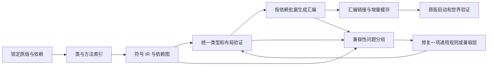

# 原版批量翻译流水线

状态：全量计划、符号 IR、批量操作数校验与 MASM 生成已接通，开始按源元数据批量生成实际汇编运行时契约，2026-11-25。目标仍是原版 1.21.1 实际启动和创建世界；生成汇编和 COFF 对象不能替代最终链接与运行验证。

v96 通过 schema 12 提供正常 String.intern，并与原字面量／Class 名字的规范对象共用发布状态。原始 native 没有 Java Code，作为真实汇编服务单列，动态表根声明跟随入口闭包自动选择。弱驻留、类卸载和自动回收仍未完成；源形状、差分与回收验证范围见[驻留设计](NORMAL_STRING_INTERN.md)。

v95 将原始 Class.getName 的缺失 native 批量接通到所有已提供类型，schema 11 记录规范名字与原字符串常量的共享身份。九个核心 native 已提供真实汇编服务；Class／System 的完整引导仍未完成。实际客户端根槽位规模超过旧平面回收接口后，新增汇编根区枚举与空槽过滤，并在原始 Java 调用和回收后缓存复查中验证。

v94 在 schema 10 中提供正常源布局 Class 镜像、全部已用 Class 字面量及八个核心实例 native。新的[自动收敛程序](AUTOMATIC_COMPLETION.md)把全输入协议缺口、未提供的分派目标和选定入口前沿合并为来源可追踪的家族任务。调度器在批量独立校验后自动生成任务清单；`-Entry`／`-ClassRoot` 可附加依赖扫描，`-PreviousWorklist` 比较请求身份，不把同数目的不同缺口视为没有变化。未实现的语义继续明确保留。

## 要解决的问题

现有后端在发现依赖时立即链接和检查运行时支持，遇到第一个不支持点便退出。通用 Java 翻译能力、VM 对象布局和少量原生接口因此混在同一个错误序列中。继续逐接口加桥接会掩盖总体缺口，也反复扫描同一批输入。

改为先建立完整方法清单和依赖图，再按兼容性分组批量处理。Java 方法使用同一套字节码规则生成汇编，不为每个游戏方法单独编写实现。运行时兼容层负责字节码本身没有提供的语义。



## 自动处理与兼容层的边界

自动处理普通 Java 方法、类继承、字段、数组、控制流、异常表、常规调用、已有协议的 lambda/字符串拼接，并复用现有后端。静态调用和方法实现先用符号身份表示，避免解码一个方法时就要求其所有子依赖已经实现。

这些能力分阶段验收。计划负责扫描，IR 保存原始语义，批量后端校验操作数并生成汇编；外部符号得到真实实现和布局适配后才允许进入链接与运行验证。

仍需兼容层的内容包括 native 方法、反射和动态类定义、VM 专有类布局、特殊 bootstrap、弱引用与自动回收、线程和图形平台接口。生成器可以自动生成 ABI 外壳、字段偏移表、注册表及校验代码，但不能根据一个方法签名猜测其行为。

已有 JDK Java 实现优先经通用后端生成汇编；有意使用专用布局的类必须有明确的布局适配表。专用优化应是可验证的替换路径，不能让每增加一个普通 Java 方法都需要手工桥接。后续布局迁移需保留现有测试和来源证明。

## 分阶段交付

1. 全量分析与任务计划：扫描锁定 classpath 和 java.base；记录每个方法的源散列、字节码、调用、bootstrap 和特殊字段依赖。一次汇总所有发现的问题，输出机器可读清单、兼容分组和批次计划。
2. 符号化编译：把现有解码、类型验证和符号解析拆开，批量生成方法 IR；一个方法失败不能阻止其他方法进入分析和编译队列。结构扫描通过仍须类型、访问、布局及链接验证。
3. 批量后端：按依赖强连通分量组织编译单元，调用现有汇编生成器，统一链接。只有实际生成、汇编和链接成功的任务才记作已编译。
4. 兼容生成器：通过声明式规格生成重复的 native ABI、字段注册与对象布局访问代码；各规格明确原始声明、来源散列、语义实现、异常、并发和根登记义务。
5. 启动闭环：优先验证原始 System 启动阶段，再执行 Minecraft 入口与世界创建。报告缺失功能的实际调用位置，不能让诊断探针返回占位结果、忽略错误或使用 JVM 回退。

第一阶段命令为 `boom plan-translation`，输出分析数据和待编译计划；它不会声称已将清单中的方法翻译完成。后续批量执行器必须消费同一清单并写回真实编译证据。

## 清单与调度

方法身份包含定义加载器、类来源、类散列、方法名与描述符。索引保留 Java 21 multi-release 选择和原 classpath 优先级。诊断按问题本身聚合，列出影响方法数、调用点和保守启动可达范围；修复一个规则后可以重新处理整个受影响组。

初始根为 System.initPhase1/2/3 和锁定的 Minecraft main。虚调用与接口调用采用名义继承关系的保守候选集；反射、外部 JDK 模块和动态定义另行标记不确定性。静态图不是执行覆盖证明，不能把保守不可达直接解释为游戏永远不使用。

循环依赖合成一个编译批次，批次按依赖顺序执行。编译工具可用 Rust 多线程处理独立任务；这属于构建加速，不算游戏执行中的多核优化。游戏侧调度和所有运行时服务继续使用汇编。

强连通分量是依赖与链接边界，不要求把其中所有方法串行生成到一个文件。后端先预声明符号和确定布局，同一分量内仍可按方法并行生成独立汇编对象，最后统一解析重定位。保守虚调用图可能形成很大的分量，不能因此退化为单线程构建。

第一阶段保留原始 Java 调用图，即使某些方法已有专用适配器，也不会假设其原 Java 子依赖已全部消失。虚调用包含未证明实际实例化的类型，启动可达数量会显著高估；反射和缺失模块则还可能带来图外依赖。后续需结合真实类型验证、适配器契约及实例化分析收紧图，不能直接据此删除代码或推算启动进度。

## 已实现的分析入口

开发命令示例，所有输入来自项目内已锁定目录：

```powershell
$jdkBase = Join-Path (Get-Content .boom/latest-server-jdk-base.txt -Raw).Trim() 'jdk-base.json'
target/release/boom.exe plan-translation --lock .boom/locks/server.json --jdk-base $jdkBase --workers 8 --output .boom/translation-plans/server
D:/Dev/Python312/python.exe scripts/verify-translation-plan.py .boom/translation-plans/server
```

输出包括：

| 文件 | 内容 |
| --- | --- |
| `classes.jsonl` | 定义加载器、源散列、继承、字段声明和完整方法 ID 清单 |
| `methods.jsonl` | 方法身份、Code 散列、访问标志、字段与类型引用、调用和审查项 |
| `dependencies.jsonl` | 每个方法的保守依赖 ID，包含静态初始化依赖 |
| `batches.jsonl` | 强连通分量、依赖顺序、启动与主入口优先标记 |
| `compatibility.jsonl` | 按原因和目标聚合的审查项及影响范围 |
| `opcodes.jsonl` | 已扫描指令的频次 |
| `summary.json` | 汇总、根方法、输入/工具身份和全部产物散列；最后写入 |

工具身份包含执行中的编译器文件散列，避免修改解析器或兼容目录后误认为仍是同一个分析器。此处只定义分析计划身份，尚未实现完整机器码缓存。独立 Python 校验器核对产物散列、方法覆盖、加载器身份、依赖顺序、强连通性、可达性和兼容组完整性。

2026-11-24 的真实服务器输入验证：35,563 个类，388,692 个方法，其中 369,708 个含 Code 的 Java 方法全部完成结构扫描，类解析失败为 0；8 个工作线程的全量分析耗时 78.295 秒。输出 215,215 个依赖批次、4,066 个审查组，独立校验通过。这些是清单数据，已生成汇编的方法数仍为 0，不是执行或类型验证覆盖率。

例如该输入的 record `equals` 和 `hashCode` 引导分别涉及 941 和 944 个调用点；后续两项通用引导规则可以批量覆盖这些调用点，但各现场仍须通过协议与类型验证。另有 937 个 native 声明未进入当前不完整绑定目录，其中包含可能不用的标准库功能和第三方库接口，不能把它们全部记作启动阻塞或已证实未实现。

同一工具对客户端锁定输入的分析耗时 95.466 秒，得到 42,182 个类、459,627 个方法，其中 434,572 个含 Code 的 Java 方法全部完成结构扫描，类解析失败为 0。客户端与服务器清单大量重叠，不能把两侧方法数相加作为独立完成量。该检查不需要登录，不执行客户端，也没有接触其他启动器账号文件。

## 符号 IR 与共享前端

新增 `boom lower-translation --plan <计划目录> --lock <输入锁> --jdk-base <java.base 清单> --output <IR 目录> --workers 8`。它消费已有计划并校验类/方法产物散列、输入锁和来源身份，再逐类读取经过散列验证的原始字节。每个 Java 方法转为与链接无关的指令、操作数、具名方法/字段引用、原始 bootstrap、控制流块和有序异常表。native 与 abstract 保留为声明，不生成占位实现。

指令前端覆盖原 Java 编码，保存 wide、signed 立即数、分支与 switch、常量池引用和多维数组参数。字符串常量保留 UTF16 单元，浮点常量保存原始位模式。未知方法、字段或引导协议不在这一阶段要求实现；动态引导仅保存来源，不执行它。旧 jsr/ret 的存在单独标记，尚未宣称完整的子程序控制流或可执行支持。

原汇编后端接入同一指令流，并检查其类型降低过程消耗的指令边界一致。v84 批量后端进一步直接消费该持久化 IR，见下节。IR 文件本身仍是未定型的字节码中间表示；操作数验证、候选布局和汇编证据保存在独立的批量后端产物中。

计划中的 class/method ID 只用于清单身份，不能直接当作既有运行时的类型 ID 或稠密方法表下标。后续链接器必须显式建立符号到运行时身份的映射，记录到重定位、分派、栈映射和异常表；跨批次复用机器码时同时校验这些解析与布局依赖。先预声明符号再并行生成方法，不要求被调方法已经生成机器码。

每 256 个类构成一个确定的分片，以 ZIP 压缩保存类 IR，避免输出几十万个小文件。缓存键包含输入、JDK、来源计划和编译器文件散列以及分片内类来源与方法 ID；ZIP 和每个类载荷均记录散列。源码/ABI/工具变化使旧键失效，缓存损坏重新生成。当前分片身份依赖完整计划；更细的方法缓存、依赖驱动失效和最终链接缓存仍需后续实现。

独立 `scripts/verify-translation-ir.py` 重新读取原始 class 字节，核对每条指令和操作数、常量值、bootstrap 身份、字段/方法声明、方法来源和 Code 散列、控制流边、异常行顺序及完整覆盖。`--require-all` 要求没有前端失败。该校验不会执行 Java 或原版游戏，也不能替代类型/访问/布局验证与真实运行验证。

真实批量输出：服务器 369,708 个 Java 方法、7,169,397 条指令；客户端 434,572 个 Java 方法、8,637,053 条指令；两侧前端失败为 0。8 工作者的首次生成分别耗时 72.981 和 79.926 秒，两次运行并行进行，时间包含锁与来源校验。服务器的 139 个分片全部复用耗时 19.368 秒；损坏一个分片后，138 个复用、1 个重建，耗时 25.404 秒，类载荷散列保持一致。

当前缓存测试可通过开发脚本 `scripts/verify-translation-ir-cache.py` 复现。它仅接受本项目 `.boom` 内的 IR 目录，检查 1 工作者复用、8 工作者选择性重建，并在失败时恢复损坏前的缓存字节。重复运行前需区分首次生成与已有缓存的耗时；此测试不验证游戏执行中的多核优化。

## 批量汇编后端

开发入口为 `boom compile-translation --ir <IR目录> --lock <输入锁> --jdk-base <java.base清单> --workers 8 --assemble --output <产物目录>`。它重新校验输入、JDK 和 IR 分片，逐类读取原始 class，对照指令、常量和声明后生成代码。IR 生成与批量代码生成分别记录工具身份；复用旧 IR 不代表复用旧机器码。

所有类和方法先获得确定的符号身份。通用成员解析、继承、访问、初始化包装和紧凑字段布局复用既有规则；操作数验证和 MASM 生成复用现有后端。字段声明 ID 与最终接收者偏移分开保存，子类重排后的字段通过映射访问。编译工作按 256 类分片并行进行，不等待被调方法先生成代码，也不为每个 JDK Java 方法新增人工桥接。

每个方法分别记录声明、操作数验证、汇编生成或失败诊断。缺少定义会影响相应方法，并汇入按原因分组的报告，其他方法继续编译。native 和 abstract 没有 Java Code，仍只保留声明；签名不能推导原生函数行为。schema 2 另记录每个方法的汇编单元 ID：IR 仍按 256 类保存，汇编按完整方法分组，默认目标为 8 MiB 方法体；单个方法不拆开。单元各自声明公共/外部符号并生成 COFF，避免把一个大 IR 分片变成数百 MB 的汇编器任务。

输出包括：

| 产物 | 验收含义 |
| --- | --- |
| `shards/*.zip` | 每个原始方法的身份、Code 散列、阶段、诊断、引用槽及绑定请求 |
| `shards/<分片>-<单元>.asm` | 本项目后端生成的真实 MASM 方法体及尚未解析的外部符号 |
| `shards/<分片>-<单元>.obj` | `--assemble` 时由 ml64 实际生成的 AMD64 COFF 对象 |
| `layouts.jsonl`、`arrays.jsonl` | 候选紧凑布局与数组类型；尚未证明兼容交付运行时 |
| `numeric-kernel.asm/.obj` | 共用数值常量与纯汇编浮点取余内核 |
| `summary.json` | 精确覆盖、分组诊断、汇编器失败及产物散列 |

虚调用、动态引导、动态常量、特殊字面量解析、原生声明以及 VM 数据表可以保留真实未解析符号。它们不生成占位函数，不返回虚构默认值，也不回退 JVM。链接器必须用实际契约实现这些符号，并证明方法选择、异常位置、初始化、根登记和运行时布局一致。既有 String/Class 等 VM 特殊对象布局不能直接套用批量 Java 候选布局。

操作数校验遵循 [JVMS 4.10.1.2](https://docs.oracle.com/javase/specs/jvms/se21/html/jvms-4.html#jvms-4.10.1.2) 的接口赋值规则，包括引用数组组件；运行时子类型、cast 和接口分派仍须用实际名义关系，不能复用放宽后的校验规则。返回指令按 [JVMS 6.5](https://docs.oracle.com/javase/specs/jvms/se21/html/jvms-6.html#jvms-6.5.areturn) 丢弃当前帧剩余操作数。frem/drem 使用整数位运算实现二进制除余，覆盖次正规数和有符号零，NaN 采用明确的规范化策略，无 C 运行时依赖。

`scripts/verify-batch-assembly.py` 独立检查源方法清单、Code 身份、产物散列、完整覆盖、引用槽边界以及真实 AMD64 COFF 导出/未定义符号；它不会执行游戏，也不证明完整 Java 校验、JPMS 访问、动态行为、GC 根完整性或运行时 ABI。该阶段报告始终保留 `linked=false`、`runtime_abi_verified=false`、`game_started=false`。

该校验器兼容 schema 1/2/3，但完整汇编验证必须实际存在所有对象文件，不能把未汇编单元记为通过。schema 2 对照每个方法的单元 ID 和精确方法导出集合，核对单元方法体预算。schema 3 另外要求 `--ir`，校验源字符串、规范化数据、解析函数和真实 COFF 定义。`verify-assembly-partition.py` 则验证 v85 拆分前后的方法体字节完全保持，`compare-batch-coverage.py` 按原始来源身份比较不同系统类输入下的同一方法；v86 改变了字符串加载指令，不能声称方法体与 v85 字节不变。

v84 批量运行仅纳入 java.base。v85 增加下节的原始默认系统模块输入，部分可选第三方定义仍保留为缺失诊断。不能把未使用的可选依赖全部列为启动阻塞，也不能随意安装额外 JAR 改变原版 classpath。后续按真实入口的符号闭包生成运行时表和可复用的汇编契约实现，再完成原始系统启动与 Minecraft 链接。

2026-11-25 的全量验证：服务器 369,708 个 Java Code 方法中 367,905 个生成 MASM，139/139 分片成功汇编，耗时 117.831 秒；客户端 434,572 个中 431,049 个生成 MASM，165/165 分片成功汇编，耗时 114.712 秒。两侧并行运行，各用 8 个编译工作者，汇编器失败均为 0；独立产物校验通过。其余 1,803/3,523 个方法均为缺少定义，不存在需要逐方法人工改写的其他当前诊断。成功生成的方法仍含未解析的运行时契约，这些数字不能当作最终链接、原版启动或性能进度。

独立校验另按所有候选 COFF 与共享数值内核计算未定义符号闭包，区分调用适配、字面量解析、缺少方法实现与数据/运行时符号。前几类通常有大量按类、字段或常量池编号实例化的同类符号，后续应按契约和元数据生成规则批量实现。符号闭包尚未纳入完整运行时适配，不代表最终缺失功能数；不能只统计未生成的 Java 方法而忽略这些契约。

## 自动契约生成与调度（v89）

`compile-translation` 的 schema 6 在普通方法、类型、字段、字面量和静态状态后，继续自动处理成功生成方法提出的虚调用／接口调用请求。具体架构、开发调度入口、缓存范围和验收边界见[自动翻译与兼容收敛设计](AUTOMATIC_TRANSLATION.md)。原始请求仍保留 `implemented=false`，实际生成证据另在 `dispatch` 模块记录，不能把一次绑定请求的存在当成实现成功。

按“已解析声明＋调用类型”去重选择表，通过倒排祖先关系枚举接收者；各现场分别保留符号所有者与 protected／数组接收者约束。游戏侧汇编进行真实类型检查、双重接收者约束与二分查找，跳转选中方法的包裹入口以保持 synchronized 语义。native 或未生成方法仍引用实际未定义符号，不能通过空函数补齐。

`dispatch/index.zip` 保留现场、共享表、目标来源与兼容组，`dispatch/*.asm/.obj` 是真实代码与数据。独立校验器按来源重新解析现场和选择方法，检查精确汇编与 COFF；它不证明 JPMS、动态加载或完整执行正确。生成分别覆盖服务器 321,711、客户端 358,825 个现场，24／26 单元全部汇编成功。候选未解析符号降为 52,499／60,127，实际完整链接和游戏标志仍为 false。

后续优先实现可重复应用的 bootstrap、类镜像、数组克隆和 native 协议。兼容报告按全输入影响排序，真实启动优先级仍需入口闭包验证。首批调度使用输入与工具散列缓存完整批次，复用时重新独立验证；方法级机器码增量复用尚未实现。

## 数组 clone 契约与断点续验（v90）

schema 7 将数组 clone 从兼容缺口移入独立 `array_clone` 模块：入口、共享池、原始 Object.clone 声明身份和源内核散列记录在摘要／`array-clone/index.zip`，实际 MASM 与 COFF 保存在该模块目录。运行时分配与浅拷贝均为汇编，保持实际数组类型，覆盖基本数组、引用数组和多维数组。源 Method 常量及组件定义加载器参与独立校验；未知普通对象 native clone 继续保留缺口。

服务器／客户端全部 2,691／3,050 个入口已执行，覆盖 1,291／1,589 种符号数组类型。原始枚举 `values()` 的自动闭包也已链接并运行，未重写 Java 方法。数组规范参考 [Object.clone API](https://docs.oracle.com/en/java/javase/21/docs/api/java.base/java/lang/Object.html#clone())。完整运行时、异常物化和游戏启动仍需独立验收。

调度程序的 `-ResumeBatch <目录>` 支持在检查器修复后继续验证已有产物；要求相同编译器散列、锁指纹和 IR 身份，并执行完整独立校验。最终报告记录 `resumed_batch`，不会把不同编译器的旧对象当成新生成对象。当前缓存和续验仍按完整批次处理，不是方法级重编译缓存。

## System 原生族与入口扫描（v91）

schema 8 的 `system_natives` 记录源 System 的四个 native 声明、真实注册池和 Context32 包裹入口，独立核对原始声明、源内核、精确 MASM 与 COFF。原始 `<clinit>` 已由自动选择的未改写 Java 方法体执行，完成三个服务的原子注册；完整 System 引导与 Minecraft 仍未完成。`prepare-class-init-probe.py --class-root ... --entry ... --scan` 可在后续入口上一次收集已发现的源符号缺口，尚未展开的虚分派／动态目标另保留为前沿。

schema 9 将该族扩展为七个声明，增加独立的三个标准流 setter。`system_natives.stream_slots` 保存真实源字段索引与类型 ID；`stream_pool_unit` 指向提供池和根行的原生单元。独立校验重新读取原始字段及加载器身份，重建精确 MASM，并确认根槽和类型符号由已校验的状态／元数据模块提供。静态根只存游戏堆引用，setter 本身不分配对象。输入流原始构造／读取方法与根图回收已有选定执行验证，其类初始化、打印流构造和 I/O 不在该验证范围。

v93 的通用闭包选择器默认继续展开已经生成的分派现场，复制完整选择表并自动跟踪全部目标入口，包括 Object 在数组上的继承目标。`--contract` 可指定源现场根，`--direct-only` 明确保留未展开的直接扫描。闭包记录所选现场、完整表和数据摘要，独立校验核对批量索引、源 MASM 和 COFF。宽泛静态表可能纳入可选类型，未知动态调用仍是前沿；没有用不完整接收者集合换取“闭包完成”。

`batch-source.py` 为所读单元一次建立完整函数、类状态描述符和分派数据的位置索引，文本逐出后仍保留索引，选择时直接读取原文区间并检查边界与内容；有界文本缓存和扫描时不保留方法副本减少重复读取与内存。`progress.json` 原子更新扫描计数，明确区分扫描结束、闭包可用及游戏启动。该工具只参与离线翻译／构建，游戏执行没有新增 Python 运行时。

## 默认系统模块的类输入

新增 `boom prepare-jdk-classes --lock <输入锁> --jdk-modules <模块快照>/jdk-modules.json --output <系统类目录>`。它复用原始默认模块解析图、锁定的 JDK image 和 jimage 工具，提取已解析模块中的真实 class；不运行游戏或类初始化器，不额外安装 JAR。输出 `jdk-classes.json` 和 `image/<模块>/<类>.class`，供计划、IR 和批量汇编三个入口通过既有 `--jdk-base` 参数读取。旧 java.base 清单仍受支持，旧执行链接器暂不扩大其运行时适配范围。

系统类的身份保留模块来源、定义加载器、类名、版本与散列；清单身份包含模块快照与原始工具/映像身份。完整类名和入口路径逐项核对，读取类字节时继续核对目录链和内容散列。新目录提取时每个目录项检查一次，避免为每个文件重复检查同一父目录链。

加载器选择复用原始模块包表：先按包找到所属模块和定义加载器，再委派到该加载器；包已归属系统模块而类不存在时保留缺失结果。未命中系统模块包的类才走父加载器和自身查找。该行为参考锁定 JDK 的 `BuiltinClassLoader.loadClassOrNull`，也见 [OpenJDK 源码](https://github.com/openjdk/jdk21u/blob/master/src/java.base/share/classes/jdk/internal/loader/BuiltinClassLoader.java)。新的类来源不会被统一改成 bootstrap，模组的自定义加载器和变换链仍须单独设计。

本机原始默认图有 63 个解析模块、772 个包、25,704 个类。其中 bootstrap 16,913 个，platform 4,381 个，application 4,410 个。独立校验器逐类核对原始内容、完整清单、模块包归属和来源散列；开发 JVM 通过 `Class.forName(Module,String)` 在不初始化类的情况下，对两侧各 25,704 个类逐一核对实际模块和定义加载器，全部一致。这不证明 JPMS 访问检查、模块运行时操作、JDK 资源加载或 native 实现已经完成。

新增清单的 `java_base_classes` 仅计 java.base，`additional_system_classes` 计其他默认解析模块，`system_classes` 计两者之和。独立计划校验器保留旧清单兼容，并核对新的总数。比较新旧汇编结果时以加载器、类来源与散列、方法名/描述符和 Code 散列匹配，不能把新增的标准库方法算成原先方法的兼容性提升。

扩展输入后的真实汇编结果为：服务器 498,179 个方法、832 个单元、105.776 秒；客户端 562,769 个方法、904 个单元、103.796 秒，全部单元汇编及独立校验通过。同一旧输入方法分别消除 1,076/2,522 个生成失败，另有 129,198 个新增系统 Java 方法生成汇编；剩余生成失败为缺少定义的 727/1,001 个。两侧输入重叠，符号与对象成功不代表运行时或游戏启动完成。

## 原始 Java 布局与运行时绑定

批量方法按原始 Java 字段和候选紧凑布局生成，不能直接交给 v81 的 String/Class/Module 等不透明 VM 对象。下一层运行时数据生成应采用统一的 Java 字段模型，VM 所需额外信息使用明确的隐藏槽或旁表；原始字段偏移、加载器、模块、类型和方法身份必须有来源校验和显式映射。类型与方法的旧运行时容量边界也需结合完整输入审核，不能把源码清单 ID 直接塞入原来的小表。

优先生成类型/字段/静态单元及真实初始化依赖，再实现汇编字面量和类镜像工厂、分派适配及必要 native 家族。String 常量必须是与原始 Java String.value/coder 等字段一致的真实对象，并满足字符编码、驻留身份、异常和根登记义务；不能用空指针占位。已有普通 JDK 方法继续自动翻译，VM 原生行为按明确协议成组实现。启动、内存回收和平台服务均保持汇编，依次验证原始系统阶段、Minecraft 入口及隔离世界。

## 缓存与失效

缓存键至少包含输入锁、类来源/散列、方法 Code 散列、编译器版本、目标 CPU/ABI、对象布局 ABI、调用与字段解析结果和优化规则版本。模组阶段再加入变换链和类版本。字段布局或方法选择变化必须使依赖者失效，不能只按文件时间或方法名称复用旧机器码。

缓存记录分别区分已索引、结构分析、类型验证、已生成汇编、汇编成功、链接成功和实际运行验证；不得合并为一个“已支持”标志。

## 启动器与验收

玩家仍只看到启动入口。输入校验、分析、编译、缓存更新和执行由启动流程自动完成；开发分析命令只存在于命令行。

真实验收包括：自研后端输出汇编并由汇编器产生游戏代码；运行时没有 JVM/GraalVM 或其他语言游戏逻辑回退；原版实际入口运行、隔离世界创建、存档验证；记录实际执行范围与未完成项。分析类数、方法数、任务完成数和单元测试通过数均不能替代这些证据。

新工具仍只安装到 D:\Dev，输入与产物仍只进入项目忽略目录，不读取其他启动器账号或已有世界。

## 从源常量批量生成汇编运行时接口（v86）

`compile-translation` 的 schema 3 新增 `string-literals` 模块。它消费逐类重验过的原始字符串常量，包括 `ldc`、bootstrap 参数和字段 ConstantValue，以 UTF-16 码元序列去重；不同类、加载器和常量池的同内容引用解析为同一字面量对象。它不是一般 `String.intern()` 的完整实现，后续还要接入动态字符串的同一张驻留表。

每个源常量自动生成 `boom_batch_literal_load_<类ID>_<常量ID>` 汇编解析函数。方法中的字符串加载经过普通外部调用 ABI，携带 Context32 和原始字节码位置，返回真实对象或保留分配失败；不再直接读取可能尚未初始化的外部单元。解析函数、UTF-16 数据和 256 项一页的 Entry16 元数据都分到有界汇编单元，并产生实际 COFF 对象。它们不在运行时调用 Rust、C# 或 JVM。

汇编工厂使用原始 `java.base/java.lang.String` 候选 Java 字段布局：`value:[B`、`hash:I`、`coder:B`、`hashIsZero:Z`。布局来源、字段身份和散列记录在摘要中。按当前源文件得到 14 字节负载，引用前缀只有 `value`；该对象可以交给相同来源的 Java 方法译码结果。为 final String 的四个字段生成检查对象类型并返回字段地址的映射，不把旧 VM 的专用 String 对象混入新布局。

运行时先检查规范化引用缓存，再以原子状态和 Windows 地址等待保证同一字面量并发构造时只分配一次。默认 CompactStrings 模式在所有码元不大于 255 时使用 Latin1，否则保存 UTF-16LE。哈希按 Java UTF-16 规则预先计算；零哈希单独标记。每项有已发布对象根与构造中 byte[] 临时根，分配失败时清理状态并允许重试。模块只绑定一个堆生命周期，拒绝第二个堆；销毁后不能继续调用该模块。

`verify-batch-assembly.py --ir <IR目录>` 调用独立常量模块校验器，逐项核对源 IR、规范化内容与哈希、常量池绑定、编码数据、页表、根区、字段映射、解析函数和真实 COFF 导出。普通 Java 单元仍禁止定义未实现的 `boom_batch_*` 接口；只有实际源字符串解析函数可作为实现导出。允许的额外平台导入严格限于 `WaitOnAddress`、`WakeByAddressAll`，没有 JVM 或 C 运行时回退。

开发验证入口为 `Test-JavaStringLiterals.ps1` 和 `Test-BatchStringLiterals.ps1 -Batch <批量输出>`。后者把实际生成的常量对象文件与纯汇编堆服务链接，并从生成汇编中选择两个未改写的原版 String 方法体做执行对照；不执行类初始化包装，不代表整个 java.lang.String 或 Minecraft 完成。

当前根区仅对停止所有来宾执行后进行的显式回收验证有效。活动帧根、安全点、分配慢路径上的自动回收、一般字符串驻留、String 类初始化及其他 VM 对象工厂仍须实现。构建并行与这些并发单元验证，均不作为游戏多核或帧率提升的证据。

## 类型、对象形状和继承字段元数据（v87）

schema 4 在 `runtime-metadata/` 中生成源类型描述符、对象布局、运行时标记表、类型与字段注册表、每个实例字段的接收者偏移记录和实际 MASM 解析函数。所有记录保留源类/字段身份，祖先按真实加载器关系计算；数组组件使用明确的原始类型身份，不把 int/char/short 在操作数栈中的共同类别混成数组元素类型。

布局只用于已证明完整的源层次，未完成类及相应数组留下缺口。字段记录从所有有效接收者的紧凑布局反向汇总，键为声明类和原始字段索引，行按接收者 ID 排序。普通父类字段在子类中发生偏移变化时，生成入口调用统一汇编内核查找实际偏移。String 的既有专属布局/字段实现继续唯一拥有它的定义。

运行时 Map ABI2 使用 Row40 来源表和可写索引槽区，在首次查询时以汇编建立散列表，保留源类型 ID，支持超过旧表上限的输入。散列表只缓存模块元数据指针，不分配 Java 对象；准备过程检查容量、重复标记和基本描述符身份。字段内核使用实际接收者行进行二分查找，检查字段宽度、对齐、负载边界和引用追踪区。该 ABI 依赖受信任且仍存活的堆/元数据指针，不宣称是任意指针沙箱。

普通错误状态保持不变，Context32 的 kind=16 待处理 Throwable 允许类型查询，以便异常匹配使用相同类型表。待处理根、PC 和方法位置不被查询消耗。类初始化调用明确选择 boom_class_ensure32；本模块不为未实现的类状态、初始化器或静态字段提供占位定义。

`verify-batch-metadata.py` 由主批量校验器调用，独立重建源层次、紧凑字段和数组关系，逐项检查编码数据、注册表、所有字段入口与 COFF 定义。`Test-IndexedTypes.ps1` 验证新旧 ABI、散列表与字段内核；`Test-BatchStringLiterals.ps1 -Runtime <新汇编运行时目录>` 同时验证源对象形状、全部字段地址以及实际原版 String 和包装类方法体。测试报告分别区分物理形状检查、构造器方法体执行和完整类初始化。

连续 Row40 表和注册表当前作为单个元数据记录生成，因此可超过普通方法体 8 MiB 分组目标；方法本身继续完整分组。后续如果扩大输入，须依据实际汇编耗时和布局约束拆分这些数据表，不能把它们默认为任意规模都足够快。

## 静态存储与初始化执行依赖（v88）

schema 5 的 `class-state/index.zip` 保存全部源类状态计划、原始静态字段和常量、初始化器 Code 身份及其生成状态、依赖顺序和汇编单元位置。有效类得到 ABI2 描述符，初始状态始终为 0。没有 `<clinit>` 的类只执行真实存在的常量赋值或依赖；完全没有工作的根类可保留空初始化指针。层次或静态计划无效时不提供成功描述符，依赖该计划的类同样保留诊断。

准备阶段的字段全为零值，实际初始化入口按原始字段顺序赋 ConstantValue；字符串经 v86 的真实解析函数取得对象。随后按目标 JVM 的父类/接口规则调用 boom_class_ensure32，再直接进入原始 `<clinit>` 方法体。已有状态机处理同线程重入、并发等待、完成发布与失败持久化；完整的 VM 异常计划仍是运行所有错误路径的前提。初始化失败、缺少绑定或未生成原始方法均不能当作成功。

源字段的引用单元与每类失败原因单元汇集为连续根区；标量单元和状态描述符单独保存。该根区仍只验证停止来宾执行后的显式回收，不能替代活动帧根、安全点或自动回收。连续根区作为一个原子数据块生成，可超过逐方法分组预算。

`verify-batch-class-state.py` 复用主校验器读取源 IR 时留下的最小静态输入，避免第三次解析所有方法体；它从原始声明和常量独立重建数值位、字段槽、依赖与初始化代码，比较真实 COFF 定义。`prepare-class-init-probe.py` 按生成函数的实际引用自动选择方法和类状态，选取完整未改写函数；缺失依赖仍抛出明确错误。`verify-initialization-closure.py` 核对被选代码与原始批量输出完全一致。

`Test-BatchClassInitialization.ps1 -Batch <目录> -Plan <源计划>` 通过命令行链接并执行选定原版 JDK 类的真实初始化闭环，检查枚举实例、静态数组、常量值、重入、并发与静态根。它是开发验证入口，玩家启动器不增加编译或测试按钮。通过这些选定类不代表 System 或 Minecraft 已经启动；当前新链路的 System 类初始化仍需要接入其原生注册接口。
